## MORI 正式实现完整走读

本文面向准备维护、评审或继续优化 MORI 的开发者，描述 `codex/mori-formal` 分支上的**实际实现**。规范性边界见
[MORI scheduling and typed KV replacement](mori-scheduling.md)，受控性能数据见
[MORI typed-LRU 受控性能对比](mori-performance.md)。本文重点回答四个问题：组件真实如何连接、一次请求如何流过系统、
两层 typed-LRU 如何维护、正式实现相对隔离实验究竟改变了什么。

正式实现的核心分工是：`MORIStrategy` 决定 Program 的逻辑保护层；vLLM 仍决定请求 batch、KV block/chunk 分配、
按需 H2D/D2H、job/fence 和最终物理安全。MORI 不预测未来返回、不主动预取，也没有第二个与 vLLM 并列的 token
scheduler。证据索引：`agentinfer/scheduling/mori/strategy.py:26-33`、`agentinfer/agentcache/core/scheduler.py:3-7`。

本文对应的已验证源码提交为 `83ee3205710d24fa4ec6ea23afa64ef936d78c63`；验证收据记录了 27 项 MORI focused
tests、302 项 scheduling/agentcache tests、pre-commit，以及 vLLM 0.31 HBM patch 与 CPU external policy smoke。
真实 GPU serve 和 1,290-request 全链路 simulator 未在该收据中重跑，本文不会把受控 CPU policy benchmark 外推为
真实端到端性能。证据索引：`design/module/scheduling/artifacts/mori-validation-20261026.json:1-51`、
`design/module/scheduling/artifacts/mori-validation-20261026.json:54-65`。

2026-10-27 的 SimpleCPU 扩展另有独立收据：24 项聚焦测试、308 项 scheduling/agentcache 回归、两个 native patch
顺序应用与编译、hook smoke、示例 shell 语法和 wheel 内容检查均通过；共享主机上没有安装新 patch 后启动 GPU serve，
因此本文不宣称完成真实 D2H/H2D 验证。证据索引：
`design/module/scheduling/artifacts/mori-simple-cpu-validation-20261027.json:1-48`。

## 1. 术语、边界与三组正交状态

| 概念 | 值 | 所有者 | 含义 |
| --- | --- | --- | --- |
| Program forwarding state | `ACTIVE / PAUSED / TERMINATED` | `ProgramScheduler` | 是否允许该 Program 的请求进入 native scheduler |
| Program activity status | `REASONING / ACTING` | `ProgramScheduler` | 正在模型推理，还是处于工具/环境调用间隙 |
| MORI logical tier | `GPU / CPU / WAITING` | `MORIStrategy` | KV 应获得哪一层保护，不等于某一时刻所有物理 KV 都已完成搬迁 |
| Cache class | `BUSY / IDLE / INACTIVE` | `MORIStrategy` 导出 | 给 HBM/CPU replacement index 使用的统一逻辑标签 |
| Native residency | block/chunk/job/fence | vLLM | 当前实际物理位置、引用计数、传输与可淘汰性 |

`ProgramState`、`ProgramStatus` 与 `MORITier` 不能合并。例如一个 in-flight Reasoning Program 被 lazy demotion
时仍是 `ACTIVE + REASONING + tier=GPU`，只额外记录 `pending_tier=CPU/WAITING`；请求完成后，runtime 才能 pause，
随后 tier 才真正提交。证据索引：`agentinfer/scheduling/domain.py:18-30`、
`agentinfer/scheduling/mori/factors.py:12-41`、`agentinfer/scheduling/mori/strategy.py:376-423`。

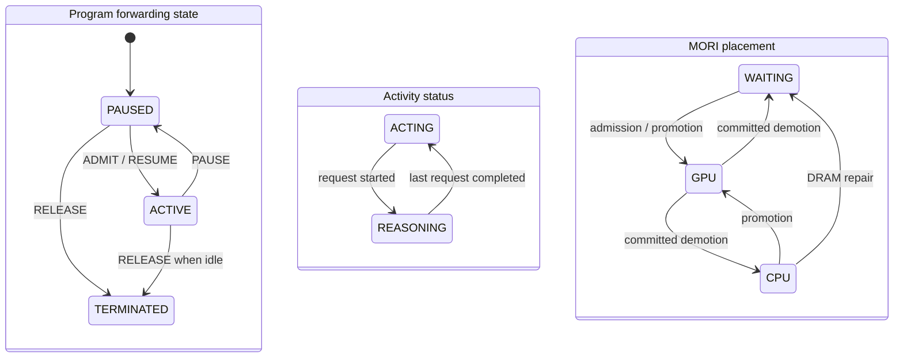

Cache class 的映射固定为：`GPU -> BUSY`、`CPU -> IDLE`、`WAITING -> INACTIVE`。类名表达保护意图，
不是物理位置证明。证据索引：`agentinfer/scheduling/mori/strategy.py:580-586`。

## 2. 总体架构：一个 native scheduler，三个协作面

### 2.1 组件关系

`AgentCacheAsyncSchedulerBridge` 或 `AgentCacheSyncSchedulerBridge` **继承** native vLLM scheduler；它不是 native
scheduler 前面的独立服务。bridge 组合 `_VllmAdmissionHooks`，hooks 再组合一个 `ProgramScheduler`；
`MORIStrategy` 是这个 Program-level controller 的策略对象。同一个 bridge 对象通过 `super().schedule()` 继续运行
原生 token-level scheduler。证据索引：`agentinfer/agentcache/core/scheduler.py:477-518`、
`agentinfer/agentcache/core/scheduler.py:521-562`。

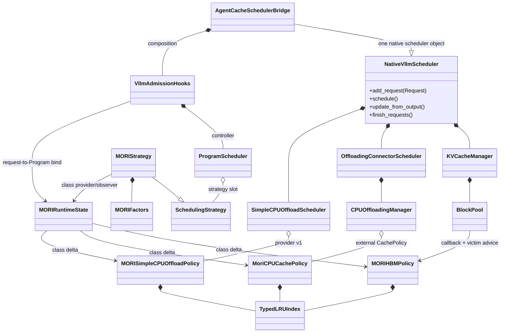

证据索引：`agentinfer/agentcache/core/scheduler.py:106-145`、`agentinfer/agentcache/mori/runtime_state.py:23-49`、
`agentinfer/agentcache/mori/hbm_policy.py:15-31`、`agentinfer/agentcache/mori_cpu_policy.py:19-47`。

### 2.2 控制面、执行面和替换面

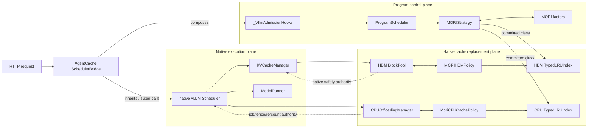

三个面的责任边界如下：

1. Program control plane 只做 identity、retention、logical capacity、tier 和 transition。
2. Native execution plane 继续决定 batch、token step、preemption、block allocation 和 model execution。
3. Cache replacement plane 只改变可回收条目的**选择顺序**；HBM BlockPool 与 CPU manager 仍执行合法性校验和物理操作。

证据索引：`agentinfer/agentcache/core/scheduler.py:38-103`、`agentinfer/scheduling/runtime.py:69-100`、
`agentinfer/agentcache/patches/vllm-0.31-mori-hbm-provider.patch:19-36`、
`agentinfer/agentcache/mori_cpu_policy.py:19-26`。

### 2.3 与 Progress-TTL 的接入关系

MORI 沿用 Progress-TTL 的现有构造与 bridge 路径，没有新增独立 factory 模块。`build_controller()` 在同一个
`agentinfer/agentcache/core/controller.py` 中显式选择 `progress_ttl` 或 `mori`，然后都返回 `ProgramScheduler`。
`build_mori_strategy()` 只构造策略与初始 factors，职责与 Progress-TTL builder 平行。证据索引：
`agentinfer/agentcache/core/controller.py:86-137`、`agentinfer/scheduling/mori/builder.py:15-28`。

## 3. 启动与能力协商

### 3.1 启动时序

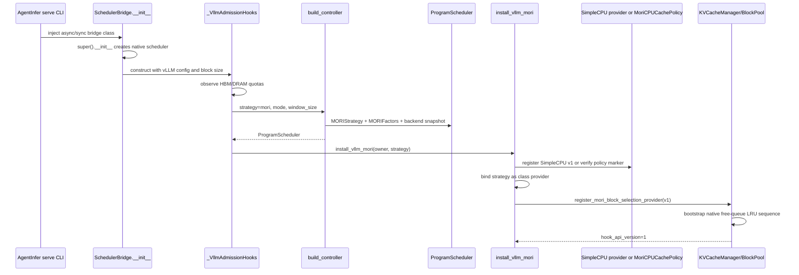

证据索引：`agentinfer/agentcache/core/scheduler.py:106-151`、
`agentinfer/agentcache/core/controller.py:101-137`、`agentinfer/agentcache/mori/vllm_adapter.py:101-201`、
`agentinfer/agentcache/patches/vllm-0.31-mori-hbm-provider.patch:176-203`、
`agentinfer/agentcache/patches/vllm-0.31-mori-simple-cpu-provider.patch:62-177`。

### 3.2 full 与 placement-only

`full` 模式启动时必须同时满足：单 embedded backend rank、rank-local DRAM quota 与 block/chunk size、HBM provider
register/unregister、hook API version 1，以及一个完整 offload-tier capability。推荐的 SimpleCPU 路径要求 snapshot、
register/unregister、CPU backend 和 eager mode；兼容的 OffloadingConnector 路径要求外部 CPU policy marker。任何条件
不满足都会 fail closed；不会静默退化到 native LRU。`placement_only` 是显式消融：只绑定 Program placement，不安装
HBM/CPU policy，也不能宣称完成三层 cache management。证据索引：
`agentinfer/agentcache/core/controller.py:115-137`、`agentinfer/agentcache/mori/vllm_adapter.py:101-201`。

## 4. 服务端 identity 与生命周期

### 4.1 正式实现不读取 plan

Program identity 只来自请求携带的 `vllm_xargs.agentic_context`、支持的 `agent_hint` 或 framework headers。
解析器在服务端生成 `AgentIdentity`；若 full MORI 解析不到 identity，bridge 直接拒绝请求。subagent 的 `agent_id`
会形成独立 Program ID，不能与 lead 共用 Program。证据索引：`agentinfer/scheduling/identity.py:97-174`、
`agentinfer/agentcache/core/scheduler.py:153-177`。

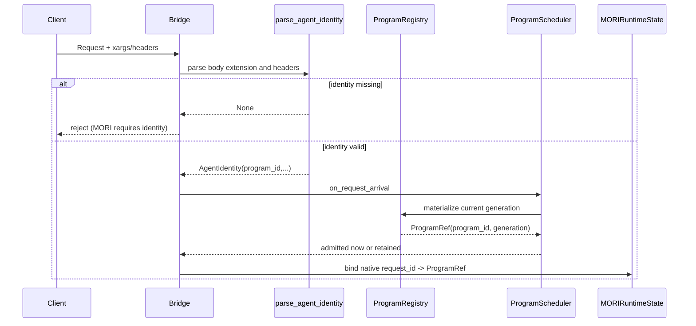

`ProgramRef(program_id, generation)` 防止同一个稳定 ID 被释放后重新出现时，旧 block/chunk owner 或迟到事件误作用于
新 incarnation。Registry 每次 rematerialize 递增 generation，release 同时清理 task/parent 索引。证据索引：
`agentinfer/scheduling/domain.py:49-66`、`agentinfer/scheduling/program_registry.py:55-102`、
`agentinfer/scheduling/program_registry.py:166-185`。

### 4.2 并发语义

首版正式 MORI 对同一个 `ProgramRef` 最多允许一个 in-flight inference request；重叠请求在 arrival 时拒绝。并行
subagent 必须使用独立 Program ID，因此各自有独立 factors、reservation 与 cache class。证据索引：
`agentinfer/scheduling/mori/strategy.py:48-54`、`agentinfer/scheduling/runtime.py:159-178`、
`tests/scheduling/test_mori_runtime.py:68-97`。

## 5. 核心数据模型

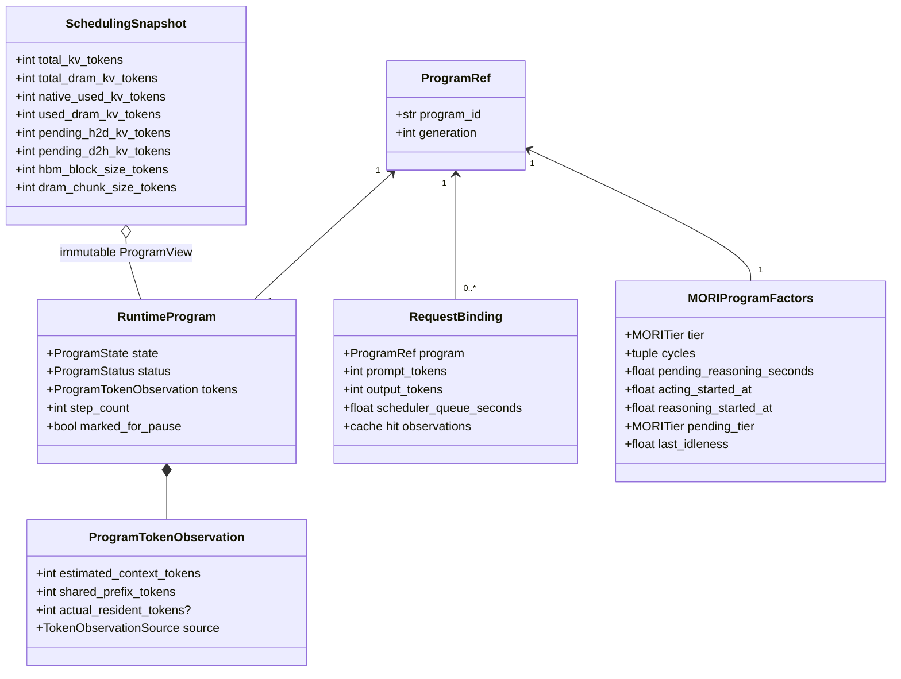

证据索引：`agentinfer/scheduling/runtime.py:50-67`、`agentinfer/scheduling/domain.py:69-148`、
`agentinfer/scheduling/mori/factors.py:20-56`、`agentinfer/scheduling/snapshot.py:22-50`。

### 5.1 `ProgramRegistry`

Registry 是 live Program 记录和 generation/task/parent 索引的唯一所有者。它不拥有等待队列、capacity 或 strategy
sidecar；所有 mutation 由嵌入式 scheduler 的同一 mutation boundary 串行化。证据索引：
`agentinfer/scheduling/program_registry.py:3-8`、`agentinfer/scheduling/program_registry.py:32-44`。

### 5.2 `RequestPool`

RequestPool 保存尚未交给 native scheduler 的真实 `Request`，按插入顺序维护 `WAITING/ADMITTED`，并通过
`recent_admit` 一次性把已准入请求交还 bridge。它不是第二套执行队列：请求一旦 consume，就进入 native waiting。
证据索引：`agentinfer/scheduling/request_pool.py:23-54`、`agentinfer/scheduling/request_pool.py:83-112`。

### 5.3 `MORIProgramFactors`

每个 Program 的 sidecar 只保存已提交历史和当前逻辑层。`cycles` 是最近若干 `(reasoning_seconds,
acting_seconds)`；当前未闭合周期由两个 start timestamp 与 `pending_reasoning_seconds` 表示；`pending_tier` 仅用于
Reasoning lazy demotion，不会提前释放 GPU logical reservation。证据索引：
`agentinfer/scheduling/mori/factors.py:31-56`、`agentinfer/scheduling/mori/strategy.py:385-394`。

## 6. 请求主流程与代码走读

### 6.1 Arrival、retention 与 admission

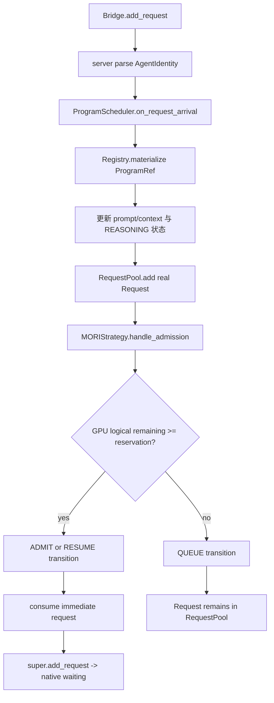

执行顺序非常重要：prompt token 先写入 Program view，再调用 `handle_admission()`；因此 admission 使用当前请求已知的
上下文，而不是上一次完成值。新 Program 首次 decision 时会从 waiting view 暂时排除，避免把“候选本身”同时当成
已有排队者。若立即准入，RequestPool 的 entry 在返回 bridge 前被消费；否则真实 request 对象继续保留在
RequestPool。证据索引：`agentinfer/scheduling/runtime.py:159-252`、`agentinfer/scheduling/runtime.py:614-643`。

### 6.2 周期调度

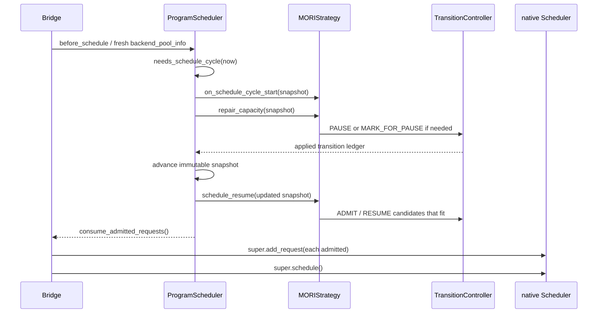

正式 MORI 固定 `REPAIR_THEN_RESUME`：先消除已有 HBM/DRAM logical debt，再从更新后的 snapshot promotion，防止
把待释放但尚未提交的容量重复出售。`ProgramScheduler` 通过 applied transition ledger 推导同一 cycle 的新 snapshot，
而不是让 strategy 直接修改 Registry。证据索引：`agentinfer/scheduling/mori/strategy.py:44-46`、
`agentinfer/scheduling/runtime.py:254-278`、`agentinfer/scheduling/runtime.py:584-612`。

### 6.3 Stream output、completion 与 lazy pause

native 每次 output 更新把累计 output tokens 回传 runtime；Program 的 context estimate 变为至少
`prompt_tokens + output_tokens`。最终完成使用 backend total tokens 覆盖 estimate，并发出包含 latency、queue wait、
cache hit 与当前 Program counts 的 `REQUEST_FINISHED` event。若 Program 已 `marked_for_pause`，完成路径先执行真正
`PAUSE`，`on_program_paused()` 再把 `pending_tier` 提交成 tier。证据索引：
`agentinfer/scheduling/runtime.py:295-315`、`agentinfer/scheduling/runtime.py:388-464`、
`agentinfer/scheduling/mori/strategy.py:337-346`。

```mermaid
stateDiagram-v2
    [*] --> GPU_REASONING
    GPU_REASONING --> GPU_PENDING_CPU: capacity repair / MARK_FOR_PAUSE
    GPU_PENDING_CPU --> GPU_PENDING_CPU: decode continues; GPU reservation retained
    GPU_PENDING_CPU --> CPU_ACTING: request finishes / PAUSE committed
    GPU_REASONING --> GPU_PENDING_WAITING: no DRAM destination
    GPU_PENDING_WAITING --> WAITING_ACTING: request finishes / PAUSE committed
```

## 7. Idleness：只使用已提交历史和当前已流逝时间

设窗口大小为 `k`，每个闭合周期为 `(R_i, A_i)`。若当前处于 Acting，加入已完成 reasoning 与截至 `now` 的 acting；
若当前处于 Reasoning，只加入截至 `now` 的 reasoning。当前 partial cycle 占用一个窗口槽：

```text
I_k(now) = sum(A_i + A_partial) / sum(R_i + R_partial + A_i + A_partial)
```

分母为零时 idleness 为 0。默认 `k=5`；公式不读 plan、未来 successor 或未来 return time。周期在
`ACTING -> REASONING` 时闭合，request completion 只提交本轮 reasoning 并开始 Acting 计时。证据索引：
`agentinfer/scheduling/mori/config.py:18-32`、`agentinfer/scheduling/mori/strategy.py:263-335`、
`agentinfer/scheduling/mori/strategy.py:543-559`。

```mermaid
sequenceDiagram
    participant P as Program
    participant R as ProgramScheduler events
    participant F as MORIProgramFactors

    P->>R: request starts
    R->>F: status=REASONING; close prior acting cycle
    P->>R: stream outputs
    Note over R,F: update token estimate; do not close timing cycle
    P->>R: request finishes
    R->>F: pending_reasoning_seconds = latency - scheduler_wait
    R->>F: acting_started_at = completion time
    P->>R: next request starts
    R->>F: append(reasoning, elapsed acting), keep last k
```

## 8. 容量账本、promotion 与 demotion

### 8.1 Logical reservation 公式

正式实现保留固定 decode buffer 设计：

```text
gpu_target(program) = round_up(estimated_context_tokens + 100, hbm_block_size_tokens)
dram_target(program) = round_up(estimated_context_tokens, dram_chunk_size_tokens)

gpu_reserved = sum(gpu_target(p) for tier(p) == GPU)
cpu_reserved = sum(dram_target(p) for tier(p) == CPU or pending_tier(p) == CPU)
```

`decode_buffer_tokens=100` 是不可从部署配置覆盖的实现常量，用于给下一段 decode 增长留出固定余量。引擎能够提供
当前 block/chunk、used quota 和传输事实，但不能在 admission 前知道未来真实输出长度；因此 reservation 使用当前
服务端维护的 context token 数加固定 buffer，并按 native allocation quantum 向上取整。证据索引：
`agentinfer/scheduling/mori/config.py:18-32`、`agentinfer/agentcache/core/controller.py:82-117`、
`agentinfer/scheduling/mori/strategy.py:499-541`。

这里必须区分两套数值：

- logical reservation 决定新的 Program 是否允许进入 GPU/CPU tier；
- `native_used_kv_tokens`、`used_dram_kv_tokens`、pending H2D/D2H 是 diagnostics 与真实 backend observation。

当前 placement 公式不直接用 physical used 数做 admission，并会对每个 Program 的完整 logical context 分别做保守预留；
因此 shared prefix 可能在 logical ledger 中重复预留。物理 block/chunk 本身仍只是一条 entry，其共享保护由 replacement
index 的 owner set 去重处理。证据索引：`agentinfer/scheduling/snapshot.py:22-50`、
`agentinfer/scheduling/mori/strategy.py:230-259`、`agentinfer/agentcache/mori/typed_lru.py:79-109`。

### 8.2 admission 与 promotion

Arrival admission 不主动挤出一个当前合法的 GPU Program：已有 GPU Program 先 repair aggregate growth；新/返回 Program
只有在 `remaining >= gpu_target` 时才 ADMIT/RESUME，否则留在 RequestPool。周期 promotion 的候选顺序是：

1. CPU tier 的 returning Program；
2. Waiting tier 且 `step_count > 0` 的 returning Program；
3. 新 Program，按较小 `gpu_target` 优先；
4. 同一优先级按 idleness 从低到高，再按 `ProgramRef` 稳定 tie-break。

这套排序与隔离原型的 key 相同，但正式 admission 不执行隔离原型中的 candidate-triggered relative swap；正式版只在
真实 aggregate capacity debt 出现时做 demotion。证据索引：`agentinfer/scheduling/mori/strategy.py:90-183`、
`agentinfer/scheduling/mori/strategy.py:468-484`、
`/data/zx/agent-kvc/research/studies/kvc_theory/mori-reproduction-20261022/candidate/joint/mori.py:509-527`。

### 8.3 HBM demotion

当 `gpu_reserved > HBM quota` 时，先扣除已经承诺的 lazy relief，再从尚未标记的 GPU Programs 中选择 victim：

1. Acting 先于 Reasoning；
2. 同 status 内 idleness 高者先；
3. Acting 可立即 PAUSE；Reasoning 只能 MARK_FOR_PAUSE；
4. 目标 DRAM logical reservation 放得下则 pending CPU，否则 pending Waiting。

Reasoning 被 mark 后仍计入 GPU reservation；只有 pause event 才提交 tier。这避免 promotion 使用并不存在的即时释放。
证据索引：`agentinfer/scheduling/mori/strategy.py:376-423`、`tests/scheduling/test_mori_strategy.py:151-167`。

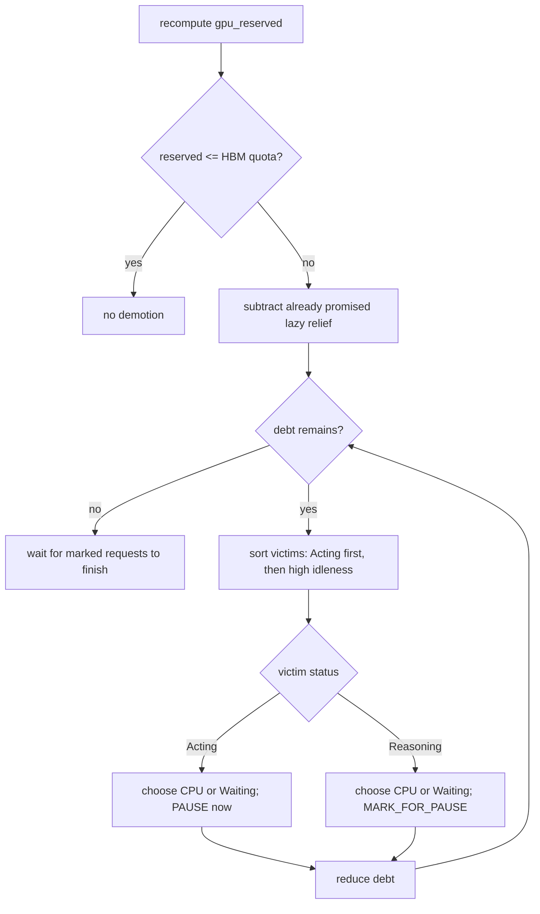

### 8.4 DRAM repair

CPU reservation 同时包含已在 CPU tier 和 `pending_tier=CPU` 的 Program，防止多个 lazy demotion 预订同一份 DRAM。
超额时按 idleness 从高到低把 CPU/pending-CPU victim 改为 Waiting，直到不超 quota。正式实现不主动发起 D2H/H2D；
tier 只改变随后 replacement 的保护等级，实际 offload/load 仍由 native connector 按请求生命周期触发。证据索引：
`agentinfer/scheduling/mori/strategy.py:425-466`、`agentinfer/scheduling/mori/strategy.py:509-515`、
`agentinfer/scheduling/mori/strategy.py:26-33`。

## 9. Program tier 如何传递到两层 KV replacement

### 9.1 `MORIRuntimeState` 是窄桥，不是另一份 scheduler

`MORIRuntimeState` 保存三类 process-local 关系：当前 class provider、native request ID 到 `ProgramRef` 的绑定、以及已注册
owner index 列表。当 strategy 提交 class change，它只对反向索引到该 Program 的 entries 触发 reclass；Program
release 则删除该 generation 的 owner 并清理残留 request binding。所有操作发生在序列化 engine thread 路径。
证据索引：`agentinfer/agentcache/mori/runtime_state.py:17-39`、
`agentinfer/agentcache/mori/runtime_state.py:51-86`。

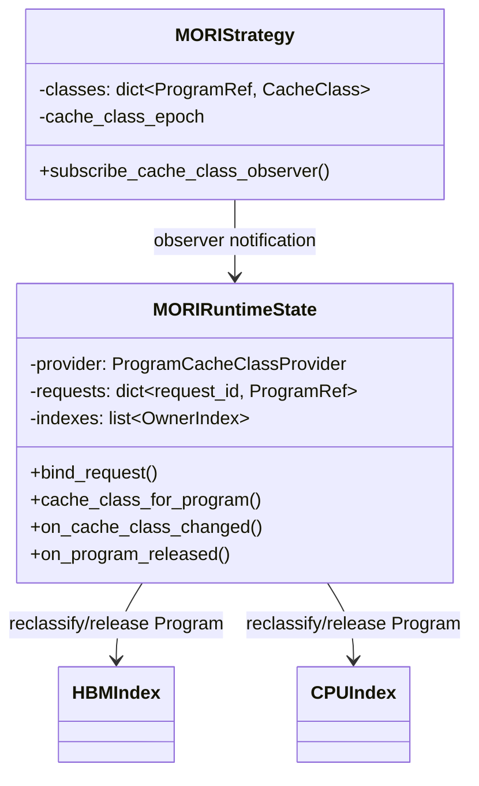

### 9.2 shared entry 的“最受保护 owner”

一个 block/chunk 可有多个 Program owner。每个 typed index 对所有 owners 求自己 protection rank 下的最大 class：

| 层 | protection rank（低 -> 高） | 淘汰顺序（先 -> 后） |
| --- | --- | --- |
| HBM | `INACTIVE < IDLE < BUSY` | `INACTIVE -> IDLE -> BUSY` |
| CPU | `INACTIVE < BUSY < IDLE` | `INACTIVE -> BUSY -> IDLE` |

因此 shared HBM block 只要有 BUSY owner 就按 BUSY 保护；shared CPU chunk 只要有 IDLE owner 就按 IDLE 保护。
两层使用相同的 owner set 语义，但 protection rank 有意不同。证据索引：
`agentinfer/agentcache/mori/hbm_policy.py:20-30`、`agentinfer/agentcache/mori_cpu_policy.py:31-46`、
`agentinfer/agentcache/mori/typed_lru.py:297-299`。

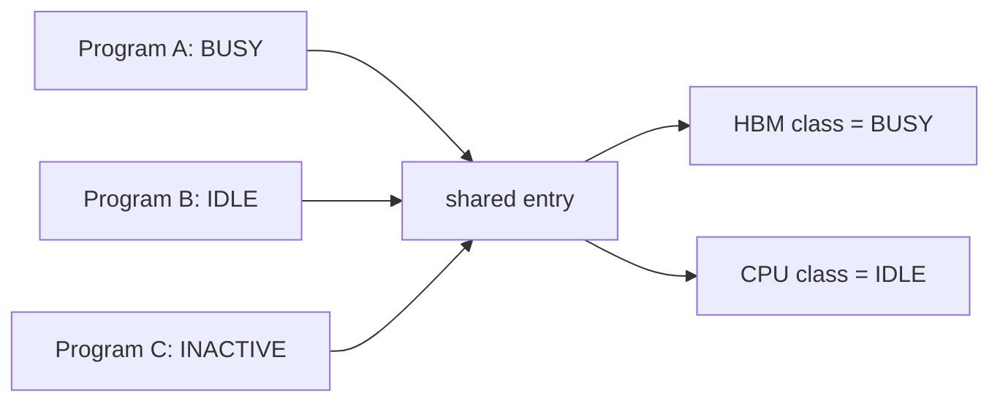

## 10. `TypedLRUIndex` 数据结构实现

### 10.1 内部对象图

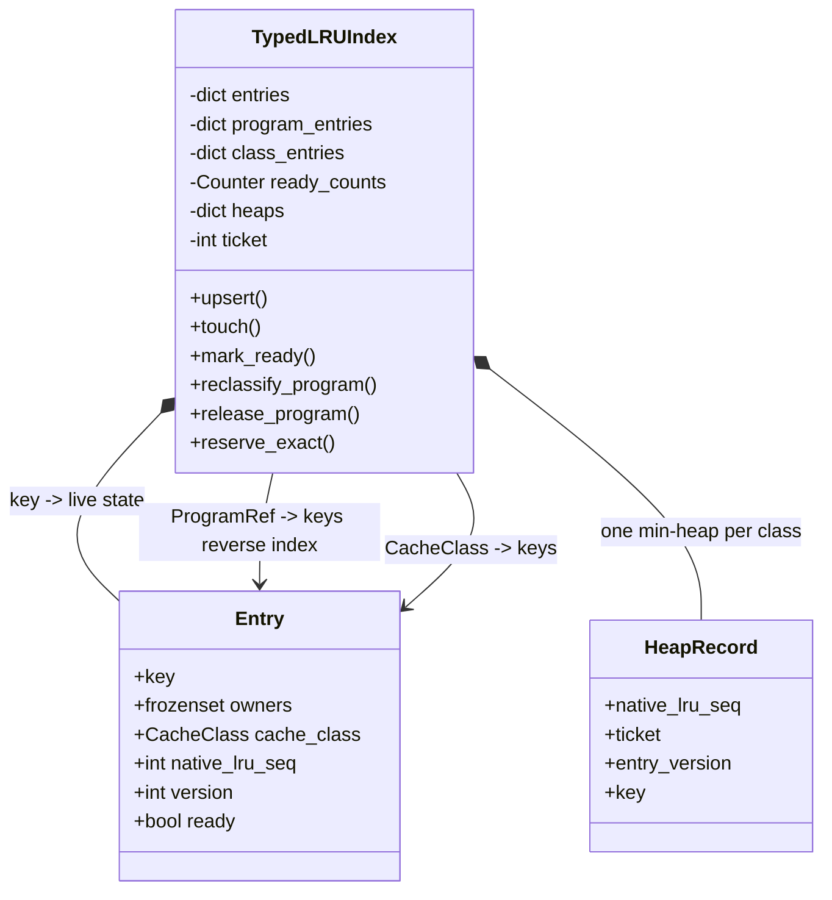

实际字段如下：

- `_entries[key]` 是某个 entry 的唯一 live state；
- `_program_entries[ProgramRef]` 使 tier change 只访问该 Program 的 entries；
- `_class_entries[CacheClass]` 支持 class-local compaction；
- `_heaps[CacheClass]` 保存 `(native_lru_seq, ticket, version, key)`，最小 sequence 就是类内 native LRU victim；
- `_ready_counts` 控制 compaction 阈值；
- `version` 让 touch/reclass/ready change 留下的旧 heap record 可惰性丢弃。

证据索引：`agentinfer/agentcache/mori/typed_lru.py:24-70`、
`agentinfer/agentcache/mori/typed_lru.py:301-338`。

### 10.2 更新路径

`upsert()` 归一化 owner set，重算 strongest class，更新 reverse/class indexes；ready entry 压入对应 class heap。
`touch()` 只推进 native sequence 和 version，不改变 class；`mark_ready()` 映射 native evictability；`remove()` 清 live state
和所有 reverse indexes。证据索引：`agentinfer/agentcache/mori/typed_lru.py:79-169`。

Program class change 采用 **eager reverse-index migration**：遍历 `_program_entries[program]`，只迁移 strongest class
真的变化的 entry，并保留原 `native_lru_seq`。它不是 `O(1)`；若 Program 拥有 `B_p` 个 entries，最坏为
`O(B_p log N)`，换取 proposal hot path 不做全表 owner join。证据索引：
`agentinfer/agentcache/mori/typed_lru.py:34-41`、`agentinfer/agentcache/mori/typed_lru.py:171-197`。

### 10.3 victim reservation

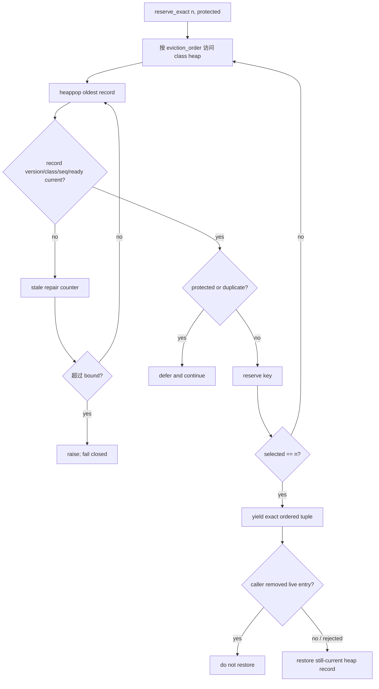

`reserve_exact()` 只在凑齐 exact count 时返回 tuple；不足返回 `None`。protected head 暂存后回压；已选 entry 若在
reservation 内被 caller `remove()`，退出时不会恢复；验证失败但 entry 仍 live，则自动恢复。stale repair 超过 4096
直接抛错，不退化为无界扫描或 native fallback。证据索引：
`agentinfer/agentcache/mori/typed_lru.py:218-281`、`agentinfer/agentcache/mori/typed_lru.py:44-61`。

### 10.4 复杂度与内存

| 操作 | 成本 | 说明 |
| --- | --- | --- |
| `upsert` | `O(owners + log N)` | owner attach/detach 加一次 heap push |
| `touch` | `O(log N)` | 新 version record；旧 record 惰性失效 |
| `mark_ready(False)` | `O(1)` | version 使旧 record 失效 |
| `mark_ready(True)` | `O(log N)` | 新 record 入堆 |
| Program reclass | `O(B_p * (owners + log N))` | eager reverse-index migration |
| `reserve_exact(n)` | `O((n + protected_heads + stale_repairs) log N)` | stale repairs 有硬上界 |
| class-local compact | `O(N_class)` amortized | heap 至少 64 且达到 ready live records 的 2 倍时重建 |

Live state 为 `O(N + sum(owner edges))`；heap 允许短期 stale records，但 class-local compaction 将其控制在与 ready
entries 同阶。证据索引：`agentinfer/agentcache/mori/typed_lru.py:309-323`、
`agentinfer/agentcache/mori/typed_lru.py:340-351`。

## 11. HBM replacement 走读

### 11.1 正式 hook 的边界

正式 HBM 不替换 `queue.popleft_n`。vLLM patch 增加版本化 `MoriBlockSelectionProvider`：BlockPool 发送 owner、ready、
evictability、remove/reset 和 native sequence delta；需要 block 时向 provider 请求 exact IDs。provider 只给建议，
BlockPool 先验证 count、唯一性、ID 范围、非 null、`ref_cnt==0` 与 free-queue membership，完整 proposal 合法后才
remove；hash eviction、reuse watcher 和 allocation 继续走 native 代码。证据索引：
`agentinfer/agentcache/patches/vllm-0.31-mori-hbm-provider.patch:19-36`、
`agentinfer/agentcache/patches/vllm-0.31-mori-hbm-provider.patch:58-100`。

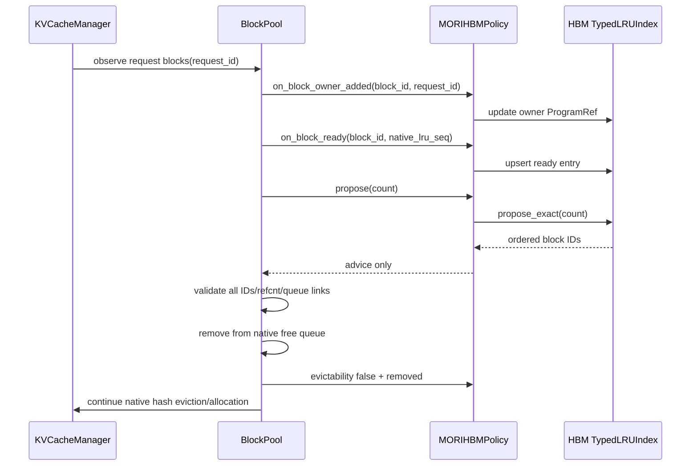

owner 建立不是每 decode step 全扫：某请求每次 residency 第一次观察已有 blocks，此后只观察 newly allocated blocks。
free queue sequence 在 provider 注册时 bootstrap，之后 prepend/append delta 使用单调 front/back sequence 保持原生顺序。
证据索引：`agentinfer/agentcache/patches/vllm-0.31-mori-hbm-provider.patch:176-217`、
`agentinfer/agentcache/patches/vllm-0.31-mori-hbm-provider.patch:275-292`。

### 11.2 `MORIHBMPolicy`

Policy 配置 `INACTIVE -> IDLE -> BUSY` 淘汰顺序。native callback 只携带 request ID；policy 通过
`MORIRuntimeState.program_for_request()` 在服务端解析 `ProgramRef`，因此 native patch 不认识 AgentInfer Program。
`propose()` 直接调用 shared `TypedLRUIndex.propose_exact()`。证据索引：
`agentinfer/agentcache/mori/hbm_policy.py:15-30`、`agentinfer/agentcache/mori/hbm_policy.py:33-82`。

bridge 仍会为 cache hit metrics 包装 `get_computed_blocks()`，但这个 observational wrapper 不参与 victim selection，
不能与隔离版替换 free queue 的 eviction monkey patch 混为一谈。证据索引：
`agentinfer/agentcache/core/scheduler.py:340-362`。

## 12. CPU offload replacement 走读

### 12.1 推荐路径：SimpleCPUOffloadConnector

SimpleCPU 没有 external `CachePolicy` slot，因此正式支持使用第二个版本化 native hook，而不是替换 scheduler 或
`BlockPool` bound method。`SimpleCPUOffloadScheduler.register_mori_offload_tier_provider(1, provider)` 把
`MORISimpleCPUOffloadPolicy` 注册到该实例的 CPU BlockPool；未注册时不维护 sequence/index，也不改变 native
`popleft_n()`。

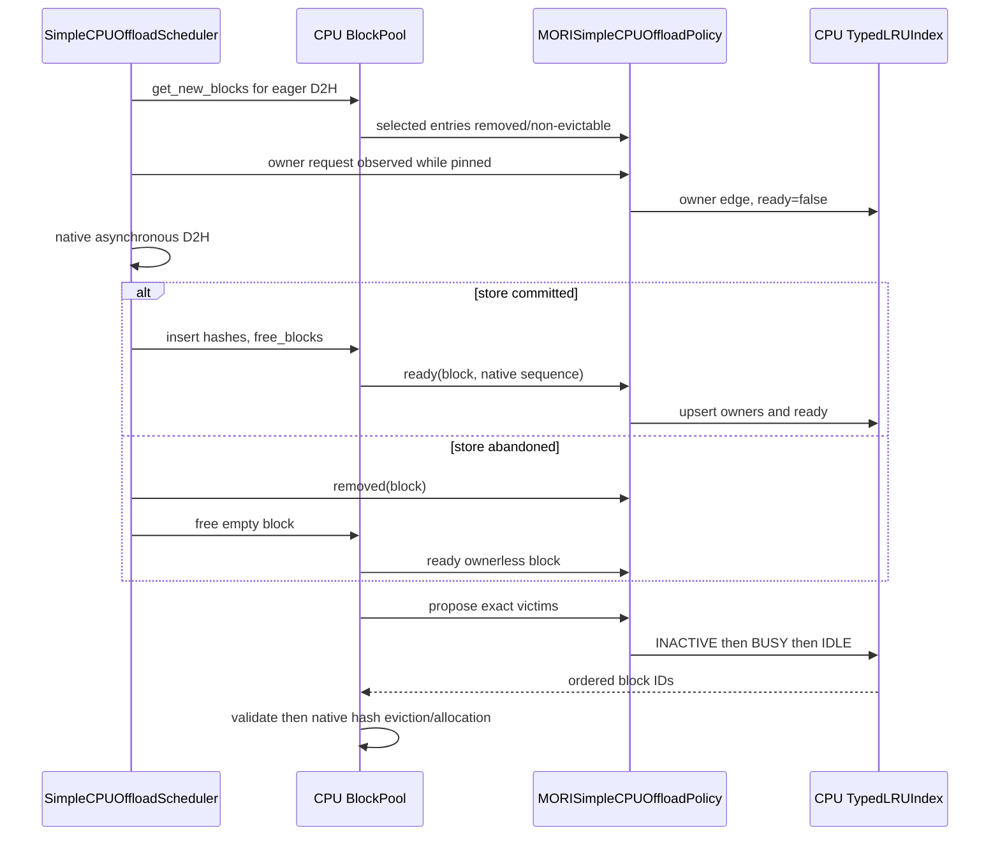

load hit 和 already-cached store 会为同一 block 追加 owner；Program generation release 只删除该 owner，shared block
继续按剩余 owner 中最受保护者分类。connector snapshot 报告可用总 block、已有有效 hash 的 resident block、pending
store/load block 和 scheduler block size；adapter 换算为 rank-local token quota。当前注册明确拒绝 disk backend 与 lazy
offload，防止把未实现的成本和 owner 语义伪装成 full 支持。证据索引：
`agentinfer/agentcache/mori/simple_cpu_policy.py:15-91`、`agentinfer/agentcache/mori/vllm_adapter.py:62-91`、
`agentinfer/agentcache/patches/vllm-0.31-mori-simple-cpu-provider.patch:62-177`。

### 12.2 兼容路径：OffloadingConnector external policy

vLLM 0.31 原生支持通过 `cache_policy_module_path` 加载外部 `CachePolicy`。`MoriCPUCachePolicy` 自己维护协议要求的
`chunks`，同时把 owner/recency/evictability delta 投影到 TypedLRU；manager 仍拥有 protected set、refcount、transfer
job、fence、chunk slot 与传输完成语义。证据索引：`agentinfer/agentcache/mori_cpu_policy.py:19-47`。

```mermaid
sequenceDiagram
    participant Native as Offload scheduler
    participant Manager as CPUOffloadingManager
    participant Policy as MoriCPUCachePolicy
    participant IDX as CPU TypedLRUIndex

    Native->>Policy: on_store_miss(keys, ReqContext)
    Policy->>Policy: pending key -> ProgramRef owners
    Manager->>Policy: insert(key, ChunkStatus)
    Policy->>IDX: upsert owners, rank, ref_cnt==0
    Native->>Policy: touch / on_request_finished
    Policy->>IDX: update native recency
    Manager->>Policy: mark_evictable/non_evictable
    Policy->>IDX: ready delta
    Manager->>Policy: evict(n, protected)
    Policy->>IDX: reserve_exact(n, protected)
    IDX-->>Policy: exact keys
    Policy->>Policy: recheck chunk/ref_cnt/protected
    alt every key still legal
        Policy->>Policy: remove selected keys
        Policy-->>Manager: key/chunk pairs
    else native state changed
        Policy-->>Manager: None; reservation restores live entries
    end
```

pending owner maps 解决 `on_store_miss` 先于 `insert` 的事件顺序；Program release 同时清 live 与 pending owner edges。
`evict()` 在 reservation 后再次校验 chunk 存在、`ref_cnt==0` 和 protected，任一失败整批返回 `None`。证据索引：
`agentinfer/agentcache/mori_cpu_policy.py:31-83`、`agentinfer/agentcache/mori_cpu_policy.py:92-129`、
`agentinfer/agentcache/mori_cpu_policy.py:153-193`。

## 13. Cache hit 与调度开销报告

bridge 在 native prefix lookup 后记录四个 server-observed 量：prompt tokens、全部 reusable prefix、HBM prefix hit、以及
lookup 时 `ref_cnt==0` 的 HBM hit。request completion event 把这些值送给 MORI；diagnostics 累积 request count、token
counters、prefix/HBM hit ratio，同时输出 tier counts、logical quota/reservation、native physical use、pending H2D/D2H、
class epoch 和 `decision_cpu_seconds`。证据索引：`agentinfer/agentcache/core/scheduler.py:281-297`、
`agentinfer/scheduling/runtime.py:388-455`、`agentinfer/scheduling/mori/strategy.py:214-261`。

这些指标不能互相替代：HBM prefix hit 不是 CPU offload hit；CPU lookup/store/load、job 和 transfer 指标仍应从所选
native connector 收集。正式报告应把两组指标并列，才能分辨策略保护效果、D2H/H2D 成本与 scheduler overhead。
证据索引：`design/module/scheduling/mori-scheduling.md:365-372`。

## 14. Failure、取消、release 与 shutdown

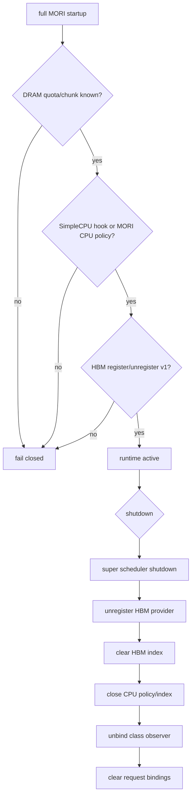

retained request 取消时先从 RequestPool 删除并清 request binding；native request finish 则先完成 native cleanup，再通知
Program runtime 并解绑 owner。terminal lifecycle 只有在该 generation 没有 in-flight request 且处于 Acting 时才 release，
迟到信号不会释放新一轮 Reasoning。证据索引：`agentinfer/agentcache/core/scheduler.py:299-338`、
`agentinfer/scheduling/runtime.py:466-526`。

adapter close 是幂等的；HBM provider unregister、两层 index close、observer unbind 与 request map clear 使用嵌套 cleanup，
确保局部异常不跳过后续清理。证据索引：`agentinfer/agentcache/mori/vllm_adapter.py:27-59`、
`agentinfer/agentcache/core/scheduler.py:382-389`。

## 15. 隔离实现与正式实现对比

### 15.1 两套架构

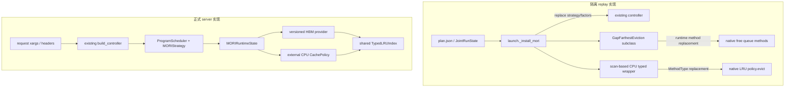

证据索引：`/data/zx/agent-kvc/research/studies/kvc_theory/mori-reproduction-20261022/candidate/joint/launch.py:78-127`、
`agentinfer/agentcache/core/controller.py:86-137`、`agentinfer/agentcache/mori/vllm_adapter.py:95-154`。

### 15.2 逐项差异

| 维度 | 隔离实现 | 正式实现 | 设计意义 |
| --- | --- | --- | --- |
| 目标 | 固定 trace 的隔离复现与机制验证 | AgentInfer serve 可维护实现 | 原型可侵入运行时；正式版需要稳定 contract |
| Program identity | `state.canonical(request)` 后查 `state.programs[canonical]`；该表由 `plan.tasks` 初始化 | 只解析 request xargs/headers；缺 identity fail closed | 正式版是 server-only；隔离版虽不读未来 return，identity 仍依赖 plan |
| future return | MORI counters 声明 `future_oracle_reads=0` | 没有 plan/DAG API | 两者的 placement 都是 causal，但输入边界不同 |
| 构造 | launch 时替换 controller strategy/factors 与 interval | 与 Progress-TTL 共用 `build_controller` 路径 | 避免实验 harness 成为生产依赖 |
| generation | 多处以 `str program_id` 建 tier/owner 索引 | 全链路 `ProgramRef(id,generation)` | 避免释放后 ID 复用污染 |
| overlap | replay trace 隐含串行 Program 段 | 显式拒绝同 Program overlap；subagent 独立 ID | 并发语义可验证 |
| GPU reservation | `estimated - shared_prefix + decode_buffer(默认256)`，无 block rounding | `round_up(estimated + 100, block_size)` | 正式版固定保守 buffer 并匹配 native quantum；两者容量数值不完全等价 |
| DRAM quota | 启动时读取 manager 私有 `_num_chunks` | 每次 snapshot 从 adapter observation 传播 rank-local quota | 消除长期抓取私有字段的 policy 依赖 |
| promotion | 可为候选立即 swap Acting，并对更 idle Reasoning 做 lazy mark | no-fit admission 先排队；仅 aggregate capacity debt 触发 demotion | 正式策略更保守；不能声称两者完整 placement 序列等价 |
| HBM selection | 复用 `GapFarthestEviction` safe-tail/content graph，替换 queue/pool/KVM 多个方法 | 窄 provider v1 + block-level incremental typed-LRU | class/LRU 意图一致，owner/content 数据结构与 backend safety 路径不同 |
| HBM native safety | 原型 `_pop()` 手动检查 hash/ref/queue link | BlockPool 批量验证 ID、refcnt、membership 后原生分配 | 正式版把安全权留给 native owner |
| CPU selection | 替换 `LRUCachePolicy.evict`；每次扫描全部 `_evictable` | 外部 `CachePolicy`；持久 reverse index + class heaps | 消除 eviction hot-path 全量扫描 |
| shared owner | HBM 通过 content owner deadline；CPU 通过 key owner + max priority | 两层都用 generation-safe owner set 与各自 strongest rank | 保护语义保留，表示法统一 |
| prefetch | full-mori preset 的 P=false | strategy 明确不 prefetch | 两者都依赖 native on-demand load |
| cleanup | close 时恢复被替换方法 | unregister provider、close policy、unbind observer | 正式生命周期可重复启动且能力可协商 |

隔离 identity 与 plan 的证据索引：
`/data/zx/agent-kvc/research/studies/kvc_theory/mori-reproduction-20261022/candidate/joint/replay.py:201-218`、
`/data/zx/agent-kvc/research/studies/kvc_theory/mori-reproduction-20261022/candidate/joint/replay.py:306-317`、
`/data/zx/agent-kvc/research/studies/kvc_theory/mori-reproduction-20261022/candidate/joint/mori.py:630-649`。

隔离与正式容量/placement 的证据索引：
`/data/zx/agent-kvc/research/studies/kvc_theory/mori-reproduction-20261022/candidate/joint/mori.py:384-564`、
`agentinfer/scheduling/mori/strategy.py:90-196`、`agentinfer/scheduling/mori/strategy.py:376-541`。

隔离 HBM/CPU 接线的证据索引：
`/data/zx/agent-kvc/research/studies/kvc_theory/mori-real-v031-20261022/joint/eviction.py:938-973`、
`/data/zx/agent-kvc/research/studies/kvc_theory/mori-real-v031-20261022/joint/eviction.py:975-1108`、
`/data/zx/agent-kvc/research/studies/kvc_theory/mori-reproduction-20261022/candidate/joint/mori.py:618-790`。

### 15.3 后端 KV 映射和 victim 选择是否“一致”

答案需要分层：

- **算法意图一致**：HBM 都是 `INACTIVE -> IDLE -> BUSY`，CPU 都是
  `INACTIVE -> BUSY -> IDLE`，同类中都以 native LRU 为 tie-break，shared entry 都采用最受保护 owner。
- **物理映射实现不一致**：隔离 HBM 建 content/hash/parent safe-tail index，并在原型中接管多个 native 方法；正式 HBM
  直接维护 block ID owner/ready/LRU delta，由 BlockPool 负责 hash 与合法性。隔离 CPU 在 request completion 重建
  OffloadKey owner，正式 CPU 从 native `CachePolicy` lifecycle 增量接收 owner/touch/ready。
- **不能由受控 benchmark 证明完整等价**：现有 identical digest 只验证 CPU typed-LRU 的给定 owner/class/recency
  workload，不验证两套 placement、HBM content dependency 或真实传输时序完全一致。

证据索引：`agentinfer/agentcache/mori/hbm_policy.py:15-76`、`agentinfer/agentcache/mori_cpu_policy.py:19-129`、
`design/module/scheduling/mori-performance.md:5-13`。

## 16. 为什么正式 CPU policy 更快

隔离 CPU `evict(n)` 每次先计算 candidate count，然后遍历全部 `_evictable` key，对每个 key 查 type priority，并只保留
每类前 n 个的有界 heap。它避免了全局 `O(N log N)` 排序，却仍是每次 eviction `O(N)` 扫描。第一轮完整隔离实验
发生 16,795 次 eviction、检查 180,152,700 keys，仅 CPU typed selection 就耗 118.2343 thread CPU-s。证据索引：
`/data/zx/agent-kvc/research/studies/kvc_theory/mori-reproduction-20261022/candidate/joint/mori.py:720-765`、
`/data/zx/agent-kvc/research/studies/kvc_theory/mori-reproduction-20261022/runs/mori-k5-v6-bounded/r1-full-mori/validation.json:319-337`。

正式版把成本移到 delta 路径：owner/touch/readiness/class change 发生时维护持久 heaps，eviction 只 pop 所需 victims。
受控 trace-derived 实验在相同 50,193-victim 序列上得到：

| 路径 | 中位 thread CPU | 相对隔离 |
| --- | ---: | ---: |
| 隔离 scan | 3.537876127 s | 1.0000x |
| 正式 proposal/restore 消融 | 0.749834859 s | 4.7181x |
| 正式 reservation | 0.622228630 s | 5.6858x |

三条路径 victim digest 相同；正式 reservation 相对隔离降低 82.4124% CPU。该结果证明的是 CPU typed-LRU 实现
开销与 victim 顺序，不是端到端 server makespan。证据索引：
`design/module/scheduling/mori-performance.md:5-13`、`design/module/scheduling/mori-performance.md:44-50`、
`design/module/scheduling/artifacts/mori-typed-lru-benchmark-20261026.json:31-41`、
`design/module/scheduling/artifacts/mori-typed-lru-benchmark-20261026.json:151-188`。

## 17. 目录、文件职责与调用入口

```text
agentinfer/
├── scheduling/
│   ├── runtime.py                    # ProgramScheduler 与 request lifecycle
│   ├── domain.py                     # ProgramRef/state/status/token facts
│   ├── snapshot.py / backend.py      # rank-local capacity read model
│   ├── cache_placement.py            # class provider/observer protocol
│   └── mori/
│       ├── config.py                 # k/mode/fixed decode buffer
│       ├── factors.py                # tier、pending tier、idleness history
│       ├── builder.py                # strategy + initial factors
│       └── strategy.py               # placement/capacity/diagnostics
└── agentcache/
    ├── core/
    │   ├── controller.py             # progress_ttl/mori explicit selector
    │   └── scheduler.py              # vLLM bridge and server observations
    ├── mori/
    │   ├── runtime_state.py          # request owner + class delta fan-out
    │   ├── typed_lru.py              # shared incremental index
    │   ├── hbm_policy.py             # HBM provider implementation
    │   ├── simple_cpu_policy.py       # SimpleCPU offload-tier provider
    │   └── vllm_adapter.py            # capability check/offload observation
    ├── mori_cpu_policy.py            # OffloadingConnector external CachePolicy
    └── patches/
        ├── vllm-0.31-mori-hbm-provider.patch
        └── vllm-0.31-mori-simple-cpu-provider.patch
```

证据索引：`design/module/scheduling/mori-scheduling.md:374-393`。

### 17.1 从入口到核心方法的阅读顺序

1. `AgentCache*SchedulerBridge.add_request/schedule/update_from_output`：看 native interception 点。
2. `_VllmAdmissionHooks`：看 controller 构造、identity、backend observation 与 request binding。
3. `ProgramScheduler`：看 RequestPool、Registry、snapshot、transition/event sequencing。
4. `MORIStrategy`：看 logical capacity、promotion/demotion 与 class notification。
5. `MORIRuntimeState`：看 Program class 如何 fan-out 到两层 index。
6. `TypedLRUIndex`：看 exact class/LRU ordering 和 reservation。
7. `MORIHBMPolicy`、`MORISimpleCPUOffloadPolicy`、两个 vLLM patch 与兼容的 `MoriCPUCachePolicy`：看最终 native
   victim contract。

证据索引：`agentinfer/agentcache/core/scheduler.py:477-562`、`agentinfer/scheduling/runtime.py:69-100`、
`agentinfer/scheduling/mori/strategy.py:26-88`、`agentinfer/agentcache/mori/typed_lru.py:34-70`。

### 17.2 调用图

```mermaid
flowchart TD
    AR[Bridge.add_request] --> HA[Hooks.add_request]
    HA --> PRA[ProgramScheduler.on_request_arrival]
    PRA --> ADM[MORIStrategy.handle_admission]
    ADM --> TR[TransitionController]
    TR --> AT[ProgramScheduler._apply_transition]
    AT --> EV[dispatch SchedulingEvent]
    EV --> SE[MORIStrategy event handler]
    SE --> CF[_set_factor / cache class change]
    CF --> RS[MORIRuntimeState observer]
    RS --> RI[TypedLRU reclassify_program]

    SC[Bridge.schedule] --> BS[Hooks.before_schedule]
    BS --> CY[ProgramScheduler.schedule_cycle]
    CY --> REP[MORIStrategy.repair_capacity]
    CY --> RES[MORIStrategy.schedule_resume]
    BS --> NA[super.add_request admitted]
    SC --> NS[super.schedule]
```

## 18. 部署配置与验证

### 18.1 vLLM 0.31 full 模式

先在目标 vLLM 0.31 source tree 依次应用 HBM/BlockPool 与 SimpleCPU provider patch：

```bash
git apply --check /path/to/agent-infer/agentinfer/agentcache/patches/vllm-0.31-mori-hbm-provider.patch
git apply /path/to/agent-infer/agentinfer/agentcache/patches/vllm-0.31-mori-hbm-provider.patch
git apply --check /path/to/agent-infer/agentinfer/agentcache/patches/vllm-0.31-mori-simple-cpu-provider.patch
git apply /path/to/agent-infer/agentinfer/agentcache/patches/vllm-0.31-mori-simple-cpu-provider.patch
```

AgentCache 配置：

```json
{
  "agentcache": {
    "strategy": "mori",
    "schedule_interval_seconds": 5.0,
    "mori": {
      "mode": "full",
      "window_size": 5
    }
  }
}
```

推荐的 CPU offload connector 配置为：

```json
{
  "kv_connector": "SimpleCPUOffloadConnector",
  "kv_role": "kv_both",
  "kv_connector_extra_config": {
    "cpu_bytes_to_use": 17179869184,
    "kv_offload_backend": "cpu",
    "lazy_offload": false
  }
}
```

完整启动范例在 `examples/serve-mori.sh`，操作说明见 `docs/zh/how-to/use-mori.md`；patch 只在 full 模式需要，
未注册 provider 时 native allocation path 不维护 MORI sequence，也不改变 `popleft_n()`。证据索引：
`examples/serve-mori.sh:1-17`、`agentinfer/agentcache/patches/README.md:1-42`。

### 18.2 请求 identity 示例

客户端不需要 plan，但必须让服务端能解析 Program identity。例如：

```json
{
  "vllm_xargs": {
    "agentic_context": {
      "program_id": "task-42:lead",
      "task_id": "task-42",
      "agent_id": "lead",
      "agent_role": "lead",
      "expected_resume": true
    }
  }
}
```

subagent 应使用不同的 `program_id`/`agent_id`，可附 `parent_program_id` 与 `blocks_parent`。解析器也支持已列出的
framework session/agent headers。证据索引：`agentinfer/scheduling/identity.py:27-87`、
`agentinfer/scheduling/identity.py:90-174`。

### 18.3 当前验证命令

```bash
pytest -q \
  tests/scheduling/test_mori_strategy.py \
  tests/scheduling/test_mori_runtime.py \
  tests/agentcache/test_mori_typed_lru.py \
  tests/agentcache/test_mori_cpu_policy.py \
  tests/agentcache/core/test_mori_controller.py \
  tests/agentcache/core/test_mori_vllm_adapter.py

pytest -q tests/scheduling tests/agentcache \
  --ignore=tests/agentcache/core/test_vllm_api_adapter.py \
  --ignore=tests/agentcache/entrypoints/test_serve_flag_e2e.py
```

收据结果分别为 27 passed 和 302 passed；两个 ignore 的宿主依赖原因以及未运行的真实 GPU/全链路范围已显式记录。
证据索引：`design/module/scheduling/artifacts/mori-validation-20261026.json:7-20`、
`design/module/scheduling/artifacts/mori-validation-20261026.json:54-65`。

## 19. 已知限制与后续扩展点

1. 当前只支持单 embedded backend rank、单 full-attention KV group 和 full-KV CPU offload；SimpleCPU full 路径限定
   CPU backend 与 eager mode。
2. 同一 Program 不支持 overlapping requests；如需支持，必须引入 per-request reservation ledger，而不是把三个单值 timing
   字段直接共享。
3. `decode_buffer_tokens=100` 是固定启发式 reservation，不是论文开源 estimator，也不保证覆盖任意未来输出。
4. tier 是保护意图，不是主动搬迁状态；当前没有 MORI-specific prefetch 或独立 transfer state machine。
5. Program reclass 是 `O(B_p log N)`；若极端 workload 的 tier churn 成为热点，可评估 lazy epoch 或 per-Program head
   index，但必须继续正确处理 shared owners 和 stale-repair 上界。
6. 当前 controlled benchmark 只证明 CPU typed-LRU 的顺序与开销；真实 GPU replay 还需报告端到端时延、HBM/cache hit、
   native CPU hit、H2D/D2H、scheduler CPU 和终态不变量。

证据索引：`design/module/scheduling/mori-scheduling.md:39-45`、
`agentinfer/scheduling/mori/strategy.py:26-33`、`agentinfer/agentcache/mori/typed_lru.py:34-41`、
`design/module/scheduling/mori-performance.md:74-78`。

## 20. 实现不变量清单

- Program identity 必须由 server request 解析；不得从 replay plan 或预知 DAG 补齐。
- 同一 stable Program ID 的 owner 关系必须携带 generation。
- 未完成 lazy demotion 不得释放 GPU logical reservation。
- pending CPU destination 必须计入 DRAM reservation。
- shared entry 必须按该层最受保护 owner 分类。
- class change 不得改变 native LRU sequence。
- HBM/CPU 都只能提交 exact-count victim set；合法性变化必须整批 fail closed。
- victim proposal hot path 不得回退为全局 owner join 或全量 key scan。
- native vLLM 必须继续拥有 refcount、queue membership、protected set、job/fence 与实际 allocation/transfer。
- shutdown 必须解除 provider、observer、indexes 与 request binding，不能把 process-global state 泄漏给同进程下一实例。

证据索引：`agentinfer/scheduling/mori/strategy.py:376-423`、
`agentinfer/agentcache/mori/typed_lru.py:171-197`、`agentinfer/agentcache/mori/typed_lru.py:218-281`、
`agentinfer/agentcache/mori/vllm_adapter.py:37-59`。
