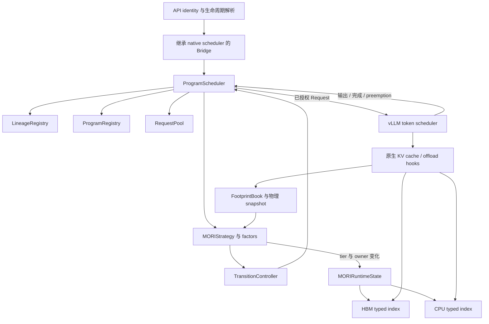
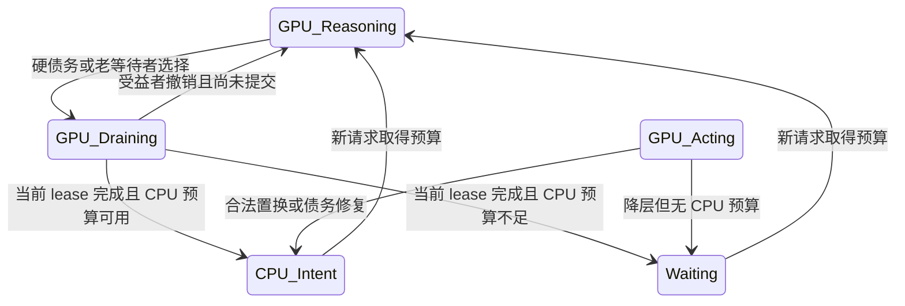

## MORI 在 AgentInfer + vLLM 0.31 上的正式实现

本文描述 `codex/mori-formal` 在源码提交 `d4af0d1e25ec4e94d13816a536b07b9fcb24c0fc` 的实际行为。
2026-10-28 全面更新身份、重叠请求、迁移触发、容量账本、原生接线和验证说明；不把隔离回放或旧版正式实现的结果移作本次重构的性能结果。
本次重构的动机、备选方案和验收边界另见 [重构设计](https://github.com/potatoZhx/agent-infer/blob/codex/mori-formal/design/module/scheduling/mori-redesign-20261028.zh-CN.md)。
源码基线及原实验工作区差异见 [design/module/scheduling/artifacts/mori-redesign-20261028/validation.json:1-23](https://github.com/potatoZhx/agent-infer/blob/d4af0d1e25ec4e94d13816a536b07b9fcb24c0fc/design/module/scheduling/artifacts/mori-redesign-20261028/validation.json#L1-L23)、[design/module/scheduling/artifacts/mori-redesign-20261028/before.patch:1-39](https://github.com/potatoZhx/agent-infer/blob/d4af0d1e25ec4e94d13816a536b07b9fcb24c0fc/design/module/scheduling/artifacts/mori-redesign-20261028/before.patch#L1-L39)。

本文同时保存于 Git 的 `design/module/scheduling/mori-implementation.zh-CN.md` 和研究目录的
`/data/zx/agent-kvc/research/studies/kvc_theory/mori-real-v031-20261022/MORI-REAL-IMPLEMENTATION.zh-CN.md`。
两份正文保持一致。源码和仓库内验证证据使用固定提交的 GitHub 行号链接，便于在本地和远端交叉审查；
历史隔离结果仍使用其原始绝对路径，未随本文上传实验数据。

## 1. 阅读入口与实现边界

正式 MORI 是嵌入 vLLM scheduler 的 Program 级准入与缓存保护策略。它决定哪些串行推理链获得 GPU/CPU 的逻辑预算、何时停止授权下一请求、何时改变 KV 淘汰优先级。
vLLM 继续负责 token batch、物理 block 分配、prefix lookup、原生 preemption、D2H/H2D job 和 fence。
系统只有一个 native token scheduler；没有读未来调用计划的调度器，也没有因改变逻辑 tier 就立即复制全量 KV 的独立执行器。
证据：[agentinfer/agentcache/core/scheduler.py:562-604](https://github.com/potatoZhx/agent-infer/blob/d4af0d1e25ec4e94d13816a536b07b9fcb24c0fc/agentinfer/agentcache/core/scheduler.py#L562-L604)、[agentinfer/agentcache/mori/vllm_adapter.py:105-200](https://github.com/potatoZhx/agent-infer/blob/d4af0d1e25ec4e94d13816a536b07b9fcb24c0fc/agentinfer/agentcache/mori/vllm_adapter.py#L105-L200)、[agentinfer/scheduling/mori/strategy.py:681-716](https://github.com/potatoZhx/agent-infer/blob/d4af0d1e25ec4e94d13816a536b07b9fcb24c0fc/agentinfer/scheduling/mori/strategy.py#L681-L716)。

建议按以下顺序阅读：

| 要回答的问题 | 入口与证据 |
| --- | --- |
| 请求从哪里进入、谁实际执行 | [agentinfer/agentcache/core/scheduler.py:167-214](https://github.com/potatoZhx/agent-infer/blob/d4af0d1e25ec4e94d13816a536b07b9fcb24c0fc/agentinfer/agentcache/core/scheduler.py#L167-L214)、[agentinfer/agentcache/core/scheduler.py:607-649](https://github.com/potatoZhx/agent-infer/blob/d4af0d1e25ec4e94d13816a536b07b9fcb24c0fc/agentinfer/agentcache/core/scheduler.py#L607-L649) |
| 重叠请求如何区分上下文 | [agentinfer/scheduling/lineage.py:14-72](https://github.com/potatoZhx/agent-infer/blob/d4af0d1e25ec4e94d13816a536b07b9fcb24c0fc/agentinfer/scheduling/lineage.py#L14-L72)、[agentinfer/scheduling/runtime.py:170-291](https://github.com/potatoZhx/agent-infer/blob/d4af0d1e25ec4e94d13816a536b07b9fcb24c0fc/agentinfer/scheduling/runtime.py#L170-L291) |
| 谁能改变 Program 状态 | [agentinfer/scheduling/transitions.py:102-169](https://github.com/potatoZhx/agent-infer/blob/d4af0d1e25ec4e94d13816a536b07b9fcb24c0fc/agentinfer/scheduling/transitions.py#L102-L169)、[agentinfer/scheduling/runtime.py:682-743](https://github.com/potatoZhx/agent-infer/blob/d4af0d1e25ec4e94d13816a536b07b9fcb24c0fc/agentinfer/scheduling/runtime.py#L682-L743) |
| 为什么没有立即迁移 | [agentinfer/scheduling/mori/strategy.py:223-345](https://github.com/potatoZhx/agent-infer/blob/d4af0d1e25ec4e94d13816a536b07b9fcb24c0fc/agentinfer/scheduling/mori/strategy.py#L223-L345)、[agentinfer/scheduling/runtime.py:536-576](https://github.com/potatoZhx/agent-infer/blob/d4af0d1e25ec4e94d13816a536b07b9fcb24c0fc/agentinfer/scheduling/runtime.py#L536-L576) |
| 预算如何扣除共享块 | [agentinfer/scheduling/mori/capacity.py:30-80](https://github.com/potatoZhx/agent-infer/blob/d4af0d1e25ec4e94d13816a536b07b9fcb24c0fc/agentinfer/scheduling/mori/capacity.py#L30-L80)、[agentinfer/agentcache/mori/footprints.py:10-54](https://github.com/potatoZhx/agent-infer/blob/d4af0d1e25ec4e94d13816a536b07b9fcb24c0fc/agentinfer/agentcache/mori/footprints.py#L10-L54) |
| 物理缓存如何得到 typed 顺序 | [agentinfer/agentcache/mori/runtime_state.py:24-121](https://github.com/potatoZhx/agent-infer/blob/d4af0d1e25ec4e94d13816a536b07b9fcb24c0fc/agentinfer/agentcache/mori/runtime_state.py#L24-L121)、[agentinfer/agentcache/mori/typed_lru.py:34-361](https://github.com/potatoZhx/agent-infer/blob/d4af0d1e25ec4e94d13816a536b07b9fcb24c0fc/agentinfer/agentcache/mori/typed_lru.py#L34-L361) |
| 结果覆盖什么、还缺什么 | [design/module/scheduling/artifacts/mori-redesign-20261028/validation.json:24-88](https://github.com/potatoZhx/agent-infer/blob/d4af0d1e25ec4e94d13816a536b07b9fcb24c0fc/design/module/scheduling/artifacts/mori-redesign-20261028/validation.json#L24-L88)、[design/module/scheduling/artifacts/mori-redesign-20261028/validation.json:107-121](https://github.com/potatoZhx/agent-infer/blob/d4af0d1e25ec4e94d13816a536b07b9fcb24c0fc/design/module/scheduling/artifacts/mori-redesign-20261028/validation.json#L107-L121) |

## 2. 身份与运行状态不能混用

| 层次 | 值或身份 | 管理者 | 精确含义 |
| --- | --- | --- | --- |
| 外部业务身份 | `program_id`，可带 `lineage_id` | API / `LineageRegistry` | 家族与可延续串行链的声明 |
| 内部调度身份 | `ProgramRef(program_id, generation)` | `ProgramRegistry` | 本代 owner；缓存所有权和迟到事件按此隔离 |
| 转发状态 | `ACTIVE / PAUSED / TERMINATED` | `ProgramScheduler` | 是否允许新请求转交 native |
| 活动状态 | `REASONING / ACTING` | runtime 与观测事件 | 当前推理步骤或工具间隙；PAUSED 的待运行请求也可标 REASONING |
| 逻辑保护层 | `GPU / CPU / WAITING` | `MORIStrategy` | 调度预算与缓存保护意图 |
| 物理状态 | resident / refcount / READY / pending transfer | vLLM | 实际副本位置及能否安全使用或驱逐 |

证据：[agentinfer/scheduling/domain.py:18-58](https://github.com/potatoZhx/agent-infer/blob/d4af0d1e25ec4e94d13816a536b07b9fcb24c0fc/agentinfer/scheduling/domain.py#L18-L58)、[agentinfer/scheduling/mori/factors.py:14-19](https://github.com/potatoZhx/agent-infer/blob/d4af0d1e25ec4e94d13816a536b07b9fcb24c0fc/agentinfer/scheduling/mori/factors.py#L14-L19)、[agentinfer/scheduling/mori/factors.py:40-67](https://github.com/potatoZhx/agent-infer/blob/d4af0d1e25ec4e94d13816a536b07b9fcb24c0fc/agentinfer/scheduling/mori/factors.py#L40-L67)、[agentinfer/scheduling/lineage.py:27-43](https://github.com/potatoZhx/agent-infer/blob/d4af0d1e25ec4e94d13816a536b07b9fcb24c0fc/agentinfer/scheduling/lineage.py#L27-L43)。

Cache class 固定由 tier 导出：`GPU → BUSY`、`CPU → IDLE`、`WAITING → INACTIVE`。
因此工具阶段仍留在 GPU 的 Program 仍是 BUSY；CPU 上属于 GPU Program 的备份也仍是 BUSY。
不能把 class 当作“当前模型是否正在运行”或“这一份 KV 的实际位置”。
证据：[agentinfer/scheduling/mori/strategy.py:894-899](https://github.com/potatoZhx/agent-infer/blob/d4af0d1e25ec4e94d13816a536b07b9fcb24c0fc/agentinfer/scheduling/mori/strategy.py#L894-L899)、[agentinfer/agentcache/mori/runtime_state.py:92-94](https://github.com/potatoZhx/agent-infer/blob/d4af0d1e25ec4e94d13816a536b07b9fcb24c0fc/agentinfer/agentcache/mori/runtime_state.py#L92-L94)。

被选中 lazy demotion 的推理请求仍是 `ACTIVE + REASONING + GPU`，额外记录 `pending_tier` 和 pause 标记。
GPU claim 在完成之前不减少。`CPU` 意味着愿意为它保留 CPU 预算并提高 CPU cache 优先级，不保证全上下文 READY；
`WAITING` 意味着没有相应保护，原生缓存残留仍可命中，不会同步清空所有 block。
证据：[agentinfer/scheduling/mori/strategy.py:668-679](https://github.com/potatoZhx/agent-infer/blob/d4af0d1e25ec4e94d13816a536b07b9fcb24c0fc/agentinfer/scheduling/mori/strategy.py#L668-L679)、[agentinfer/scheduling/mori/strategy.py:681-716](https://github.com/potatoZhx/agent-infer/blob/d4af0d1e25ec4e94d13816a536b07b9fcb24c0fc/agentinfer/scheduling/mori/strategy.py#L681-L716)、[agentinfer/agentcache/mori/typed_lru.py:200-217](https://github.com/potatoZhx/agent-infer/blob/d4af0d1e25ec4e94d13816a536b07b9fcb24c0fc/agentinfer/agentcache/mori/typed_lru.py#L200-L217)。

## 3. 架构与组件职责



图中的 bridge 本身继承 native sync/async scheduler，并通过 `super().schedule()` 执行原生调度。
`_VllmAdmissionHooks` 是 bridge 的组合对象，内部再持有 `ProgramScheduler`。生命周期接收器、容量观测、请求转发都在这一层接线。
证据：[agentinfer/agentcache/core/scheduler.py:116-165](https://github.com/potatoZhx/agent-infer/blob/d4af0d1e25ec4e94d13816a536b07b9fcb24c0fc/agentinfer/agentcache/core/scheduler.py#L116-L165)、[agentinfer/agentcache/core/scheduler.py:577-581](https://github.com/potatoZhx/agent-infer/blob/d4af0d1e25ec4e94d13816a536b07b9fcb24c0fc/agentinfer/agentcache/core/scheduler.py#L577-L581)、[agentinfer/agentcache/core/scheduler.py:622-626](https://github.com/potatoZhx/agent-infer/blob/d4af0d1e25ec4e94d13816a536b07b9fcb24c0fc/agentinfer/agentcache/core/scheduler.py#L622-L626)。

### 3.1 Registry、RequestPool 和 factors 为什么同时存在

`ProgramRegistry` 保存跨请求的事实：本代身份、父子关系、token estimate、step count、转发状态和活动状态。
它不保存完整的 vLLM Request，也不实现 MORI 排名。release 后再出现相同 ID 会产生新的 generation，旧缓存 owner 不会自动继承新身份。
证据：[agentinfer/scheduling/program_registry.py:55-92](https://github.com/potatoZhx/agent-infer/blob/d4af0d1e25ec4e94d13816a536b07b9fcb24c0fc/agentinfer/scheduling/program_registry.py#L55-L92)、[agentinfer/scheduling/program_registry.py:137-164](https://github.com/potatoZhx/agent-infer/blob/d4af0d1e25ec4e94d13816a536b07b9fcb24c0fc/agentinfer/scheduling/program_registry.py#L137-L164)、[agentinfer/scheduling/program_registry.py:166-185](https://github.com/potatoZhx/agent-infer/blob/d4af0d1e25ec4e94d13816a536b07b9fcb24c0fc/agentinfer/scheduling/program_registry.py#L166-L185)。

`RequestPool` 保存尚未交给 native 的实际请求对象及 `WAITING/ADMITTED` 状态，并用 `_by_program` 按 owner 索引。
`consume_admitted_requests()` 只转交一次请求；此后 native waiting/running 队列负责 token 调度。
runtime 的 request binding 在交接后仍保留，直到完成或取消确认，用来计算上下文、识别 lease、归属 cache owner。
所以“RequestPool 已经没有条目”并不意味着当前推理已经结束。
证据：[agentinfer/scheduling/request_pool.py:49-133](https://github.com/potatoZhx/agent-infer/blob/d4af0d1e25ec4e94d13816a536b07b9fcb24c0fc/agentinfer/scheduling/request_pool.py#L49-L133)、[agentinfer/scheduling/runtime.py:319-326](https://github.com/potatoZhx/agent-infer/blob/d4af0d1e25ec4e94d13816a536b07b9fcb24c0fc/agentinfer/scheduling/runtime.py#L319-L326)、[agentinfer/scheduling/runtime.py:525-534](https://github.com/potatoZhx/agent-infer/blob/d4af0d1e25ec4e94d13816a536b07b9fcb24c0fc/agentinfer/scheduling/runtime.py#L525-L534)。

`MORIProgramFactors` 保存策略历史：tier、最近 cycles、部分 Reasoning 时间、Acting 起点、pending destination、GPU 驻留起点和置换受益者。
`MORIGlobalFactors` 保存轮数、下次唤醒时间与正在等待释放空间的受益者。
这些因素与通用 Program 事实分开，使 Progress-TTL 继续走原来的策略接口；只有 `uses_serial_lineages` 的策略启用新分支语义。
证据：[agentinfer/scheduling/mori/factors.py:23-36](https://github.com/potatoZhx/agent-infer/blob/d4af0d1e25ec4e94d13816a536b07b9fcb24c0fc/agentinfer/scheduling/mori/factors.py#L23-L36)、[agentinfer/scheduling/mori/factors.py:40-67](https://github.com/potatoZhx/agent-infer/blob/d4af0d1e25ec4e94d13816a536b07b9fcb24c0fc/agentinfer/scheduling/mori/factors.py#L40-L67)、[agentinfer/scheduling/mori/strategy.py:47-49](https://github.com/potatoZhx/agent-infer/blob/d4af0d1e25ec4e94d13816a536b07b9fcb24c0fc/agentinfer/scheduling/mori/strategy.py#L47-L49)、[agentinfer/scheduling/runtime.py:170-291](https://github.com/potatoZhx/agent-infer/blob/d4af0d1e25ec4e94d13816a536b07b9fcb24c0fc/agentinfer/scheduling/runtime.py#L170-L291)。

### 3.2 TransitionController 与快照

策略通过 `admit / queue / mark_for_pause / pause / cancel_pause / resume / release` 请求状态变化。
`TransitionController` 记录实际接受的 transition；runtime 再按 ledger 推进不可变快照，供同一轮后续阶段使用。
策略不能直接改 registry，也不能把“计划成功”当作“状态已经提交”。
证据：[agentinfer/scheduling/transitions.py:113-124](https://github.com/potatoZhx/agent-infer/blob/d4af0d1e25ec4e94d13816a536b07b9fcb24c0fc/agentinfer/scheduling/transitions.py#L113-L124)、[agentinfer/scheduling/transitions.py:126-130](https://github.com/potatoZhx/agent-infer/blob/d4af0d1e25ec4e94d13816a536b07b9fcb24c0fc/agentinfer/scheduling/transitions.py#L126-L130)、[agentinfer/scheduling/runtime.py:753-782](https://github.com/potatoZhx/agent-infer/blob/d4af0d1e25ec4e94d13816a536b07b9fcb24c0fc/agentinfer/scheduling/runtime.py#L753-L782)。

MORI 使用 `REPAIR_THEN_RESUME`：先处理过期受益者及 CPU/GPU 债务，再让等待者消费剩余预算。
若先 resume 再 repair，新请求可能使用尚未排空的空间；先 repair 仍不代表可以花掉 pending GPU relief。
证据：[agentinfer/scheduling/mori/strategy.py:95-96](https://github.com/potatoZhx/agent-infer/blob/d4af0d1e25ec4e94d13816a536b07b9fcb24c0fc/agentinfer/scheduling/mori/strategy.py#L95-L96)、[agentinfer/scheduling/mori/strategy.py:385-397](https://github.com/potatoZhx/agent-infer/blob/d4af0d1e25ec4e94d13816a536b07b9fcb24c0fc/agentinfer/scheduling/mori/strategy.py#L385-L397)、[agentinfer/scheduling/runtime.py:293-317](https://github.com/potatoZhx/agent-infer/blob/d4af0d1e25ec4e94d13816a536b07b9fcb24c0fc/agentinfer/scheduling/runtime.py#L293-L317)。

## 4. Identity、重叠请求与上下文归属

### 4.1 请求元数据

API 层接受 `vllm_xargs.agentic_context`、`agent_hint` 和已支持的 framework headers，并归一化成 `AgentIdentity`。
MORI 要求有效 program identity；不要求客户端给完整未来计划。API 会为每次请求生成新的 `lifecycle_token`，覆盖传入值，用作本次响应的生命周期回执。
证据：[agentinfer/scheduling/identity.py:105-184](https://github.com/potatoZhx/agent-infer/blob/d4af0d1e25ec4e94d13816a536b07b9fcb24c0fc/agentinfer/scheduling/identity.py#L105-L184)、[agentinfer/agentcache/core/api_adapter.py:234-276](https://github.com/potatoZhx/agent-infer/blob/d4af0d1e25ec4e94d13816a536b07b9fcb24c0fc/agentinfer/agentcache/core/api_adapter.py#L234-L276)、[agentinfer/scheduling/mori/strategy.py:99-100](https://github.com/potatoZhx/agent-infer/blob/d4af0d1e25ec4e94d13816a536b07b9fcb24c0fc/agentinfer/scheduling/mori/strategy.py#L99-L100)。

```json
{
  "vllm_xargs": {
    "agentic_context": {
      "program_id": "task-42:lead",
      "task_id": "task-42",
      "agent_id": "lead",
      "agent_role": "lead",
      "lineage_id": "main",
      "expected_resume": true
    }
  }
}
```

`lineage_id` 是可选客户端声明；`lifecycle_token` 不需要客户端自行构造。
真实 subagent 应使用独立 Program 身份，并按业务提供 `parent_program_id / blocks_parent`。
这些字段与“同一 Program 的两个重叠 HTTP 请求”不是一回事。
证据：[agentinfer/scheduling/identity.py:28-95](https://github.com/potatoZhx/agent-infer/blob/d4af0d1e25ec4e94d13816a536b07b9fcb24c0fc/agentinfer/scheduling/identity.py#L28-L95)、[agentinfer/scheduling/lineage.py:27-43](https://github.com/potatoZhx/agent-infer/blob/d4af0d1e25ec4e94d13816a536b07b9fcb24c0fc/agentinfer/scheduling/lineage.py#L27-L43)、[agentinfer/agentcache/core/api_adapter.py:234-276](https://github.com/potatoZhx/agent-infer/blob/d4af0d1e25ec4e94d13816a536b07b9fcb24c0fc/agentinfer/agentcache/core/api_adapter.py#L234-L276)。

### 4.2 三种请求形态

| 输入形态 | 内部 owner 与调度 | 完成后的保护 |
| --- | --- | --- |
| 无 `lineage_id`，默认 owner 无未结束工作 | 继续使用外部 `program_id` 的默认串行链 | 进入 Acting，按容量和生命周期保留 |
| 无 `lineage_id`，默认 owner 已有未结束工作 | 创建独立临时 owner，不覆盖默认链 | 最后接受的工作结束后 release 保护 |
| 显式 `(program_id, lineage_id)` | 映射为稳定内部 owner；同 lineage 的重叠请求依次排队 | 可跨工具阶段延续；终止回执或容量处理作用于本分支 |

这里“未结束工作”包括已经接受但仍排队的请求。内部 lineage 不自动建立父子阻塞边；分支解析会清除自动分支的 `parent_program_id / blocks_parent`。
临时 owner 和已结束家族的 named owner 槽位可复用，generation 递增；这避免为每次临时请求永久新增内部 ID。
它不等于所有外部 Program 元数据都已有 TTL 回收上界。
证据：[agentinfer/scheduling/lineage.py:14-72](https://github.com/potatoZhx/agent-infer/blob/d4af0d1e25ec4e94d13816a536b07b9fcb24c0fc/agentinfer/scheduling/lineage.py#L14-L72)、[agentinfer/scheduling/runtime.py:170-291](https://github.com/potatoZhx/agent-infer/blob/d4af0d1e25ec4e94d13816a536b07b9fcb24c0fc/agentinfer/scheduling/runtime.py#L170-L291)、[tests/scheduling/test_mori_lineages.py:238-256](https://github.com/potatoZhx/agent-infer/blob/d4af0d1e25ec4e94d13816a536b07b9fcb24c0fc/tests/scheduling/test_mori_lineages.py#L238-L256)。

### 4.3 不猜哪个回答会进入未来上下文

请求 A 和 B 重叠时，二者的完成只更新各自 owner；不会以最后完成、最大长度、请求编号推断哪个是主分支。
下一条真实请求激活时，其 prompt 长度替换该串行链的 estimate，允许上下文缩短，并撤销旧 prompt 的共享块证据。
如果客户端希望 B 在工具调用后继续获得独立保护，应从一开始提供稳定 `lineage_id`；临时分支完成后不保证替未来续接保存保护。
证据：[agentinfer/scheduling/runtime.py:170-291](https://github.com/potatoZhx/agent-infer/blob/d4af0d1e25ec4e94d13816a536b07b9fcb24c0fc/agentinfer/scheduling/runtime.py#L170-L291)、[agentinfer/scheduling/runtime.py:536-576](https://github.com/potatoZhx/agent-infer/blob/d4af0d1e25ec4e94d13816a536b07b9fcb24c0fc/agentinfer/scheduling/runtime.py#L536-L576)、[agentinfer/scheduling/mori/strategy.py:55-60](https://github.com/potatoZhx/agent-infer/blob/d4af0d1e25ec4e94d13816a536b07b9fcb24c0fc/agentinfer/scheduling/mori/strategy.py#L55-L60)。

例如，默认链 A 的长请求尚未结束时到达短请求 B，B 的结束不会缩小 A 的预算，也不会把 A 改为 Acting。
若 C 显式属于同一 named lineage，它仅排队；激活前不覆盖当前推理的 context、phase 或生命周期 receipt。
若后续 prompt 采用了 B 的文本，原生 prefix cache 可按实际 block 匹配复用；这次实现没有把 B 的历史 idleness 或保护权自动“合并回”默认链。
证据：[tests/scheduling/test_mori_lineages.py:32-45](https://github.com/potatoZhx/agent-infer/blob/d4af0d1e25ec4e94d13816a536b07b9fcb24c0fc/tests/scheduling/test_mori_lineages.py#L32-L45)、[tests/scheduling/test_mori_lineages.py:48-59](https://github.com/potatoZhx/agent-infer/blob/d4af0d1e25ec4e94d13816a536b07b9fcb24c0fc/tests/scheduling/test_mori_lineages.py#L48-L59)。

## 5. 一次请求的完整流转

### 5.1 到达与准入

1. API 解析业务 identity 并生成本次 receipt；bridge 读取 prompt 和 native 配额。
2. 检查请求自身容量上界；超界仅拒绝该请求并发布终止输出，不让整个服务崩溃。
3. runtime 解析 lineage，创建/复用 ProgramRef，保存 binding 和完整请求。
4. 若是同 lineage 后继，只入 deferred 队列；否则替换当前 prompt、进入 Reasoning、调用策略准入。
5. 有空余预算且没有其他待选 Reasoning 时可立即准入；否则排队并请求一次规划。
6. bridge 消费已授权请求，绑定 native request→ProgramRef，然后加入 native waiting。

证据：[agentinfer/agentcache/core/api_adapter.py:234-276](https://github.com/potatoZhx/agent-infer/blob/d4af0d1e25ec4e94d13816a536b07b9fcb24c0fc/agentinfer/agentcache/core/api_adapter.py#L234-L276)、[agentinfer/agentcache/core/scheduler.py:167-214](https://github.com/potatoZhx/agent-infer/blob/d4af0d1e25ec4e94d13816a536b07b9fcb24c0fc/agentinfer/agentcache/core/scheduler.py#L167-L214)、[agentinfer/scheduling/runtime.py:170-291](https://github.com/potatoZhx/agent-infer/blob/d4af0d1e25ec4e94d13816a536b07b9fcb24c0fc/agentinfer/scheduling/runtime.py#L170-L291)、[agentinfer/agentcache/core/scheduler.py:260-276](https://github.com/potatoZhx/agent-infer/blob/d4af0d1e25ec4e94d13816a536b07b9fcb24c0fc/agentinfer/agentcache/core/scheduler.py#L260-L276)。

已有 GPU owner 的下一串行请求也必须重算预算。新 prompt 变长且整体预算不再满足时，尚未开始的步骤会暂停排队。
这个 pause 没有中断已运行 Reasoning；它阻止新 lease 错用上一轮较小工作集的授权。
证据：[agentinfer/scheduling/mori/strategy.py:141-209](https://github.com/potatoZhx/agent-infer/blob/d4af0d1e25ec4e94d13816a536b07b9fcb24c0fc/agentinfer/scheduling/mori/strategy.py#L141-L209)、[tests/scheduling/test_mori_lineages.py:86-96](https://github.com/potatoZhx/agent-infer/blob/d4af0d1e25ec4e94d13816a536b07b9fcb24c0fc/tests/scheduling/test_mori_lineages.py#L86-L96)。

### 5.2 调度周期与事件唤醒

`before_schedule()` 接收生命周期事实、观测容量和 retained prefix，然后在需要时执行 Program 调度周期，最后转交新授权请求。
到达、pending、完成、release、预算取整跨界等事件使下一轮尽快发生；维护周期负责没有新事件时的检查。
多个事件可合并成一次规划。事件提供新事实，不是“无条件回收当前 Acting”的命令。
证据：[agentinfer/agentcache/core/scheduler.py:239-257](https://github.com/potatoZhx/agent-infer/blob/d4af0d1e25ec4e94d13816a536b07b9fcb24c0fc/agentinfer/agentcache/core/scheduler.py#L239-L257)、[agentinfer/scheduling/runtime.py:146-157](https://github.com/potatoZhx/agent-infer/blob/d4af0d1e25ec4e94d13816a536b07b9fcb24c0fc/agentinfer/scheduling/runtime.py#L146-L157)、[agentinfer/scheduling/mori/strategy.py:422-427](https://github.com/potatoZhx/agent-infer/blob/d4af0d1e25ec4e94d13816a536b07b9fcb24c0fc/agentinfer/scheduling/mori/strategy.py#L422-L427)、[agentinfer/scheduling/mori/strategy.py:506-509](https://github.com/potatoZhx/agent-infer/blob/d4af0d1e25ec4e94d13816a536b07b9fcb24c0fc/agentinfer/scheduling/mori/strategy.py#L506-L509)。

### 5.3 Streaming、完成与下一请求

Streaming 输出递增当前 owner 的 context estimate。容量唤醒依据 `round_up(context + decode_buffer)` 是否跨 block，
因此不能只检查原始 context 的 block 边界。native schedule/output 还提供开始执行、preemption 和完成观测。
证据：[agentinfer/scheduling/runtime.py:334-364](https://github.com/potatoZhx/agent-infer/blob/d4af0d1e25ec4e94d13816a536b07b9fcb24c0fc/agentinfer/scheduling/runtime.py#L334-L364)、[agentinfer/scheduling/mori/strategy.py:62-70](https://github.com/potatoZhx/agent-infer/blob/d4af0d1e25ec4e94d13816a536b07b9fcb24c0fc/agentinfer/scheduling/mori/strategy.py#L62-L70)、[agentinfer/agentcache/core/scheduler.py:344-367](https://github.com/potatoZhx/agent-infer/blob/d4af0d1e25ec4e94d13816a536b07b9fcb24c0fc/agentinfer/agentcache/core/scheduler.py#L344-L367)、[agentinfer/agentcache/core/scheduler.py:310-342](https://github.com/potatoZhx/agent-infer/blob/d4af0d1e25ec4e94d13816a536b07b9fcb24c0fc/agentinfer/agentcache/core/scheduler.py#L310-L342)。

完成时记录实际 total tokens、命中与时长，撤销该 binding；若已标记降层，先提交 pause。
`_finish_lineage_step()` 再激活同 lineage 队首，按它自己的 prompt 重新取得预算。
临时 lineage 没有后继时 release；默认与 named lineage 通常进入工具阶段等待继续。
证据：[agentinfer/scheduling/runtime.py:444-519](https://github.com/potatoZhx/agent-infer/blob/d4af0d1e25ec4e94d13816a536b07b9fcb24c0fc/agentinfer/scheduling/runtime.py#L444-L519)、[agentinfer/scheduling/runtime.py:536-576](https://github.com/potatoZhx/agent-infer/blob/d4af0d1e25ec4e94d13816a536b07b9fcb24c0fc/agentinfer/scheduling/runtime.py#L536-L576)。

## 6. 有限 lease 与 Reasoning 完成后的迁移保证

lease 表示一个已获准、可能尚在 native waiting 或正在运行的请求；它不是可超时抢占的租约。
即使 RequestPool 已移交对象，binding 仍证明 lease 存在。runtime 的 PAUSE 分支独立检查是否还有授权请求，
不能只相信 `status=ACTING`。同 lineage 后继没有获得 lease，不能延长当前 drain。
证据：[agentinfer/scheduling/runtime.py:525-534](https://github.com/potatoZhx/agent-infer/blob/d4af0d1e25ec4e94d13816a536b07b9fcb24c0fc/agentinfer/scheduling/runtime.py#L525-L534)、[agentinfer/scheduling/runtime.py:682-743](https://github.com/potatoZhx/agent-infer/blob/d4af0d1e25ec4e94d13816a536b07b9fcb24c0fc/agentinfer/scheduling/runtime.py#L682-L743)、[tests/scheduling/test_mori_lineages.py:78-83](https://github.com/potatoZhx/agent-infer/blob/d4af0d1e25ec4e94d13816a536b07b9fcb24c0fc/tests/scheduling/test_mori_lineages.py#L78-L83)。



降层分为“选中 → 标记并预留目标 → 当前请求结束 → 提交 tier”。Reasoning 期间保留全部 GPU claim，CPU 目标若已预留也进入 CPU ledger。
不能先把 GPU claim 扣掉再等待推理结束。正常 Acting 无授权 lease 时可立即降层。
证据：[agentinfer/scheduling/mori/strategy.py:681-716](https://github.com/potatoZhx/agent-infer/blob/d4af0d1e25ec4e94d13816a536b07b9fcb24c0fc/agentinfer/scheduling/mori/strategy.py#L681-L716)、[agentinfer/scheduling/mori/strategy.py:668-679](https://github.com/potatoZhx/agent-infer/blob/d4af0d1e25ec4e94d13816a536b07b9fcb24c0fc/agentinfer/scheduling/mori/strategy.py#L668-L679)、[agentinfer/scheduling/runtime.py:536-576](https://github.com/potatoZhx/agent-infer/blob/d4af0d1e25ec4e94d13816a536b07b9fcb24c0fc/agentinfer/scheduling/runtime.py#L536-L576)。

该保证是 MORI placement 的提交条件。原生 vLLM 仍可能因实际容量不足 preempt；eager D2H 也可以在 Reasoning 期间创建 CPU 备份。
备份不代表 MORI 已迁移，native 的 source pin、destination pin、fence 和最终分配合法性仍由原生实现负责。
证据：[agentinfer/agentcache/mori/simple_cpu_policy.py:14-24](https://github.com/potatoZhx/agent-infer/blob/d4af0d1e25ec4e94d13816a536b07b9fcb24c0fc/agentinfer/agentcache/mori/simple_cpu_policy.py#L14-L24)、[agentinfer/agentcache/core/scheduler.py:577-581](https://github.com/potatoZhx/agent-infer/blob/d4af0d1e25ec4e94d13816a536b07b9fcb24c0fc/agentinfer/agentcache/core/scheduler.py#L577-L581)、[agentinfer/scheduling/mori/strategy.py:681-716](https://github.com/potatoZhx/agent-infer/blob/d4af0d1e25ec4e94d13816a536b07b9fcb24c0fc/agentinfer/scheduling/mori/strategy.py#L681-L716)。

## 7. Idleness 的计算与时间口径

策略使用最近 `window_size=5` 个 cycle 的 `Acting / (Reasoning + Acting)`；当前尚未结束的部分 cycle 也占窗口位置。
工具间隙越长，idleness 越大；等待准入的时间不应成为 Acting 或有效 Reasoning。
证据：[agentinfer/scheduling/mori/strategy.py:851-872](https://github.com/potatoZhx/agent-infer/blob/d4af0d1e25ec4e94d13816a536b07b9fcb24c0fc/agentinfer/scheduling/mori/strategy.py#L851-L872)、[agentinfer/scheduling/mori/strategy.py:511-558](https://github.com/potatoZhx/agent-infer/blob/d4af0d1e25ec4e94d13816a536b07b9fcb24c0fc/agentinfer/scheduling/mori/strategy.py#L511-L558)、[agentinfer/scheduling/mori/strategy.py:566-612](https://github.com/potatoZhx/agent-infer/blob/d4af0d1e25ec4e94d13816a536b07b9fcb24c0fc/agentinfer/scheduling/mori/strategy.py#L566-L612)。

有 native 执行观测后，策略累积已调度区间，并在 native waiting / preemption 间隔暂停累积。
这仍是调度观测的时间，不是 CUDA kernel 独占运行时间。没有执行观测的兼容路径使用请求时长减去 Program queue 时间，精度较弱。
新 lineage 没有历史时 idleness 为零；临时分支不会继承默认链的统计。
证据：[agentinfer/scheduling/mori/strategy.py:72-92](https://github.com/potatoZhx/agent-infer/blob/d4af0d1e25ec4e94d13816a536b07b9fcb24c0fc/agentinfer/scheduling/mori/strategy.py#L72-L92)、[agentinfer/scheduling/mori/strategy.py:566-612](https://github.com/potatoZhx/agent-infer/blob/d4af0d1e25ec4e94d13816a536b07b9fcb24c0fc/agentinfer/scheduling/mori/strategy.py#L566-L612)、[tests/scheduling/test_mori_lineages.py:222-235](https://github.com/potatoZhx/agent-infer/blob/d4af0d1e25ec4e94d13816a536b07b9fcb24c0fc/tests/scheduling/test_mori_lineages.py#L222-L235)。

## 8. Sticky placement、容量修复与等待进展

### 8.1 规划顺序

一轮使用固定时间的快照，并依次处理过期的置换受益者、CPU 债务、GPU 债务和 promotion。
待结束的 GPU victims 只在 projected ledger 中提供预计 relief；实际 GPU ledger 没有下降前，存在硬债务时禁止 promotion。
CPU repair 同时统计现有 CPU owner 和 pending CPU 目标，按较高 idleness 放弃保护到 WAITING。
证据：[agentinfer/scheduling/mori/strategy.py:385-397](https://github.com/potatoZhx/agent-infer/blob/d4af0d1e25ec4e94d13816a536b07b9fcb24c0fc/agentinfer/scheduling/mori/strategy.py#L385-L397)、[agentinfer/scheduling/mori/strategy.py:748-771](https://github.com/potatoZhx/agent-infer/blob/d4af0d1e25ec4e94d13816a536b07b9fcb24c0fc/agentinfer/scheduling/mori/strategy.py#L748-L771)、[agentinfer/scheduling/mori/strategy.py:718-746](https://github.com/potatoZhx/agent-infer/blob/d4af0d1e25ec4e94d13816a536b07b9fcb24c0fc/agentinfer/scheduling/mori/strategy.py#L718-L746)。

### 8.2 Promotion 与完整置换计划

等待者排名依次优先：已有空间承诺的受益者、达到 `max_wait_seconds` 的老等待者、普通 CPU 返回者、WAITING 返回者、新 Program。
普通新 Program 再按较小工作集、较低 idleness 和稳定身份排序。先扫描现有 slack，可跳过不 fit 的请求，让后面的可容纳请求运行。
已有受益者仍在等 lazy relief 时则停止这种回填，防止答应给它的空间被反复消耗。
证据：[agentinfer/scheduling/mori/strategy.py:223-345](https://github.com/potatoZhx/agent-infer/blob/d4af0d1e25ec4e94d13816a536b07b9fcb24c0fc/agentinfer/scheduling/mori/strategy.py#L223-L345)、[agentinfer/scheduling/mori/strategy.py:773-790](https://github.com/potatoZhx/agent-infer/blob/d4af0d1e25ec4e94d13816a536b07b9fcb24c0fc/agentinfer/scheduling/mori/strategy.py#L773-L790)。

对尚不能 fit 的候选，一轮最多构造一个新的完整置换计划：先在 projected union ledger 中删除候选 victims，证明整个计划足以容纳受益者，再提交。
若移走所有合法 victims 仍无法 fit，则保留当前 placement，不做无效的部分驱逐。
Acting victims 可立即腾出逻辑 claim；Reasoning victims 仅标记，受益者继续等待。这个单轮限制不限制硬债务修复处理多个 victims。
证据：[agentinfer/scheduling/mori/strategy.py:223-345](https://github.com/potatoZhx/agent-infer/blob/d4af0d1e25ec4e94d13816a536b07b9fcb24c0fc/agentinfer/scheduling/mori/strategy.py#L223-L345)、[agentinfer/scheduling/mori/strategy.py:718-746](https://github.com/potatoZhx/agent-infer/blob/d4af0d1e25ec4e94d13816a536b07b9fcb24c0fc/agentinfer/scheduling/mori/strategy.py#L718-L746)。

### 8.3 普通置换与例外

| 场景 | 条件与动作 |
| --- | --- |
| 无硬债务、无等待者 | 保持合法驻留；不因 idleness 改变而全局重排 |
| 普通等待者需要空间 | victim 必须 Acting、达到 GPU 最小驻留时间，且相对 idleness 差达到 margin；或全部 GPU owner 均 Acting 且该工具阶段已稳定 |
| 等待超过公平性阈值 | 优先服务老等待者，可越过稳定性门槛并选择 Reasoning lazy victim |
| GPU 硬债务 | Acting 优先，其次 Reasoning；同类高 idleness 优先，不受普通 sticky 门槛约束 |
| 受益者取消或已不再等待 | 撤销为它保留的未提交软降层；不撤回已经完成的 CPU 降层 |

证据：[agentinfer/scheduling/mori/strategy.py:223-345](https://github.com/potatoZhx/agent-infer/blob/d4af0d1e25ec4e94d13816a536b07b9fcb24c0fc/agentinfer/scheduling/mori/strategy.py#L223-L345)、[agentinfer/scheduling/mori/strategy.py:352-383](https://github.com/potatoZhx/agent-infer/blob/d4af0d1e25ec4e94d13816a536b07b9fcb24c0fc/agentinfer/scheduling/mori/strategy.py#L352-L383)、[agentinfer/scheduling/mori/strategy.py:798-809](https://github.com/potatoZhx/agent-infer/blob/d4af0d1e25ec4e94d13816a536b07b9fcb24c0fc/agentinfer/scheduling/mori/strategy.py#L798-L809)。

默认 `min_residency_seconds=1.0` 从 GPU promotion 时计时，不是每次进入工具阶段重新得到一秒免回收期。
当相对 idleness 明显不匹配时，已驻留足够久的 owner 仍可在短工具间隙降层。
`max_wait_seconds=30.0` 是启动公平性例外的阈值，不是排队延迟上界：已有推理必须结束，单请求也必须能被容量容纳。
这三个稳定性参数尚无本次重构的 GPU 消融调优结论。
证据：[agentinfer/scheduling/mori/config.py:20-42](https://github.com/potatoZhx/agent-infer/blob/d4af0d1e25ec4e94d13816a536b07b9fcb24c0fc/agentinfer/scheduling/mori/config.py#L20-L42)、[agentinfer/scheduling/mori/strategy.py:223-345](https://github.com/potatoZhx/agent-infer/blob/d4af0d1e25ec4e94d13816a536b07b9fcb24c0fc/agentinfer/scheduling/mori/strategy.py#L223-L345)、[design/module/scheduling/artifacts/mori-redesign-20261028/validation.json:114-121](https://github.com/potatoZhx/agent-infer/blob/d4af0d1e25ec4e94d13816a536b07b9fcb24c0fc/design/module/scheduling/artifacts/mori-redesign-20261028/validation.json#L114-L121)。

## 9. 容量：上界、共享联合账本和边际回收

### 9.1 原生可分配容量

HBM 配额来自单 rank 的 native pool，扣除 null block：`C_gpu = (num_gpu_blocks - 1) × block_size`。
SimpleCPU snapshot 的可分配容量同样排除 sentinel，并由 adapter 转换成 token 单位。
当前 token 等价账本只支持一个 KV cache group；多 group 在启动时拒绝，不能把异构 group 简单相加。
证据：[agentinfer/agentcache/core/scheduler.py:116-165](https://github.com/potatoZhx/agent-infer/blob/d4af0d1e25ec4e94d13816a536b07b9fcb24c0fc/agentinfer/agentcache/core/scheduler.py#L116-L165)、[agentinfer/agentcache/core/scheduler.py:472-513](https://github.com/potatoZhx/agent-infer/blob/d4af0d1e25ec4e94d13816a536b07b9fcb24c0fc/agentinfer/agentcache/core/scheduler.py#L472-L513)、[agentinfer/agentcache/mori/vllm_adapter.py:245-270](https://github.com/potatoZhx/agent-infer/blob/d4af0d1e25ec4e94d13816a536b07b9fcb24c0fc/agentinfer/agentcache/mori/vllm_adapter.py#L245-L270)。

bridge 拒绝 `prompt > C_gpu`，也会在提供整数输出上界时拒绝 `prompt + max_output > C_gpu`。
这是保守可容纳性检查：即使模型可能提前 EOS，也不会放行声明上界超过容量的请求。
它不等于为每个请求预留完整最大输出；多个同时运行请求仍可能在后续增长时产生债务。
证据：[agentinfer/agentcache/core/scheduler.py:167-214](https://github.com/potatoZhx/agent-infer/blob/d4af0d1e25ec4e94d13816a536b07b9fcb24c0fc/agentinfer/agentcache/core/scheduler.py#L167-L214)、[tests/agentcache/core/test_mori_vllm_adapter.py:498-521](https://github.com/potatoZhx/agent-infer/blob/d4af0d1e25ec4e94d13816a536b07b9fcb24c0fc/tests/agentcache/core/test_mori_vllm_adapter.py#L498-L521)。

### 9.2 每个 owner 的 promise

设当前上下文 T、HBM block 大小 B、CPU chunk 大小 H、decode buffer d=100：

```text
ceil_q(x) = ceil(x / q) × q
GPU promise = max(ceil_B(T), min(ceil_B(T + d), C_gpu))
CPU promise = ceil_H(T)
```

GPU target 的 clamp 防止一个本来可容纳的 prompt 仅因为额外 headroom 永远无法准入；原始 context 不会被 clamp 掩盖。
headroom 属于私有增长余量，不能因为共享 prefix 命中就把它也抵扣。
证据：[agentinfer/scheduling/mori/strategy.py:820-828](https://github.com/potatoZhx/agent-infer/blob/d4af0d1e25ec4e94d13816a536b07b9fcb24c0fc/agentinfer/scheduling/mori/strategy.py#L820-L828)、[agentinfer/scheduling/mori/strategy.py:831-833](https://github.com/potatoZhx/agent-infer/blob/d4af0d1e25ec4e94d13816a536b07b9fcb24c0fc/agentinfer/scheduling/mori/strategy.py#L831-L833)、[tests/scheduling/test_mori_strategy.py:518-529](https://github.com/potatoZhx/agent-infer/blob/d4af0d1e25ec4e94d13816a536b07b9fcb24c0fc/tests/scheduling/test_mori_strategy.py#L518-L529)。

### 9.3 哪些共享证据可以抵扣

`FootprintBook` 由 native owner callback 维护 `(tier, ProgramRef) → block IDs` 与 `(tier, block ID) → owners` 两个索引。
GPU 和 CPU 的 ID 空间分开；null ID 不记账；同一 owner 的重复 ID 不重复计费。
prompt 替换、owner release、原生 block remove/reuse、cache reset 都会撤销相关证明。
若某 owner 的已知块数超过当前 context 能容纳的块数，策略丢弃该 owner 的整份证明，不猜哪个子集仍有效。
证据：[agentinfer/agentcache/mori/footprints.py:10-54](https://github.com/potatoZhx/agent-infer/blob/d4af0d1e25ec4e94d13816a536b07b9fcb24c0fc/agentinfer/agentcache/mori/footprints.py#L10-L54)、[agentinfer/agentcache/mori/hbm_policy.py:38-53](https://github.com/potatoZhx/agent-infer/blob/d4af0d1e25ec4e94d13816a536b07b9fcb24c0fc/agentinfer/agentcache/mori/hbm_policy.py#L38-L53)、[agentinfer/agentcache/mori/simple_cpu_policy.py:46-61](https://github.com/potatoZhx/agent-infer/blob/d4af0d1e25ec4e94d13816a536b07b9fcb24c0fc/agentinfer/agentcache/mori/simple_cpu_policy.py#L46-L61)、[agentinfer/scheduling/mori/strategy.py:657-666](https://github.com/potatoZhx/agent-infer/blob/d4af0d1e25ec4e94d13816a536b07b9fcb24c0fc/agentinfer/scheduling/mori/strategy.py#L657-L666)。

`shared_prefix_tokens`、一次 lookup 的 hit tokens、refcount 大于一都不能单独证明多个 owner 的联合物理工作集。
缺失或不完整的当前 prompt 证明时完整收取未证明部分。当前没有为 waiting 请求建立独立的全局 hash 预准入目录；
legacy CPU policy 也没有 SimpleCPU 的物理块证明能力，因此共享抵扣可能偏少。
证据：[agentinfer/scheduling/mori/capacity.py:11-27](https://github.com/potatoZhx/agent-infer/blob/d4af0d1e25ec4e94d13816a536b07b9fcb24c0fc/agentinfer/scheduling/mori/capacity.py#L11-L27)、[agentinfer/scheduling/mori/strategy.py:657-666](https://github.com/potatoZhx/agent-infer/blob/d4af0d1e25ec4e94d13816a536b07b9fcb24c0fc/agentinfer/scheduling/mori/strategy.py#L657-L666)、[agentinfer/agentcache/mori/runtime_state.py:61-63](https://github.com/potatoZhx/agent-infer/blob/d4af0d1e25ec4e94d13816a536b07b9fcb24c0fc/agentinfer/agentcache/mori/runtime_state.py#L61-L63)、[agentinfer/agentcache/mori/vllm_adapter.py:105-200](https://github.com/potatoZhx/agent-infer/blob/d4af0d1e25ec4e94d13816a536b07b9fcb24c0fc/agentinfer/agentcache/mori/vllm_adapter.py#L105-L200)。

### 9.4 Union ledger 与边际回收

对同一层，量子为 q，每个 claim 有 promise 与已证明块集合 K：

```text
used = Σ(promise_i - q × |K_i|) + q × |union(K_i)|
reclaim(i) = promise_i - q × |K_i 中仍被其他 claim 持有的块|
```

例如不含 decode headroom 的 A=40 块、B=30 块、共享=20 块，联合工作集为 50 块；移除 A 的边际 relief 是 20 块。
直接求和得到 70 块会过度收费，取最大值得到 40 块会低估，回收时减去 A 的全部 40 块会虚构可用预算。
`CapacityLedger` 使用 block 引用计数增减联合占用；GPU/CPU 分别建账，pending CPU 目标只进入 CPU ledger。
证据：[agentinfer/scheduling/mori/capacity.py:30-80](https://github.com/potatoZhx/agent-infer/blob/d4af0d1e25ec4e94d13816a536b07b9fcb24c0fc/agentinfer/scheduling/mori/capacity.py#L30-L80)、[tests/scheduling/test_mori_capacity.py:23-30](https://github.com/potatoZhx/agent-infer/blob/d4af0d1e25ec4e94d13816a536b07b9fcb24c0fc/tests/scheduling/test_mori_capacity.py#L23-L30)、[tests/scheduling/test_mori_capacity.py:33-50](https://github.com/potatoZhx/agent-infer/blob/d4af0d1e25ec4e94d13816a536b07b9fcb24c0fc/tests/scheduling/test_mori_capacity.py#L33-L50)。

### 9.5 逻辑预算和物理驻留的关系

| 观测或承诺 | 可以推断 | 不能推断 |
| --- | --- | --- |
| `gpu_reserved_tokens` | 逻辑 GPU promises 的共享联合计费 | allocator 立即可用的 free blocks |
| `cpu_reserved_tokens` | CPU owner 与 pending 目标的逻辑计费 | 每个 owner 已完整 READY |
| `native_hbm_used_tokens` | 当前 native 使用观测 | 尚未分配的未来 decode 空间 |
| `native_dram_used_tokens` | 当前 CPU tier 使用观测 | CPU 命中收益或可回收量 |
| `pending_h2d/d2h_tokens` | 当前在途传输观测 | 传输已完成或不再持有源 block |
| owner footprint | 可证明的共享容量关系 | 所有 block 现在均可驱逐或已经持久化 |

证据：[agentinfer/scheduling/mori/strategy.py:429-504](https://github.com/potatoZhx/agent-infer/blob/d4af0d1e25ec4e94d13816a536b07b9fcb24c0fc/agentinfer/scheduling/mori/strategy.py#L429-L504)、[agentinfer/agentcache/core/scheduler.py:472-513](https://github.com/potatoZhx/agent-infer/blob/d4af0d1e25ec4e94d13816a536b07b9fcb24c0fc/agentinfer/agentcache/core/scheduler.py#L472-L513)、[agentinfer/agentcache/mori/vllm_adapter.py:69-102](https://github.com/potatoZhx/agent-infer/blob/d4af0d1e25ec4e94d13816a536b07b9fcb24c0fc/agentinfer/agentcache/mori/vllm_adapter.py#L69-L102)。

因此本实现提供的是保守逻辑准入与 cache protection。它没有建立“全量 CPU READY 才允许 demotion”的两阶段物理迁移协议；
缓存缺失时 native 仍可重算。这个差异也是后续性能分析必须单独测量的因素。
证据：[agentinfer/scheduling/mori/strategy.py:681-716](https://github.com/potatoZhx/agent-infer/blob/d4af0d1e25ec4e94d13816a536b07b9fcb24c0fc/agentinfer/scheduling/mori/strategy.py#L681-L716)、[agentinfer/agentcache/mori/simple_cpu_policy.py:14-85](https://github.com/potatoZhx/agent-infer/blob/d4af0d1e25ec4e94d13816a536b07b9fcb24c0fc/agentinfer/agentcache/mori/simple_cpu_policy.py#L14-L85)、[design/module/scheduling/artifacts/mori-redesign-20261028/validation.json:114-121](https://github.com/potatoZhx/agent-infer/blob/d4af0d1e25ec4e94d13816a536b07b9fcb24c0fc/design/module/scheduling/artifacts/mori-redesign-20261028/validation.json#L114-L121)。

## 10. Typed-LRU：两层共享索引机制

### 10.1 类顺序和共享 owner

| 物理层 | 优先驱逐顺序 | 同一 entry 共享 owner 时最强保护 |
| --- | --- | --- |
| HBM | INACTIVE → IDLE → BUSY | BUSY > IDLE > INACTIVE |
| CPU | INACTIVE → BUSY → IDLE | IDLE > BUSY > INACTIVE |

CPU 优先保留只依赖 CPU 层的 IDLE owner；GPU 上已有 BUSY 工作集的 CPU 备份相对低优先级。
同一层按最强 owner 保护共享 entry，然后在同 class 内沿用 native recency。
证据：[agentinfer/agentcache/mori/hbm_policy.py:20-31](https://github.com/potatoZhx/agent-infer/blob/d4af0d1e25ec4e94d13816a536b07b9fcb24c0fc/agentinfer/agentcache/mori/hbm_policy.py#L20-L31)、[agentinfer/agentcache/mori/simple_cpu_policy.py:24-35](https://github.com/potatoZhx/agent-infer/blob/d4af0d1e25ec4e94d13816a536b07b9fcb24c0fc/agentinfer/agentcache/mori/simple_cpu_policy.py#L24-L35)、[agentinfer/agentcache/mori/typed_lru.py:302-304](https://github.com/potatoZhx/agent-infer/blob/d4af0d1e25ec4e94d13816a536b07b9fcb24c0fc/agentinfer/agentcache/mori/typed_lru.py#L302-L304)。

### 10.2 索引结构与更新

每个 entry 保存 key、owner 集合、cache class、native LRU sequence、version 和 ready 标记。
索引同时维护 key→entry、ProgramRef→keys、class→keys、class→heap 及 ready 计数。
owner 变化只更新相应 entry；某 Program tier 改变时仅遍历它反向索引的 entries，重新计算最强 class。
release 只移除本代 owner，其他共享 owner 继续保护该 entry。
证据：[agentinfer/agentcache/mori/typed_lru.py:25-71](https://github.com/potatoZhx/agent-infer/blob/d4af0d1e25ec4e94d13816a536b07b9fcb24c0fc/agentinfer/agentcache/mori/typed_lru.py#L25-L71)、[agentinfer/agentcache/mori/typed_lru.py:113-123](https://github.com/potatoZhx/agent-infer/blob/d4af0d1e25ec4e94d13816a536b07b9fcb24c0fc/agentinfer/agentcache/mori/typed_lru.py#L113-L123)、[agentinfer/agentcache/mori/typed_lru.py:172-198](https://github.com/potatoZhx/agent-infer/blob/d4af0d1e25ec4e94d13816a536b07b9fcb24c0fc/agentinfer/agentcache/mori/typed_lru.py#L172-L198)、[agentinfer/agentcache/mori/typed_lru.py:200-217](https://github.com/potatoZhx/agent-infer/blob/d4af0d1e25ec4e94d13816a536b07b9fcb24c0fc/agentinfer/agentcache/mori/typed_lru.py#L200-L217)。

heap ticket 带 sequence 和 version，旧记录在弹出时校验并跳过；频繁 touch/class 变化引入的 stale records 通过 class-local compaction 清理。
heap 长度达到 `max(64, 2 × ready_count)` 会重建；一次 proposal 的 stale repair 超过预算也会重建，并排除已暂存的有效记录以避免重复恢复。
证据：[agentinfer/agentcache/mori/typed_lru.py:225-286](https://github.com/potatoZhx/agent-infer/blob/d4af0d1e25ec4e94d13816a536b07b9fcb24c0fc/agentinfer/agentcache/mori/typed_lru.py#L225-L286)、[agentinfer/agentcache/mori/typed_lru.py:314-320](https://github.com/potatoZhx/agent-infer/blob/d4af0d1e25ec4e94d13816a536b07b9fcb24c0fc/agentinfer/agentcache/mori/typed_lru.py#L314-L320)、[agentinfer/agentcache/mori/typed_lru.py:322-333](https://github.com/potatoZhx/agent-infer/blob/d4af0d1e25ec4e94d13816a536b07b9fcb24c0fc/agentinfer/agentcache/mori/typed_lru.py#L322-L333)、[agentinfer/agentcache/mori/typed_lru.py:339-348](https://github.com/potatoZhx/agent-infer/blob/d4af0d1e25ec4e94d13816a536b07b9fcb24c0fc/agentinfer/agentcache/mori/typed_lru.py#L339-L348)。

### 10.3 Proposal 与 reservation

`propose_exact(n)` 返回恰好 n 个候选或 None，不改 live entries；内部借助 reservation，在作用域结束时恢复仍有效记录。
legacy CPU 的 `reserve_exact(n)` 允许 caller 在作用域内真正 remove，已经删除的 victims 不再回压，因此省掉 proposal→restore→remove 的额外 heap 操作。
protected entries 暂存后恢复；不足 n 不返回部分列表。所有修改在 engine thread 执行，reservation 不是跨线程锁。
证据：[agentinfer/agentcache/mori/typed_lru.py:219-222](https://github.com/potatoZhx/agent-infer/blob/d4af0d1e25ec4e94d13816a536b07b9fcb24c0fc/agentinfer/agentcache/mori/typed_lru.py#L219-L222)、[agentinfer/agentcache/mori/typed_lru.py:225-286](https://github.com/potatoZhx/agent-infer/blob/d4af0d1e25ec4e94d13816a536b07b9fcb24c0fc/agentinfer/agentcache/mori/typed_lru.py#L225-L286)、[agentinfer/agentcache/mori_cpu_policy.py:19-196](https://github.com/potatoZhx/agent-infer/blob/d4af0d1e25ec4e94d13816a536b07b9fcb24c0fc/agentinfer/agentcache/mori_cpu_policy.py#L19-L196)。

Program class 更新成本是 `O(B_p log N)`，不是 O(1)；proposal 成本取决于 victims、protected heads、stale records，极端时包括 class-local rebuild。
增量索引消除了每次 CPU eviction 扫描所有 keys 的常规路径，但没有让所有 cache 操作都变成常数时间。
证据：[agentinfer/agentcache/mori/typed_lru.py:34-43](https://github.com/potatoZhx/agent-infer/blob/d4af0d1e25ec4e94d13816a536b07b9fcb24c0fc/agentinfer/agentcache/mori/typed_lru.py#L34-L43)、[agentinfer/agentcache/mori/typed_lru.py:172-198](https://github.com/potatoZhx/agent-infer/blob/d4af0d1e25ec4e94d13816a536b07b9fcb24c0fc/agentinfer/agentcache/mori/typed_lru.py#L172-L198)、[agentinfer/agentcache/mori/typed_lru.py:225-286](https://github.com/potatoZhx/agent-infer/blob/d4af0d1e25ec4e94d13816a536b07b9fcb24c0fc/agentinfer/agentcache/mori/typed_lru.py#L225-L286)。

## 11. Native HBM 与 CPU 接线

### 11.1 HBM provider

`MORIHBMPolicy` 接收 block ready、owner added、touch、evictability 和 remove/reset 事件，维护 typed index 与 footprint。
provider 只给出候选。native patch 在实际摘取前校验数量、唯一性、ID 范围、非 null、refcount 和 free queue membership。
无效 proposal 回退 native LRU 并记录诊断，不能为追求 typed 顺序绕过原生安全条件。
证据：[agentinfer/agentcache/mori/hbm_policy.py:15-86](https://github.com/potatoZhx/agent-infer/blob/d4af0d1e25ec4e94d13816a536b07b9fcb24c0fc/agentinfer/agentcache/mori/hbm_policy.py#L15-L86)、[agentinfer/agentcache/patches/vllm-0.31-mori-hbm-provider.patch:58-108](https://github.com/potatoZhx/agent-infer/blob/d4af0d1e25ec4e94d13816a536b07b9fcb24c0fc/agentinfer/agentcache/patches/vllm-0.31-mori-hbm-provider.patch#L58-L108)。

native LRU sequence 来自原生 free queue 的操作语义，不能把 request 到达顺序当作 block recency。
block 被真正 remove 时先撤销旧 owner/footprint，之后同一个物理 ID 才能被复用；cache reset 清空相应层证明。
证据：[agentinfer/agentcache/mori/hbm_policy.py:64-66](https://github.com/potatoZhx/agent-infer/blob/d4af0d1e25ec4e94d13816a536b07b9fcb24c0fc/agentinfer/agentcache/mori/hbm_policy.py#L64-L66)、[agentinfer/agentcache/mori/hbm_policy.py:68-70](https://github.com/potatoZhx/agent-infer/blob/d4af0d1e25ec4e94d13816a536b07b9fcb24c0fc/agentinfer/agentcache/mori/hbm_policy.py#L68-L70)、[tests/scheduling/test_mori_capacity.py:70-87](https://github.com/potatoZhx/agent-infer/blob/d4af0d1e25ec4e94d13816a536b07b9fcb24c0fc/tests/scheduling/test_mori_capacity.py#L70-L87)。

### 11.2 推荐路径：SimpleCPUOffloadConnector

SimpleCPU provider 使用原生 CPU block pool，直接接收 ready、owner、pin/evictability 和 remove/reset 回调。
D2H 尚未完成的目标和正在 load 的块不能作为可淘汰 entries；native 完成时再发布 READY。
provider 以 typed 顺序提议 CPU victims，最终选择和传输安全仍留在 native；没有另造 CPU allocator 或 job manager。
证据：[agentinfer/agentcache/mori/simple_cpu_policy.py:14-85](https://github.com/potatoZhx/agent-infer/blob/d4af0d1e25ec4e94d13816a536b07b9fcb24c0fc/agentinfer/agentcache/mori/simple_cpu_policy.py#L14-L85)、[agentinfer/agentcache/patches/README.md:28-35](https://github.com/potatoZhx/agent-infer/blob/d4af0d1e25ec4e94d13816a536b07b9fcb24c0fc/agentinfer/agentcache/patches/README.md#L28-L35)。

当前 full 接线要求 eager offload，`lazy_offload=false`。这保证使用现有备份流程，但可能复制 GPU 热 owner 的备份、增加 CPU 压力与回迁流量。
优化 typed replacement 与减少 D2H 不是同一件事；“改成 lazy”需要另行设计 readiness、源持有和迁移确认，不能仅改开关。
证据：[agentinfer/agentcache/mori/simple_cpu_policy.py:14-24](https://github.com/potatoZhx/agent-infer/blob/d4af0d1e25ec4e94d13816a536b07b9fcb24c0fc/agentinfer/agentcache/mori/simple_cpu_policy.py#L14-L24)、[agentinfer/agentcache/patches/vllm-0.31-mori-simple-cpu-provider.patch:143-155](https://github.com/potatoZhx/agent-infer/blob/d4af0d1e25ec4e94d13816a536b07b9fcb24c0fc/agentinfer/agentcache/patches/vllm-0.31-mori-simple-cpu-provider.patch#L143-L155)、[examples/serve-mori.sh:1-17](https://github.com/potatoZhx/agent-infer/blob/d4af0d1e25ec4e94d13816a536b07b9fcb24c0fc/examples/serve-mori.sh#L1-L17)。

### 11.3 兼容路径：OffloadingConnector external policy

`MoriCPUCachePolicy` 插入旧 OffloadingManager 的 CachePolicy 接口，key/hash/chunk 的组织与 SimpleCPU block provider 不同。
它复用同一 typed index，但通过 `reserve_exact → 原生条目校验 → remove` 提交 CPU victims。
选择逻辑可对齐，不能据此认为两个 connector 的复制批次、readiness、CPU 命中与耗时完全一致。
证据：[agentinfer/agentcache/mori_cpu_policy.py:19-196](https://github.com/potatoZhx/agent-infer/blob/d4af0d1e25ec4e94d13816a536b07b9fcb24c0fc/agentinfer/agentcache/mori_cpu_policy.py#L19-L196)、[agentinfer/agentcache/mori/vllm_adapter.py:105-200](https://github.com/potatoZhx/agent-infer/blob/d4af0d1e25ec4e94d13816a536b07b9fcb24c0fc/agentinfer/agentcache/mori/vllm_adapter.py#L105-L200)。

### 11.4 RuntimeState 的进程内桥梁

`MORIRuntimeState` 绑定 cache-class provider、request→ProgramRef、owner indexes 和 FootprintBook。
class 变化通过 observer 通知 HBM/CPU 索引；release 撤销本代 owner 与 footprint；shutdown 清理 request 和 provider。
安装失败需回滚部分注册，避免一次失败启动污染同进程的下次初始化。
证据：[agentinfer/agentcache/mori/runtime_state.py:24-121](https://github.com/potatoZhx/agent-infer/blob/d4af0d1e25ec4e94d13816a536b07b9fcb24c0fc/agentinfer/agentcache/mori/runtime_state.py#L24-L121)、[agentinfer/agentcache/mori/vllm_adapter.py:105-200](https://github.com/potatoZhx/agent-infer/blob/d4af0d1e25ec4e94d13816a536b07b9fcb24c0fc/agentinfer/agentcache/mori/vllm_adapter.py#L105-L200)、[agentinfer/agentcache/mori/vllm_adapter.py:40-66](https://github.com/potatoZhx/agent-infer/blob/d4af0d1e25ec4e94d13816a536b07b9fcb24c0fc/agentinfer/agentcache/mori/vllm_adapter.py#L40-L66)。

## 12. 取消、terminal、release 和 shutdown

| 事件 | 当前处理 | 保护的边界 |
| --- | --- | --- |
| 取消尚未转发的请求 | 从 retained pool 与 binding 删除；当前步骤可结束，deferred 后继取消不影响当前 lease | 不伪造 native 完成 |
| 取消已转发请求 | 先交给 native finish；收到确认后才解除绑定与 lease | 取消意图不能提前兑现 GPU relief |
| 最新响应的 scoped terminal | receipt 匹配该家族中的精确 owner，且没有已接受工作时 release | 旧响应不能结束新上下文或其他分支 |
| 可信内部 unscoped terminal | 仅在整个 family 没有已接受工作时释放 family | 不与 HTTP receipt 路径混用 |
| CONTINUE / UNKNOWN | 不做 terminal release | 未知不等于结束；MORI 没有另加 TTL 猜测 |
| shutdown / 初始化失败 | 注销 provider、owner indexes、request bindings 和 footprint | 下次同进程初始化不继承脏状态 |

证据：[agentinfer/scheduling/runtime.py:639-680](https://github.com/potatoZhx/agent-infer/blob/d4af0d1e25ec4e94d13816a536b07b9fcb24c0fc/agentinfer/scheduling/runtime.py#L639-L680)、[agentinfer/agentcache/core/scheduler.py:394-419](https://github.com/potatoZhx/agent-infer/blob/d4af0d1e25ec4e94d13816a536b07b9fcb24c0fc/agentinfer/agentcache/core/scheduler.py#L394-L419)、[agentinfer/scheduling/runtime.py:589-599](https://github.com/potatoZhx/agent-infer/blob/d4af0d1e25ec4e94d13816a536b07b9fcb24c0fc/agentinfer/scheduling/runtime.py#L589-L599)、[agentinfer/scheduling/runtime.py:601-637](https://github.com/potatoZhx/agent-infer/blob/d4af0d1e25ec4e94d13816a536b07b9fcb24c0fc/agentinfer/scheduling/runtime.py#L601-L637)、[agentinfer/agentcache/mori/vllm_adapter.py:40-66](https://github.com/potatoZhx/agent-infer/blob/d4af0d1e25ec4e94d13816a536b07b9fcb24c0fc/agentinfer/agentcache/mori/vllm_adapter.py#L40-L66)。

API lifecycle 经响应语义解析和 Unix datagram 传递；发送是 best effort，不能把信号送达当作强一致保证。
MORI wire 路径使用 scoped receipt；若 terminal 丢失，owner 可能继续保留直到后续容量降层或新的生命周期事实。
容量降至 WAITING 只降低保护，不会自动清理所有业务身份元数据；这与物理缓存由 native 最终回收是两个层面。
证据：[agentinfer/agentcache/core/api_adapter.py:169-222](https://github.com/potatoZhx/agent-infer/blob/d4af0d1e25ec4e94d13816a536b07b9fcb24c0fc/agentinfer/agentcache/core/api_adapter.py#L169-L222)、[agentinfer/agentcache/core/api_adapter.py:606-638](https://github.com/potatoZhx/agent-infer/blob/d4af0d1e25ec4e94d13816a536b07b9fcb24c0fc/agentinfer/agentcache/core/api_adapter.py#L606-L638)、[agentinfer/agentcache/core/scheduler.py:544-559](https://github.com/potatoZhx/agent-infer/blob/d4af0d1e25ec4e94d13816a536b07b9fcb24c0fc/agentinfer/agentcache/core/scheduler.py#L544-L559)、[agentinfer/scheduling/mori/strategy.py:748-771](https://github.com/potatoZhx/agent-infer/blob/d4af0d1e25ec4e94d13816a536b07b9fcb24c0fc/agentinfer/scheduling/mori/strategy.py#L748-L771)。

## 13. 扫描复杂度与仍存在的热路径

重构后，一轮的每个固定规划阶段建一次 ledger；候选和 victims 各排序一次，使用增量 union add/remove 更新预算。
新置换最多做一个完整计划，`RequestPool.for_program()` 按 owner 访问，避免为每个候选重新扫全部请求或全部 Programs。
以 P 为 live owners、K 为本轮遍历的 footprint 条目，放置选择目标成本是 `O(P log P + K)`，而非逐候选再做一次全量修复。
证据：[agentinfer/scheduling/mori/strategy.py:223-345](https://github.com/potatoZhx/agent-infer/blob/d4af0d1e25ec4e94d13816a536b07b9fcb24c0fc/agentinfer/scheduling/mori/strategy.py#L223-L345)、[agentinfer/scheduling/mori/strategy.py:668-679](https://github.com/potatoZhx/agent-infer/blob/d4af0d1e25ec4e94d13816a536b07b9fcb24c0fc/agentinfer/scheduling/mori/strategy.py#L668-L679)、[agentinfer/scheduling/request_pool.py:76-78](https://github.com/potatoZhx/agent-infer/blob/d4af0d1e25ec4e94d13816a536b07b9fcb24c0fc/agentinfer/scheduling/request_pool.py#L76-L78)。

这个复杂度边界不包含所有系统工作。到达仍构造全量快照与 ledger，一批 A 次到达可累计 `O(A × (P + K))`；
program completion、diagnostics 也可能扫描 Programs。typed owner reclassification 还需按实际受影响 blocks 更新。
因此不能把“移除一处平方级规划”写成“整个 scheduler 所有请求均为线性或 O(1)”。
证据：[agentinfer/scheduling/mori/strategy.py:141-209](https://github.com/potatoZhx/agent-infer/blob/d4af0d1e25ec4e94d13816a536b07b9fcb24c0fc/agentinfer/scheduling/mori/strategy.py#L141-L209)、[agentinfer/scheduling/runtime.py:784-813](https://github.com/potatoZhx/agent-infer/blob/d4af0d1e25ec4e94d13816a536b07b9fcb24c0fc/agentinfer/scheduling/runtime.py#L784-L813)、[agentinfer/scheduling/runtime.py:444-519](https://github.com/potatoZhx/agent-infer/blob/d4af0d1e25ec4e94d13816a536b07b9fcb24c0fc/agentinfer/scheduling/runtime.py#L444-L519)、[agentinfer/scheduling/mori/strategy.py:429-504](https://github.com/potatoZhx/agent-infer/blob/d4af0d1e25ec4e94d13816a536b07b9fcb24c0fc/agentinfer/scheduling/mori/strategy.py#L429-L504)、[agentinfer/agentcache/mori/typed_lru.py:172-198](https://github.com/potatoZhx/agent-infer/blob/d4af0d1e25ec4e94d13816a536b07b9fcb24c0fc/agentinfer/agentcache/mori/typed_lru.py#L172-L198)。

CPU 探针只增加不 fit 的等待者，结果如下；它验证该规划路径的读取增长，不代表 GPU 吞吐或 TTFT：

| 等待者 | factor reads | 中位线程 CPU / ms | 每组样本数 |
| --- | ---: | ---: | ---: |
| 64 | 389 | 0.419393 | 3 |
| 128 | 773 | 0.767241 | 3 |
| 256 | 1541 | 1.491170 | 3 |
| 512 | 3077 | 2.885365 | 3 |

证据：[design/module/scheduling/artifacts/mori-redesign-20261028/scaling.json:1-86](https://github.com/potatoZhx/agent-infer/blob/d4af0d1e25ec4e94d13816a536b07b9fcb24c0fc/design/module/scheduling/artifacts/mori-redesign-20261028/scaling.json#L1-L86)；
复现脚本 [design/module/scheduling/artifacts/mori-redesign-20261028/probe_scaling.py:1-40](https://github.com/potatoZhx/agent-infer/blob/d4af0d1e25ec4e94d13816a536b07b9fcb24c0fc/design/module/scheduling/artifacts/mori-redesign-20261028/probe_scaling.py#L1-L40)。

## 14. 诊断指标如何读

| 维度 | 当前诊断字段 | 注意事项 |
| --- | --- | --- |
| 逻辑放置 | tier program counts、reserved/quota/debt tokens | 与物理 resident 分开解释 |
| 物理状态 | native HBM/DRAM used、pending H2D/D2H | snapshot，不等于累计传输字节 |
| 缓存命中 | observed requests、prompt/prefix/HBM/ref-zero hit tokens、相应 ratio | 必须先核实分母和覆盖范围 |
| 等待和稳定性 | mean idleness、`max_wait_seconds`、配置门槛 | `max_wait_seconds` 是当前观测；`configured_max_wait_seconds` 才是阈值 |
| 规划成本 | decision CPU、program reads、candidates、victims、sticky kept、lazy relief 等 | 决策 CPU 不是端到端全部开销 |
| native fallback | pool fallback count 与限频 warning | fallback 表示退回原生顺序，不能继续假设全程 typed |

证据：[agentinfer/scheduling/mori/strategy.py:429-504](https://github.com/potatoZhx/agent-infer/blob/d4af0d1e25ec4e94d13816a536b07b9fcb24c0fc/agentinfer/scheduling/mori/strategy.py#L429-L504)、[agentinfer/agentcache/patches/vllm-0.31-mori-hbm-provider.patch:58-108](https://github.com/potatoZhx/agent-infer/blob/d4af0d1e25ec4e94d13816a536b07b9fcb24c0fc/agentinfer/agentcache/patches/vllm-0.31-mori-hbm-provider.patch#L58-L108)。

GPU 命中率与“GPU miss 之后 CPU 条件命中率”的分母不同，不能直接相加；
应使用不重叠的 tier hit token counts 除以同一 prompt query 总量。也不能把 H2D/D2H 累计操作时间相加当作关键路径 wall time。
历史统计口径的具体例子见第 17 节及
[/data/zx/agent-kvc/research/studies/kvc_theory/mori-real-v031-20261022/baseline-evidence/REAL-RUN-REPORT-20261022.md:167–245](/data/zx/agent-kvc/research/studies/kvc_theory/mori-real-v031-20261022/baseline-evidence/REAL-RUN-REPORT-20261022.md:167)。

## 15. 配置、启动与兼容性

### 15.1 参数

| 配置 | 默认 | 当前含义 |
| --- | --- | --- |
| `agentcache.strategy` | 通用默认为 progress_ttl | 显式设 `mori` 启用本文行为 |
| `agentcache.schedule_interval_seconds` | MORI builder 为 5 秒 | 周期维护，不阻止事件更早唤醒 |
| `mori.mode` | `full` | 安装 typed providers；`placement_only` 用于显式消融 |
| `mori.window_size` | 5 | 最近 idleness cycles |
| `mori.min_residency_seconds` | 1.0 秒 | 普通置换的驻留稳定门槛 |
| `mori.idleness_margin` | 0.05 | 普通置换相对差距，范围 0–1 |
| `mori.max_wait_seconds` | 30.0 秒 | 正数、公平性例外阈值 |
| `decode_buffer_tokens` | 内部固定 100 | 服务配置禁止覆盖，不是可调配置项 |

未知配置和已移除配置会报错；不要继续传入旧 `starvation_timeout_seconds`。
时间参数需有限且非负，max wait 必须大于零。full 要求一个 embedded backend rank 与已知 CPU quota/chunk size；
`placement_only` 不安装 native cache policy，也不代表 full 的 CPU 保护效果。两种模式都要求请求 identity。
证据：[agentinfer/agentcache/core/controller.py:103-145](https://github.com/potatoZhx/agent-infer/blob/d4af0d1e25ec4e94d13816a536b07b9fcb24c0fc/agentinfer/agentcache/core/controller.py#L103-L145)、[agentinfer/scheduling/mori/config.py:20-42](https://github.com/potatoZhx/agent-infer/blob/d4af0d1e25ec4e94d13816a536b07b9fcb24c0fc/agentinfer/scheduling/mori/config.py#L20-L42)、[agentinfer/agentcache/mori/vllm_adapter.py:105-200](https://github.com/potatoZhx/agent-infer/blob/d4af0d1e25ec4e94d13816a536b07b9fcb24c0fc/agentinfer/agentcache/mori/vllm_adapter.py#L105-L200)、[agentinfer/scheduling/mori/strategy.py:99-100](https://github.com/potatoZhx/agent-infer/blob/d4af0d1e25ec4e94d13816a536b07b9fcb24c0fc/agentinfer/scheduling/mori/strategy.py#L99-L100)。

### 15.2 vLLM 0.31 full 启动

在匹配的 vLLM source root 按顺序应用两个补丁，再使用该构建安装运行：

```bash
git apply --check /path/to/agent-infer/agentinfer/agentcache/patches/vllm-0.31-mori-hbm-provider.patch
git apply /path/to/agent-infer/agentinfer/agentcache/patches/vllm-0.31-mori-hbm-provider.patch
git apply --check /path/to/agent-infer/agentinfer/agentcache/patches/vllm-0.31-mori-simple-cpu-provider.patch
git apply /path/to/agent-infer/agentinfer/agentcache/patches/vllm-0.31-mori-simple-cpu-provider.patch
```

完整启动入口是 `examples/serve-mori.sh`。下例明确展示新增参数；CPU 字节数仅为示例，需按部署容量设置：

```json
{
  "agentcache": {
    "strategy": "mori",
    "schedule_interval_seconds": 5.0,
    "mori": {
      "mode": "full",
      "window_size": 5,
      "min_residency_seconds": 1.0,
      "idleness_margin": 0.05,
      "max_wait_seconds": 30.0
    }
  }
}
```

```json
{
  "kv_connector": "SimpleCPUOffloadConnector",
  "kv_role": "kv_both",
  "kv_connector_extra_config": {
    "cpu_bytes_to_use": 17179869184,
    "kv_offload_backend": "cpu",
    "lazy_offload": false
  }
}
```

full 启动严格验证 provider 注册/注销能力与 API version，缺失时失败并回滚。未启用 provider 的原生路径不维护 MORI sequence。
操作依据：[examples/serve-mori.sh:1-17](https://github.com/potatoZhx/agent-infer/blob/d4af0d1e25ec4e94d13816a536b07b9fcb24c0fc/examples/serve-mori.sh#L1-L17)、[agentinfer/agentcache/patches/README.md:1-45](https://github.com/potatoZhx/agent-infer/blob/d4af0d1e25ec4e94d13816a536b07b9fcb24c0fc/agentinfer/agentcache/patches/README.md#L1-L45)、[agentinfer/agentcache/mori/vllm_adapter.py:105-200](https://github.com/potatoZhx/agent-infer/blob/d4af0d1e25ec4e94d13816a536b07b9fcb24c0fc/agentinfer/agentcache/mori/vllm_adapter.py#L105-L200)。

## 16. 论文机制与正式实现范围

论文将 Program 建模为串行推理与工具交替，使用滑动窗口 idleness、容量驱动 sticky placement、Reasoning 结束后的 lazy demotion，以及分层 typed eviction。
论文还包含多副本路由和 batch 类型优先级，其实验系统基于 ThunderAgent/SGLang。
来源：[MORI，§3.1、§4.1–4.3、§5](https://arxiv.org/html/2606.00866v1)。

正式实现保留上述 idleness、sticky、lazy 与 typed eviction 主干，在 vLLM 上另加 lineage、有限 lease、receipt、共享容量证明、事件唤醒和等待进展条件。
它只做 embedded rank 放置，没有实现跨副本 BFD/affinity 路由，也没有改写 native token batch 为 BUSY 优先的全新批处理器。
CPU tier 是保护意图，WAITING 可留下机会性缓存；这两个工程语义必须与物理完整迁移区分。
证据：[agentinfer/agentcache/core/controller.py:103-142](https://github.com/potatoZhx/agent-infer/blob/d4af0d1e25ec4e94d13816a536b07b9fcb24c0fc/agentinfer/agentcache/core/controller.py#L103-L142)、[agentinfer/agentcache/core/scheduler.py:622-626](https://github.com/potatoZhx/agent-infer/blob/d4af0d1e25ec4e94d13816a536b07b9fcb24c0fc/agentinfer/agentcache/core/scheduler.py#L622-L626)、[agentinfer/scheduling/mori/strategy.py:681-716](https://github.com/potatoZhx/agent-infer/blob/d4af0d1e25ec4e94d13816a536b07b9fcb24c0fc/agentinfer/scheduling/mori/strategy.py#L681-L716)、[agentinfer/scheduling/lineage.py:14-72](https://github.com/potatoZhx/agent-infer/blob/d4af0d1e25ec4e94d13816a536b07b9fcb24c0fc/agentinfer/scheduling/lineage.py#L14-L72)。

## 17. 与 MORI 隔离实现及历史实验的对照

### 17.1 架构和语义

隔离目录用于 replay 与原型实验；正式服务实现运行于常规请求入口。二者可共享策略思想，不能因名字相同便认定请求生命周期、owner 管理和容量口径相同。
以下隔离路径为研究本地证据，不属于本文提交到 Git 的源码。

| 项目 | 隔离路径 | 当前正式路径 |
| --- | --- | --- |
| Program ranking | `_promotion_key/_demotion_key` 按 tier、idleness、上下文排序 | 相同基础顺序，加稳定性、公平性与受益者保护 |
| 请求身份 | replay harness 提供请求与 Program 的归属 | API identity + lineage + generation + 每请求 receipt |
| 重叠与未来采用 | 回放的已定义请求结构不能覆盖任意线上分叉语义 | 默认临时分支；显式链串行；真实 prompt 决定工作集 |
| CPU victim selection | 扫描 `_evictable`，每类 bounded heap 排序 | 增量 typed-LRU 与反向 owner 索引 |
| GPU/CPU 物理工作 | 依赖隔离 native 接线和运行配置 | versioned provider；native 校验与 fallback |
| 联合容量 | 不能以隔离的单 Program context 排名替代分叉联合账本 | 有效 footprint 抵扣；按边际 relief 选择 victims |

正式证据：[agentinfer/scheduling/mori/strategy.py:773-790](https://github.com/potatoZhx/agent-infer/blob/d4af0d1e25ec4e94d13816a536b07b9fcb24c0fc/agentinfer/scheduling/mori/strategy.py#L773-L790)、[agentinfer/scheduling/lineage.py:14-72](https://github.com/potatoZhx/agent-infer/blob/d4af0d1e25ec4e94d13816a536b07b9fcb24c0fc/agentinfer/scheduling/lineage.py#L14-L72)、[agentinfer/scheduling/mori/capacity.py:30-80](https://github.com/potatoZhx/agent-infer/blob/d4af0d1e25ec4e94d13816a536b07b9fcb24c0fc/agentinfer/scheduling/mori/capacity.py#L30-L80)、[agentinfer/agentcache/mori/typed_lru.py:34-361](https://github.com/potatoZhx/agent-infer/blob/d4af0d1e25ec4e94d13816a536b07b9fcb24c0fc/agentinfer/agentcache/mori/typed_lru.py#L34-L361)。
隔离证据：
[/data/zx/agent-kvc/research/studies/kvc_theory/mori-reproduction-20261022/candidate/joint/mori.py:509–527](/data/zx/agent-kvc/research/studies/kvc_theory/mori-reproduction-20261022/candidate/joint/mori.py:509)、
[/data/zx/agent-kvc/research/studies/kvc_theory/mori-reproduction-20261022/candidate/joint/mori.py:697–765](/data/zx/agent-kvc/research/studies/kvc_theory/mori-reproduction-20261022/candidate/joint/mori.py:697)。

### 17.2 历史真实 GPU 回放：只说明当时运行

2026-10-22 的隔离 full run 记录 1,290 次成功请求、真实 D2H/H2D，并审计未来 oracle 读取为零。
同一报告中的 cache 覆盖如下，均属于那次运行，不是本次重构代码的复测：

| 方法 | GPU prefix hit | CPU 条件 hit | 总 prompt-token hit |
| --- | ---: | ---: | ---: |
| vanilla | 30.8681% | 30.7922% | 52.1553% |
| PT | 72.4697% | 22.3003% | 78.6091% |
| 隔离 MORI | 71.5883% | 26.7298% | 79.1827% |

这组对比是描述性结果：报告说明 GPU UUID 不同，生成内容也可能使后续 prompt 分叉。它不能证明当前正式重构对 vanilla/PT 的收益。
原报告与运行审计保留不改写：
[/data/zx/agent-kvc/research/studies/kvc_theory/mori-real-v031-20261022/baseline-evidence/REAL-RUN-REPORT-20261022.md:142–219](/data/zx/agent-kvc/research/studies/kvc_theory/mori-real-v031-20261022/baseline-evidence/REAL-RUN-REPORT-20261022.md:142)。

该报告还记录 placement 0.4991 thread CPU-s、GPU typed 35.9090 elapsed-s、CPU typed 163.4116 thread CPU-s；
CPU policy 检查了 181,037,770 个 keys。
这些不同口径的计时不能相加称为关键路径开销，却为当时优化 CPU 扫描提供了依据。
证据：[/data/zx/agent-kvc/research/studies/kvc_theory/mori-real-v031-20261022/baseline-evidence/REAL-RUN-REPORT-20261022.md:221–245](/data/zx/agent-kvc/research/studies/kvc_theory/mori-real-v031-20261022/baseline-evidence/REAL-RUN-REPORT-20261022.md:221)。

### 17.3 历史受控 typed-LRU benchmark

受控输入使用相同 50,193 个 victims，5 轮 digest 一致：隔离扫描中位线程 CPU 为 3.537876127 秒，formal proposal 为 0.749834859 秒，
formal reservation 为 0.622228630 秒。
相对隔离扫描降低 82.4124%，约 5.6858 倍；这是旧 connector CPU policy 的维护与 selection 成本，不是 SimpleCPU end-to-end 性能。
输入、脚本、计数、原始 JSON 与复现命令见 [design/module/scheduling/mori-performance.md:1-73](https://github.com/potatoZhx/agent-infer/blob/d4af0d1e25ec4e94d13816a536b07b9fcb24c0fc/design/module/scheduling/mori-performance.md#L1-L73)。

## 18. 当前源码验证与复现

下面是本次重构收据中的命令。运行根目录为 MORI worktree；`MORI_VLLM_SOURCE` 指向当时保存的原生源码副本。
另一环境复现时需准备匹配源码和依赖，不能假定这个临时路径永远存在。

```bash
MORI_VLLM_SOURCE=/tmp/mori-review-fixes-20261027/upstream PYTHONPATH=. \
  python -m pytest -q tests/scheduling tests/agentcache -m 'not gpu_test'
MORI_VLLM_SOURCE=/tmp/mori-review-fixes-20261027/upstream PYTHONPATH=. \
  /data/zx-envs/agentinfer-vllm-0.31.0/bin/python -m pytest -q tests/scheduling tests/agentcache -m 'not gpu_test'
PYTHONPATH=. python -m pytest -q tests/agentbench/request_proxy -m 'not gpu_test'
pre-commit run --all-files
PYTHONPATH=. python design/module/scheduling/artifacts/mori-redesign-20261028/probe_scaling.py
```

| 检查 | 已记录结果 |
| --- | --- |
| 系统 Python scheduling + agentcache | 415 passed，5 GPU tests deselected，16 warnings |
| vLLM 0.31 目标环境同组检查 | 415 passed，5 deselected，14 warnings |
| request proxy | 41 passed |
| 全仓与新增文件静态检查 | 适用 hooks 通过 |
| 不 fit 等待者 CPU 探针 | 64/128/256/512 样本与原始计数已归档 |

精确命令、环境、native source hash 与每项 raw log 路径见 [design/module/scheduling/artifacts/mori-redesign-20261028/validation.json:1-80](https://github.com/potatoZhx/agent-infer/blob/d4af0d1e25ec4e94d13816a536b07b9fcb24c0fc/design/module/scheduling/artifacts/mori-redesign-20261028/validation.json#L1-L80)。
lineage/drain/receipt 场景见 [tests/scheduling/test_mori_lineages.py:32-256](https://github.com/potatoZhx/agent-infer/blob/d4af0d1e25ec4e94d13816a536b07b9fcb24c0fc/tests/scheduling/test_mori_lineages.py#L32-L256)；
容量联合计费和复杂度测试见 [tests/scheduling/test_mori_capacity.py:23-134](https://github.com/potatoZhx/agent-infer/blob/d4af0d1e25ec4e94d13816a536b07b9fcb24c0fc/tests/scheduling/test_mori_capacity.py#L23-L134)；
native 取消确认及上界见 [tests/agentcache/core/test_mori_vllm_adapter.py:467-521](https://github.com/potatoZhx/agent-infer/blob/d4af0d1e25ec4e94d13816a536b07b9fcb24c0fc/tests/agentcache/core/test_mori_vllm_adapter.py#L467-L521)。

收据的 `full_gpu_or_e2e_benchmark_run=false` 只描述该次实现验证；当时暂停实验的原因保留在原始回执中。
本文更新不启动新 GPU 实验，也不据此断言研究目录没有其他后续运行。任何新 GPU 报告都必须核对 code revision、patch、配置和输入后才能关联到本实现。
证据：[design/module/scheduling/artifacts/mori-redesign-20261028/validation.json:82-88](https://github.com/potatoZhx/agent-infer/blob/d4af0d1e25ec4e94d13816a536b07b9fcb24c0fc/design/module/scheduling/artifacts/mori-redesign-20261028/validation.json#L82-L88)、[design/module/scheduling/artifacts/mori-redesign-20261028/validation.json:107-121](https://github.com/potatoZhx/agent-infer/blob/d4af0d1e25ec4e94d13816a536b07b9fcb24c0fc/design/module/scheduling/artifacts/mori-redesign-20261028/validation.json#L107-L121)。

## 19. 已知限制与后续性能分析入口

| 机制或缺口 | 可能的性能影响 | 需要验证的量 |
| --- | --- | --- |
| 缺少 waiting prompt 的完整共享证明 | 保守收费、有效并发偏低 | 未证明 context 比例、逻辑预算与物理占用差 |
| CPU tier 不保证 READY，eager 备份全程存在 | 回迁 miss、重算或无效复制 | 实际 D2H/H2D bytes、ready coverage、recompute |
| sticky 门槛与 aged 例外 | 降低抖动，也可能推迟准入或造成往返 | 每 owner 驻留时间、回迁间隔、排队分位数 |
| 同 lineage 串行、临时分支即完成释放 | 改变重叠时序、丢失临时分支跨工具保护 | 并发/串行请求量、lineage 采用率、续接命中 |
| 100-token headroom | 多请求共同增长时仍有债务与 preemption | debt 持续时间、native preempt、增长速率 |
| 到达/完成/diagnostics 全量快照 | 大量短请求下 scheduler CPU 仍可能较高 | 分路径 thread CPU、P/K/request rate |
| typed reclassification 与 stale rebuild | 大工作集频繁换层带来维护成本 | entries reclassified、heap compactions、fallback |
| 单 rank、原生 batch 顺序 | 未覆盖论文所有系统层优化 | 单独控制路由与 batch 的实验 |
| best-effort terminal，无 MORI TTL | 闲置 owner 元数据和保护可能延长 | terminal 丢失、live owners、WAITING 元数据量 |

这些是由机制推导的待验证方向，不能直接写成已测得的瓶颈或收益。
依据：[agentinfer/scheduling/mori/strategy.py:657-666](https://github.com/potatoZhx/agent-infer/blob/d4af0d1e25ec4e94d13816a536b07b9fcb24c0fc/agentinfer/scheduling/mori/strategy.py#L657-L666)、[agentinfer/scheduling/mori/strategy.py:223-345](https://github.com/potatoZhx/agent-infer/blob/d4af0d1e25ec4e94d13816a536b07b9fcb24c0fc/agentinfer/scheduling/mori/strategy.py#L223-L345)、[agentinfer/scheduling/mori/strategy.py:141-209](https://github.com/potatoZhx/agent-infer/blob/d4af0d1e25ec4e94d13816a536b07b9fcb24c0fc/agentinfer/scheduling/mori/strategy.py#L141-L209)、[agentinfer/agentcache/mori/typed_lru.py:172-198](https://github.com/potatoZhx/agent-infer/blob/d4af0d1e25ec4e94d13816a536b07b9fcb24c0fc/agentinfer/agentcache/mori/typed_lru.py#L172-L198)、[agentinfer/agentcache/core/api_adapter.py:169-222](https://github.com/potatoZhx/agent-infer/blob/d4af0d1e25ec4e94d13816a536b07b9fcb24c0fc/agentinfer/agentcache/core/api_adapter.py#L169-L222)、[design/module/scheduling/artifacts/mori-redesign-20261028/validation.json:114-121](https://github.com/potatoZhx/agent-infer/blob/d4af0d1e25ec4e94d13816a536b07b9fcb24c0fc/design/module/scheduling/artifacts/mori-redesign-20261028/validation.json#L114-L121)。

## 20. 维护者不变量清单

- 一个 MORI lineage 同时至多一个授权 lease；deferred 请求不覆盖当前 prompt 或延长 drain。
- GPU 降层在当前 lease 完成或 native 取消确认后提交；pending relief 不能花两次。
- 旧 generation、旧 receipt、其他 lineage 的完成不能修改当前 owner 的生命周期。
- 每次新 prompt 都重新估算并使旧 footprint 失效；共享抵扣只依赖有效唯一块证据。
- victim 回收按边际联合占用计算；CPU pending destination 也必须计费。
- 无压力且无等待者时保持合法 placement；普通置换先证明完整计划可以让候选进展。
- native refcount、readiness、fence 与可驱逐性始终是最终物理安全条件。
- 性能报告同时记录源码版本、输入、容量、命中分母、传输和调度成本，不能用局部 CPU 探针替代 E2E。

对应验收与实现索引：[tests/scheduling/test_mori_lineages.py:78-219](https://github.com/potatoZhx/agent-infer/blob/d4af0d1e25ec4e94d13816a536b07b9fcb24c0fc/tests/scheduling/test_mori_lineages.py#L78-L219)、[tests/scheduling/test_mori_capacity.py:23-134](https://github.com/potatoZhx/agent-infer/blob/d4af0d1e25ec4e94d13816a536b07b9fcb24c0fc/tests/scheduling/test_mori_capacity.py#L23-L134)、[tests/agentcache/core/test_mori_vllm_adapter.py:467-521](https://github.com/potatoZhx/agent-infer/blob/d4af0d1e25ec4e94d13816a536b07b9fcb24c0fc/tests/agentcache/core/test_mori_vllm_adapter.py#L467-L521)、[agentinfer/agentcache/patches/vllm-0.31-mori-hbm-provider.patch:58-108](https://github.com/potatoZhx/agent-infer/blob/d4af0d1e25ec4e94d13816a536b07b9fcb24c0fc/agentinfer/agentcache/patches/vllm-0.31-mori-hbm-provider.patch#L58-L108)、[design/module/scheduling/artifacts/mori-redesign-20261028/validation.json:82-121](https://github.com/potatoZhx/agent-infer/blob/d4af0d1e25ec4e94d13816a536b07b9fcb24c0fc/design/module/scheduling/artifacts/mori-redesign-20261028/validation.json#L82-L121)。

## 2026-10-28 后续修订：收敛论文机制与 CPU 写入保护

本页前文固定到早先实现的提交，作为历史记录保留。后续工作树已删除 escrow、最短驻留、idleness margin
和等待超时提权；GPU tier 请求直接准入，容量超额由统一循环按 Acting 优先及 Reasoning 完成后降层处理。
SimpleCPU 升为 API 2，BUSY 备份不能驱逐 IDLE CPU 缓存，拒绝写入不会回退 LRU。

完整语义、论文解释边界、部署要求及验证索引见
[MORI 论文机制收敛与 CPU 写入保护](mori-paper-alignment-20261028.zh-CN.md)。
证据：`agentinfer/scheduling/mori/strategy.py:141-284`、`agentinfer/agentcache/mori/simple_cpu_policy.py:82-94`。

## 2026-10-28 后续修订：删除客户端 lineage 协议

`lineage_id` 字段和命名分支后继队列已移除；重叠请求由服务端分配临时独立 owner，完成或确认取消后释放保护。
无需客户端声明分支；后续真实 prompt 决定上下文，服务端不推断重叠结果的采用关系。
保留服务端生成的 `lifecycle_token`，用于拒绝迟到 terminal，不用于分支续接。
证据：`agentinfer/scheduling/request_branches.py:14-58`、`agentinfer/scheduling/runtime.py:178-214,527-560`。

尚需重构的 native 事实目录、增量账本、迁移确认与异步规划见
[状态与执行边界重构方案](mori-state-refactor-20261028.zh-CN.md)；该文明确区分已实现与后续设计。

## 2026-10-28 后续修订：相对分界置换

等待 Reasoning 不再无条件置换 GPU Acting。无现有容量超额时，先用余量；余量不足时仅交换严格比候选
更 idle 的 Acting，且共享块边际收益必须能支持整组交换。平局保持 placement，不能 fit 就继续后续候选。
超额修复保留 Acting 优先和 Reasoning 完成边界。100-token 预留与 native 内部排队计时按用户要求保留。

回收前缀投影在本轮成功准入后增量更新，不构造候选独占的跨轮计划。
实现与测试索引见[相对分界置换重构](mori-relative-rebalance-20261028.zh-CN.md)。
源码：`agentinfer/scheduling/mori/strategy.py:206-289`、`capacity.py:83-138`；
回归：`tests/scheduling/test_mori_capacity.py:56-83,143-267`、`test_mori_runtime.py:132-154`。
完整 native 实例目录、迁移确认与后台规划仍属于后续阶段；本次只有 CPU 验证，没有 GPU 性能结论。
