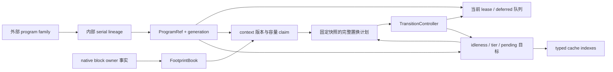

## MORI 分支、容量与 sticky placement 重构设计

本文记录 2026-10-28 已落地重构的完整设计、取舍与验收边界。目标是共同解决重叠上下文、迁移抖动、容量误计与逐候选重复扫描，
同时保留“已授权 Reasoning 结束后才能提交降层”的契约。当前源码对应 `d4af0d1e25ec4e94d13816a536b07b9fcb24c0fc`；
逐组件的现行行为与部署说明另见 [实现走读](https://github.com/potatoZhx/agent-infer/blob/codex/mori-formal/design/module/scheduling/mori-implementation.zh-CN.md)。
实现和回归证据：[agentinfer/scheduling/lineage.py:14-72](https://github.com/potatoZhx/agent-infer/blob/d4af0d1e25ec4e94d13816a536b07b9fcb24c0fc/agentinfer/scheduling/lineage.py#L14-L72)、[agentinfer/scheduling/mori/strategy.py:223-345](https://github.com/potatoZhx/agent-infer/blob/d4af0d1e25ec4e94d13816a536b07b9fcb24c0fc/agentinfer/scheduling/mori/strategy.py#L223-L345)、[tests/scheduling/test_mori_capacity.py:23-134](https://github.com/potatoZhx/agent-infer/blob/d4af0d1e25ec4e94d13816a536b07b9fcb24c0fc/tests/scheduling/test_mori_capacity.py#L23-L134)、[tests/scheduling/test_mori_lineages.py:32-256](https://github.com/potatoZhx/agent-infer/blob/d4af0d1e25ec4e94d13816a536b07b9fcb24c0fc/tests/scheduling/test_mori_lineages.py#L32-L256)。

本文在 Git 保存为 `design/module/scheduling/mori-redesign-20261028.zh-CN.md`，本地镜像保存为
`/data/zx/agent-kvc/research/studies/kvc_theory/mori-real-v031-20261022/MORI-REDESIGN-20261028.zh-CN.md`。
代码和仓库证据链接固定到上述提交；所有性能假设与已取得的验证结果分开标注。

## 1. 基线与问题之间的耦合

本次输入不是一个干净的旧 HEAD：它是 `c714745d682f77409cbb8666587a70eef18246f3` 加上实验阶段的工作区修改。
原差异已冻结为 `before.patch`，SHA-256 为 `9750d2702d11ca912ca16883b5cc4d7d40a419858a77d3d01d2d0a82ad6d88f8`。
旧问题必须对照这一组合基线，不能链接当前文件的旧行号，或把实验修改漏掉。
证据：[design/module/scheduling/artifacts/mori-redesign-20261028/baseline.json:1-6](https://github.com/potatoZhx/agent-infer/blob/d4af0d1e25ec4e94d13816a536b07b9fcb24c0fc/design/module/scheduling/artifacts/mori-redesign-20261028/baseline.json#L1-L6)、[design/module/scheduling/artifacts/mori-redesign-20261028/before.patch:85-250](https://github.com/potatoZhx/agent-infer/blob/d4af0d1e25ec4e94d13816a536b07b9fcb24c0fc/design/module/scheduling/artifacts/mori-redesign-20261028/before.patch#L85-L250)。

实验版把到达也接入 ranked selection，并在每个不 fit 候选上调用容量修复，再重新计算剩余空间。
这使唤醒更及时，但“有等待者”可能直接触发 Acting 回收；同一轮还会重复遍历 Programs 和预算。
这些是具体路径上的问题，不意味着事件驱动本身应被删除。
证据：[design/module/scheduling/artifacts/mori-redesign-20261028/before.patch:104-113](https://github.com/potatoZhx/agent-infer/blob/d4af0d1e25ec4e94d13816a536b07b9fcb24c0fc/design/module/scheduling/artifacts/mori-redesign-20261028/before.patch#L104-L113)、[design/module/scheduling/artifacts/mori-redesign-20261028/before.patch:164-247](https://github.com/potatoZhx/agent-infer/blob/d4af0d1e25ec4e94d13816a536b07b9fcb24c0fc/design/module/scheduling/artifacts/mori-redesign-20261028/before.patch#L164-L247)。

如果重叠请求共享一个 context/phase/tier，短请求完成就可能影响长请求的状态或预算；如果把它们简单拆开再完整求和，又可能重复收取共同 prefix。
即使修正计费，若 Reasoning 的预计释放被提前当作实际空余，新准入仍会过度承诺；若新请求不断延长同一个“正在排空”的 owner，等待者又可能没有进展。
因此身份、lease、联合容量和置换计划必须一起设计。相应回归反例与当前修复位置见
[tests/scheduling/test_mori_lineages.py:32-161](https://github.com/potatoZhx/agent-infer/blob/d4af0d1e25ec4e94d13816a536b07b9fcb24c0fc/tests/scheduling/test_mori_lineages.py#L32-L161)、[tests/scheduling/test_mori_capacity.py:23-112](https://github.com/potatoZhx/agent-infer/blob/d4af0d1e25ec4e94d13816a536b07b9fcb24c0fc/tests/scheduling/test_mori_capacity.py#L23-L112)、[agentinfer/scheduling/runtime.py:536-576](https://github.com/potatoZhx/agent-infer/blob/d4af0d1e25ec4e94d13816a536b07b9fcb24c0fc/agentinfer/scheduling/runtime.py#L536-L576)。

| 原问题 | 仅局部修改为什么不够 | 本次对应契约 |
| --- | --- | --- |
| 短工具间隙反复迁移 | 降低事件频率仍可能在每个 tick 回收 | 事件只唤醒；完整置换计划加稳定门槛 |
| 同身份重叠 | 对 context 取 max 仍混淆 phase、历史、终止与采用关系 | 独立 owner，明确串行 lineage |
| 容量上界与共享回收 | sum 过度收费，max 低估，完整减 victim 夸大 relief | 单层 union ledger 与边际回收 |
| Reasoning lazy demotion | 只看 phase 或无限等待同身份所有请求都不可靠 | 有限授权 lease，queued follower 不延长 drain |
| CPU 目标并发预留 | GPU 计划可同时把多个 victims 塞入同一剩余 CPU 空间 | pending CPU 目标进入账本 |
| 重复扫描 | 只缓存某个总和不能消除逐候选建计划 | 一轮固定快照、增量账本、最多一个新置换计划 |

对应实现：[agentinfer/scheduling/runtime.py:525-534](https://github.com/potatoZhx/agent-infer/blob/d4af0d1e25ec4e94d13816a536b07b9fcb24c0fc/agentinfer/scheduling/runtime.py#L525-L534)、[agentinfer/scheduling/mori/strategy.py:668-679](https://github.com/potatoZhx/agent-infer/blob/d4af0d1e25ec4e94d13816a536b07b9fcb24c0fc/agentinfer/scheduling/mori/strategy.py#L668-L679)、[agentinfer/scheduling/mori/strategy.py:223-345](https://github.com/potatoZhx/agent-infer/blob/d4af0d1e25ec4e94d13816a536b07b9fcb24c0fc/agentinfer/scheduling/mori/strategy.py#L223-L345)、[agentinfer/scheduling/mori/capacity.py:30-80](https://github.com/potatoZhx/agent-infer/blob/d4af0d1e25ec4e94d13816a536b07b9fcb24c0fc/agentinfer/scheduling/mori/capacity.py#L30-L80)。

## 2. 论文要求、隔离原型与工程增量

论文的串行 Program、容量驱动 sticky placement、Reasoning 结束后 lazy demotion 和分层 typed eviction 是保留的设计基线。
同业务身份任意并发、响应采用关系与下述 receipt/union 协议由本工程补充。论文还包含本次单 rank 接线未覆盖的路由与 batch 机制。
来源：[MORI，§3.1、§4.1–4.3、§5](https://arxiv.org/html/2606.00866v1)。

| 层面 | 采用的实现决定 | 工程边界与证据 |
| --- | --- | --- |
| Program | 一个内部 lineage 表示可连续统计的一条串行链 | 服务端不推断回答采用关系；[agentinfer/scheduling/lineage.py:27-43](https://github.com/potatoZhx/agent-infer/blob/d4af0d1e25ec4e94d13816a536b07b9fcb24c0fc/agentinfer/scheduling/lineage.py#L27-L43) |
| Sticky | 无压力无等待者保持；有需要时证明完整 plan，再置换 | 1 秒、0.05、30 秒是工程默认，非论文常数；[agentinfer/scheduling/mori/config.py:20-42](https://github.com/potatoZhx/agent-infer/blob/d4af0d1e25ec4e94d13816a536b07b9fcb24c0fc/agentinfer/scheduling/mori/config.py#L20-L42) |
| Lazy | 已授权请求结束或取消确认后提交 | 排队后继不属于当前 drain；[agentinfer/scheduling/runtime.py:536-576](https://github.com/potatoZhx/agent-infer/blob/d4af0d1e25ec4e94d13816a536b07b9fcb24c0fc/agentinfer/scheduling/runtime.py#L536-L576) |
| 分层预算 | 以原生可分配容量、真实量子和有效共享证据计费 | CPU promise 不等于完整 READY；[agentinfer/scheduling/mori/capacity.py:30-80](https://github.com/potatoZhx/agent-infer/blob/d4af0d1e25ec4e94d13816a536b07b9fcb24c0fc/agentinfer/scheduling/mori/capacity.py#L30-L80)、[agentinfer/scheduling/mori/strategy.py:657-666](https://github.com/potatoZhx/agent-infer/blob/d4af0d1e25ec4e94d13816a536b07b9fcb24c0fc/agentinfer/scheduling/mori/strategy.py#L657-L666) |
| Typed eviction | 同类 native LRU，HBM/CPU 使用不同类顺序 | 原生可驱逐性优先于建议；[agentinfer/agentcache/mori/hbm_policy.py:15-86](https://github.com/potatoZhx/agent-infer/blob/d4af0d1e25ec4e94d13816a536b07b9fcb24c0fc/agentinfer/agentcache/mori/hbm_policy.py#L15-L86)、[agentinfer/agentcache/mori/simple_cpu_policy.py:14-85](https://github.com/potatoZhx/agent-infer/blob/d4af0d1e25ec4e94d13816a536b07b9fcb24c0fc/agentinfer/agentcache/mori/simple_cpu_policy.py#L14-L85) |
| 多副本与 batch | 本次沿用单 embedded rank 和 native batch | 不宣称完整复刻论文系统；[agentinfer/agentcache/core/controller.py:103-142](https://github.com/potatoZhx/agent-infer/blob/d4af0d1e25ec4e94d13816a536b07b9fcb24c0fc/agentinfer/agentcache/core/controller.py#L103-L142)、[agentinfer/agentcache/core/scheduler.py:622-626](https://github.com/potatoZhx/agent-infer/blob/d4af0d1e25ec4e94d13816a536b07b9fcb24c0fc/agentinfer/agentcache/core/scheduler.py#L622-L626) |

隔离 MORI 已有 tier/idleness 排名与 CPU typed eviction，但旧 CPU 路径每次遍历 `_evictable`，即使用 bounded heap 也仍要访问全体 keys。
它能提供回放证据和 victim 顺序对照，不能替代线上未知重叠关系的 identity/lifecycle 协议。
隔离证据：
[/data/zx/agent-kvc/research/studies/kvc_theory/mori-reproduction-20261022/candidate/joint/mori.py:509–527](/data/zx/agent-kvc/research/studies/kvc_theory/mori-reproduction-20261022/candidate/joint/mori.py:509)、
[/data/zx/agent-kvc/research/studies/kvc_theory/mori-reproduction-20261022/candidate/joint/mori.py:720–765](/data/zx/agent-kvc/research/studies/kvc_theory/mori-reproduction-20261022/candidate/joint/mori.py:720)。
正式增量索引证据：[agentinfer/agentcache/mori/typed_lru.py:172-198](https://github.com/potatoZhx/agent-infer/blob/d4af0d1e25ec4e94d13816a536b07b9fcb24c0fc/agentinfer/agentcache/mori/typed_lru.py#L172-L198)、[agentinfer/agentcache/mori/typed_lru.py:225-286](https://github.com/potatoZhx/agent-infer/blob/d4af0d1e25ec4e94d13816a536b07b9fcb24c0fc/agentinfer/agentcache/mori/typed_lru.py#L225-L286)。

## 3. 状态与所有权契约



identity 决定“谁的历史”，lease 决定“谁仍不能迁移”，claim 决定“承诺多少”，footprint 决定“哪些共享已被证明”，native 决定“哪些副本实际可使用/驱逐”。
这些职责保持分离，避免把某层的观测当成另一层的事实。
证据：[agentinfer/scheduling/lineage.py:14-72](https://github.com/potatoZhx/agent-infer/blob/d4af0d1e25ec4e94d13816a536b07b9fcb24c0fc/agentinfer/scheduling/lineage.py#L14-L72)、[agentinfer/scheduling/runtime.py:525-534](https://github.com/potatoZhx/agent-infer/blob/d4af0d1e25ec4e94d13816a536b07b9fcb24c0fc/agentinfer/scheduling/runtime.py#L525-L534)、[agentinfer/scheduling/mori/capacity.py:23-27](https://github.com/potatoZhx/agent-infer/blob/d4af0d1e25ec4e94d13816a536b07b9fcb24c0fc/agentinfer/scheduling/mori/capacity.py#L23-L27)、[agentinfer/agentcache/mori/footprints.py:10-54](https://github.com/potatoZhx/agent-infer/blob/d4af0d1e25ec4e94d13816a536b07b9fcb24c0fc/agentinfer/agentcache/mori/footprints.py#L10-L54)、[agentinfer/agentcache/mori/runtime_state.py:24-121](https://github.com/potatoZhx/agent-infer/blob/d4af0d1e25ec4e94d13816a536b07b9fcb24c0fc/agentinfer/agentcache/mori/runtime_state.py#L24-L121)。

关键不变量：

1. 一个 lineage 同时最多一个授权请求；后继仅保留对象，不改当前 context/phase。
2. 旧 generation 与旧响应 receipt 不影响新 owner；临时分支不会建立虚构的父子阻塞边。
3. 降层标记不释放 GPU claim；提交 PAUSE 必须没有授权 lease。
4. pending CPU 目标提前计入 CPU 预算；所有共享移除按边际值计算。
5. 状态变化通过 runtime 校验并记入 transition ledger；策略不能直接修改 registry。
6. 事件只更新事实和期限；placement 由同一个规划路径决定。

证据：[agentinfer/scheduling/runtime.py:170-291](https://github.com/potatoZhx/agent-infer/blob/d4af0d1e25ec4e94d13816a536b07b9fcb24c0fc/agentinfer/scheduling/runtime.py#L170-L291)、[agentinfer/scheduling/runtime.py:682-743](https://github.com/potatoZhx/agent-infer/blob/d4af0d1e25ec4e94d13816a536b07b9fcb24c0fc/agentinfer/scheduling/runtime.py#L682-L743)、[agentinfer/scheduling/mori/strategy.py:668-679](https://github.com/potatoZhx/agent-infer/blob/d4af0d1e25ec4e94d13816a536b07b9fcb24c0fc/agentinfer/scheduling/mori/strategy.py#L668-L679)、[agentinfer/scheduling/transitions.py:102-169](https://github.com/potatoZhx/agent-infer/blob/d4af0d1e25ec4e94d13816a536b07b9fcb24c0fc/agentinfer/scheduling/transitions.py#L102-L169)。

## 4. 重叠请求与“哪个回答进入后续上下文”

### 4.1 选择显式 lineage，加默认临时分支

| 情形 | 设计选择 | 原因 |
| --- | --- | --- |
| 默认身份无未结束工作 | 延续默认串行 owner | 保持已有串行客户端语义 |
| 默认身份存在未结束工作 | 新建临时独立 owner | 不共享 context/phase，不猜主分支 |
| 提供稳定 `lineage_id` | 同名串行链，重叠请求入 deferred 队列 | 客户端明确声明需要延续哪一支 |
| 真正应用 subagent | 使用独立业务身份与显式 parent 关系 | 父子阻塞必须来自应用事实 |

证据：[agentinfer/scheduling/lineage.py:27-43](https://github.com/potatoZhx/agent-infer/blob/d4af0d1e25ec4e94d13816a536b07b9fcb24c0fc/agentinfer/scheduling/lineage.py#L27-L43)、[agentinfer/scheduling/runtime.py:170-291](https://github.com/potatoZhx/agent-infer/blob/d4af0d1e25ec4e94d13816a536b07b9fcb24c0fc/agentinfer/scheduling/runtime.py#L170-L291)、[tests/scheduling/test_mori_lineages.py:32-75](https://github.com/potatoZhx/agent-infer/blob/d4af0d1e25ec4e94d13816a536b07b9fcb24c0fc/tests/scheduling/test_mori_lineages.py#L32-L75)。

将默认重叠视为“类似 subagent 的独立 cache owner”是可行的；直接当作应用 subagent 则会错误增加父级阻塞和生命周期关系。
因此内部临时/named 分支清除自动 parent edge。临时分支结束即 release 保护；需要跨工具 gap 保留的分支通过显式 lineage 延续。
后续真实 prompt 是新工作集的唯一输入，可变长也可缩短；不从回答顺序、长度或缓存命中推测 adoption。
证据：[agentinfer/scheduling/lineage.py:27-43](https://github.com/potatoZhx/agent-infer/blob/d4af0d1e25ec4e94d13816a536b07b9fcb24c0fc/agentinfer/scheduling/lineage.py#L27-L43)、[agentinfer/scheduling/runtime.py:536-576](https://github.com/potatoZhx/agent-infer/blob/d4af0d1e25ec4e94d13816a536b07b9fcb24c0fc/agentinfer/scheduling/runtime.py#L536-L576)、[tests/scheduling/test_mori_lineages.py:48-59](https://github.com/potatoZhx/agent-infer/blob/d4af0d1e25ec4e94d13816a536b07b9fcb24c0fc/tests/scheduling/test_mori_lineages.py#L48-L59)。

### 4.2 生命周期和资源回收

API 为每次请求生成 receipt；runtime 只接受该 owner 最新且没有已接受工作的 terminal。
默认临时分支在完成/确认取消后自动 release；named owner 保留到合适的 terminal，再在 family 结束后回收内部槽位。
复用槽位时 generation 递增，旧回执/旧 native owner 不可复活。
证据：[agentinfer/agentcache/core/api_adapter.py:234-276](https://github.com/potatoZhx/agent-infer/blob/d4af0d1e25ec4e94d13816a536b07b9fcb24c0fc/agentinfer/agentcache/core/api_adapter.py#L234-L276)、[agentinfer/scheduling/runtime.py:589-599](https://github.com/potatoZhx/agent-infer/blob/d4af0d1e25ec4e94d13816a536b07b9fcb24c0fc/agentinfer/scheduling/runtime.py#L589-L599)、[agentinfer/scheduling/lineage.py:60-72](https://github.com/potatoZhx/agent-infer/blob/d4af0d1e25ec4e94d13816a536b07b9fcb24c0fc/agentinfer/scheduling/lineage.py#L60-L72)、[tests/scheduling/test_mori_lineages.py:195-256](https://github.com/potatoZhx/agent-infer/blob/d4af0d1e25ec4e94d13816a536b07b9fcb24c0fc/tests/scheduling/test_mori_lineages.py#L195-L256)。

CONTINUE/UNKNOWN 不强行结束 owner。MORI 没有把 Progress-TTL 的 timeout 搬成“业务结束”的判据；容量回收可把保护降到 WAITING，
但未必清理长期静默业务身份。best-effort terminal 的可靠投递/重试和闲置元数据 GC 是独立后续设计，不能靠把 overlap 命名为 subagent 自动获得。
证据：[agentinfer/scheduling/runtime.py:601-637](https://github.com/potatoZhx/agent-infer/blob/d4af0d1e25ec4e94d13816a536b07b9fcb24c0fc/agentinfer/scheduling/runtime.py#L601-L637)、[agentinfer/agentcache/core/api_adapter.py:169-222](https://github.com/potatoZhx/agent-infer/blob/d4af0d1e25ec4e94d13816a536b07b9fcb24c0fc/agentinfer/agentcache/core/api_adapter.py#L169-L222)、[agentinfer/scheduling/mori/strategy.py:748-771](https://github.com/potatoZhx/agent-infer/blob/d4af0d1e25ec4e94d13816a536b07b9fcb24c0fc/agentinfer/scheduling/mori/strategy.py#L748-L771)。

## 5. 有限 lease 和降层提交协议

### 5.1 状态转换

| 状态/事件 | 可执行动作 | 禁止动作 |
| --- | --- | --- |
| Acting 且无授权请求 | 立即提交合法降层 | 把 retained/deferred 请求当作已经运行 |
| Reasoning 已授权 | 标记 pending destination，阻止新增授权 | 减少实际 GPU claim 或立即 PAUSE |
| 原生完成或取消确认 | 结束 lease，提交 pending，之后暴露下一队首 | 让队列后继延长本次 drain |
| 仅收到取消意图 | 保留 running binding，等待 native finish | 在模型仍使用 KV 时 release owner |
| 受益者已撤销 | 撤销尚未提交的软 pause 与目标预留 | 反向假装已经发生的物理复制被撤销 |

证据：[agentinfer/scheduling/runtime.py:525-534](https://github.com/potatoZhx/agent-infer/blob/d4af0d1e25ec4e94d13816a536b07b9fcb24c0fc/agentinfer/scheduling/runtime.py#L525-L534)、[agentinfer/scheduling/runtime.py:536-576](https://github.com/potatoZhx/agent-infer/blob/d4af0d1e25ec4e94d13816a536b07b9fcb24c0fc/agentinfer/scheduling/runtime.py#L536-L576)、[agentinfer/agentcache/core/scheduler.py:394-419](https://github.com/potatoZhx/agent-infer/blob/d4af0d1e25ec4e94d13816a536b07b9fcb24c0fc/agentinfer/agentcache/core/scheduler.py#L394-L419)、[agentinfer/scheduling/mori/strategy.py:352-383](https://github.com/potatoZhx/agent-infer/blob/d4af0d1e25ec4e94d13816a536b07b9fcb24c0fc/agentinfer/scheduling/mori/strategy.py#L352-L383)。

lease 包含“已准入但还在 native waiting”的请求，因为所有权已经交接，不能仅凭阶段观测撤销。
runtime 即使错误收到 Acting phase，仍会拒绝有授权请求的 PAUSE。尚未获得授权的新长 prompt 则可暂停重新申请容量。
证据：[tests/scheduling/test_mori_lineages.py:78-83](https://github.com/potatoZhx/agent-infer/blob/d4af0d1e25ec4e94d13816a536b07b9fcb24c0fc/tests/scheduling/test_mori_lineages.py#L78-L83)、[tests/scheduling/test_mori_lineages.py:86-96](https://github.com/potatoZhx/agent-infer/blob/d4af0d1e25ec4e94d13816a536b07b9fcb24c0fc/tests/scheduling/test_mori_lineages.py#L86-L96)、[tests/agentcache/core/test_mori_vllm_adapter.py:467-494](https://github.com/potatoZhx/agent-infer/blob/d4af0d1e25ec4e94d13816a536b07b9fcb24c0fc/tests/agentcache/core/test_mori_vllm_adapter.py#L467-L494)。

### 5.2 “完成后才能迁移”的精确承诺

本次保证的是逻辑 placement 提交与 GPU promise 释放。当前 eager D2H 可以在推理期间备份；它不触发 tier 变化。
MORI 不接管 native preemption，也不要求每次 CPU demotion 之前等待完整 CPU READY。
若未来要求严格物理迁移完成确认，需要另加源 pin、目标 reservation、copy submit、completion/failure、commit/rollback 的事务状态，当前没有实现这一套。
证据：[agentinfer/scheduling/mori/strategy.py:681-716](https://github.com/potatoZhx/agent-infer/blob/d4af0d1e25ec4e94d13816a536b07b9fcb24c0fc/agentinfer/scheduling/mori/strategy.py#L681-L716)、[agentinfer/scheduling/mori/strategy.py:668-679](https://github.com/potatoZhx/agent-infer/blob/d4af0d1e25ec4e94d13816a536b07b9fcb24c0fc/agentinfer/scheduling/mori/strategy.py#L668-L679)、[agentinfer/agentcache/patches/README.md:28-35](https://github.com/potatoZhx/agent-infer/blob/d4af0d1e25ec4e94d13816a536b07b9fcb24c0fc/agentinfer/agentcache/patches/README.md#L28-L35)、[design/module/scheduling/artifacts/mori-redesign-20261028/validation.json:114-121](https://github.com/potatoZhx/agent-infer/blob/d4af0d1e25ec4e94d13816a536b07b9fcb24c0fc/design/module/scheduling/artifacts/mori-redesign-20261028/validation.json#L114-L121)。

## 6. 共享容量与规划预算

### 6.1 上界和单 owner 计费

```text
C_gpu = (native_num_blocks - 1) × B
gpu_claim(T) = max(ceil_B(T), min(ceil_B(T + 100), C_gpu))
cpu_claim(T) = ceil_chunk(T)
```

原生 null block 不计入可分配预算；单请求 prompt 或已声明的 prompt+max_output 超界会拒绝。
单 KV group 使 token 等价计费成立，多 group 在启动时明确拒绝。100-token headroom 不是最大输出硬预留，不能消除所有 native preemption。
证据：[agentinfer/agentcache/core/scheduler.py:116-165](https://github.com/potatoZhx/agent-infer/blob/d4af0d1e25ec4e94d13816a536b07b9fcb24c0fc/agentinfer/agentcache/core/scheduler.py#L116-L165)、[agentinfer/agentcache/core/scheduler.py:167-214](https://github.com/potatoZhx/agent-infer/blob/d4af0d1e25ec4e94d13816a536b07b9fcb24c0fc/agentinfer/agentcache/core/scheduler.py#L167-L214)、[agentinfer/scheduling/mori/strategy.py:820-848](https://github.com/potatoZhx/agent-infer/blob/d4af0d1e25ec4e94d13816a536b07b9fcb24c0fc/agentinfer/scheduling/mori/strategy.py#L820-L848)。

### 6.2 共享证据与联合工作集

有效 footprint 必须来自 native 唯一 block owner 观测，按层与 generation 隔离。
新 prompt、remove/reuse、release、reset 撤销证明；证明超过当前 prompt 的可能大小时整体放弃。
已知部分按 union 收费，未知部分和未来增长余量按 owner 私有收费：

```text
used = Σ(claim_i - q × |K_i|) + q × |union(K_i)|
marginal_remove(i) = claim_i - q × |K_i 中仍被其他 owner 使用的块|
```

两个分支分别有 40、30 块，其中共享 20 块，则 context union=50；释放 40 块分支只产生 20 块的边际 relief。
这个例子不含额外 decode headroom；实际 planner 会分别叠加。不能直接从 hit tokens、refcount 或 max(context) 得到同样结论。
证据：[agentinfer/agentcache/mori/footprints.py:10-54](https://github.com/potatoZhx/agent-infer/blob/d4af0d1e25ec4e94d13816a536b07b9fcb24c0fc/agentinfer/agentcache/mori/footprints.py#L10-L54)、[agentinfer/scheduling/mori/strategy.py:657-666](https://github.com/potatoZhx/agent-infer/blob/d4af0d1e25ec4e94d13816a536b07b9fcb24c0fc/agentinfer/scheduling/mori/strategy.py#L657-L666)、[tests/scheduling/test_mori_capacity.py:23-87](https://github.com/potatoZhx/agent-infer/blob/d4af0d1e25ec4e94d13816a536b07b9fcb24c0fc/tests/scheduling/test_mori_capacity.py#L23-L87)。

### 6.3 实际账本与 projected ledger

GPU 实际 ledger 包含所有尚未提交降层的 GPU owner；CPU ledger 包含现有 CPU owner 与 pending CPU destinations。
projected ledger 只用于判断计划是否足够、避免硬债务重复挑选 victims。它不能授权等待者提前消耗空间。
CPU 预算不够时目标为 WAITING；CPU repair 可把已有或 pending CPU claim 放弃到 WAITING。
证据：[agentinfer/scheduling/mori/strategy.py:668-679](https://github.com/potatoZhx/agent-infer/blob/d4af0d1e25ec4e94d13816a536b07b9fcb24c0fc/agentinfer/scheduling/mori/strategy.py#L668-L679)、[agentinfer/scheduling/mori/strategy.py:681-716](https://github.com/potatoZhx/agent-infer/blob/d4af0d1e25ec4e94d13816a536b07b9fcb24c0fc/agentinfer/scheduling/mori/strategy.py#L681-L716)、[agentinfer/scheduling/mori/strategy.py:718-746](https://github.com/potatoZhx/agent-infer/blob/d4af0d1e25ec4e94d13816a536b07b9fcb24c0fc/agentinfer/scheduling/mori/strategy.py#L718-L746)、[agentinfer/scheduling/mori/strategy.py:748-771](https://github.com/potatoZhx/agent-infer/blob/d4af0d1e25ec4e94d13816a536b07b9fcb24c0fc/agentinfer/scheduling/mori/strategy.py#L748-L771)。

物理 resident、READY 和 pending transfers 单独观测。没有完善的 waiting-prompt 全局 hash 目录时，保守账本可能使有效并发低于理想值；
它是明确的可用性/精度取舍，优先避免无证据抵扣。下一步若建立预准入共享目录，必须保持 hash 生命周期、跨请求安全与 block 复用失效的同样契约。
依据：[agentinfer/scheduling/mori/strategy.py:657-666](https://github.com/potatoZhx/agent-infer/blob/d4af0d1e25ec4e94d13816a536b07b9fcb24c0fc/agentinfer/scheduling/mori/strategy.py#L657-L666)、[agentinfer/scheduling/mori/strategy.py:429-504](https://github.com/potatoZhx/agent-infer/blob/d4af0d1e25ec4e94d13816a536b07b9fcb24c0fc/agentinfer/scheduling/mori/strategy.py#L429-L504)、[design/module/scheduling/artifacts/mori-redesign-20261028/validation.json:114-121](https://github.com/potatoZhx/agent-infer/blob/d4af0d1e25ec4e94d13816a536b07b9fcb24c0fc/design/module/scheduling/artifacts/mori-redesign-20261028/validation.json#L114-L121)。

## 7. 事件唤醒与 sticky 统一规划

### 7.1 到达路径

到达先更新 identity/context 与 retained 请求。只有已有合法 GPU lease 预算仍足够，或没有其他待选者且现有 slack 足够时，才走直接准入。
到达不挑 victims；其余情况只入队、设置下一轮唤醒。stream growth 仅在含 headroom 的取整预算改变时唤醒。
证据：[agentinfer/scheduling/mori/strategy.py:141-209](https://github.com/potatoZhx/agent-infer/blob/d4af0d1e25ec4e94d13816a536b07b9fcb24c0fc/agentinfer/scheduling/mori/strategy.py#L141-L209)、[agentinfer/scheduling/mori/strategy.py:62-70](https://github.com/potatoZhx/agent-infer/blob/d4af0d1e25ec4e94d13816a536b07b9fcb24c0fc/agentinfer/scheduling/mori/strategy.py#L62-L70)。

### 7.2 周期算法

```text
now, snapshot = 本轮固定观测
撤销受益者已经失效的软 pause
修复 CPU 实际+pending 债务
规划 GPU 硬债务 relief；Reasoning claim 保持到完成
推进已接受 transitions 的快照
若 GPU 实际 ledger 仍超预算：结束 promotion
按受益者 / aged / 常规优先级排序候选
  尝试用实际 slack 准入可 fit 请求
  已有受益者还不能 fit 时停止回填
若仍有候选，且没有待完成的受益者计划：
  按 sticky/aged 条件收集并排序 victims
  在 projected union ledger 中尝试一个完整计划
  计划仍不能 fit：不提交部分置换，只安排下一次检查
  计划能 fit：保留受益者，提交 Acting pause / Reasoning mark
  若实际 relief 已足够：准入受益者；否则等完成事件
```

上面是行为摘要，不是独立执行器。实际 transition 结果由 runtime 接受后才更新计划，CPU/GPU repair 和 promotion 阶段通过快照推进衔接。
证据：[agentinfer/scheduling/runtime.py:293-317](https://github.com/potatoZhx/agent-infer/blob/d4af0d1e25ec4e94d13816a536b07b9fcb24c0fc/agentinfer/scheduling/runtime.py#L293-L317)、[agentinfer/scheduling/runtime.py:753-782](https://github.com/potatoZhx/agent-infer/blob/d4af0d1e25ec4e94d13816a536b07b9fcb24c0fc/agentinfer/scheduling/runtime.py#L753-L782)、[agentinfer/scheduling/mori/strategy.py:385-397](https://github.com/potatoZhx/agent-infer/blob/d4af0d1e25ec4e94d13816a536b07b9fcb24c0fc/agentinfer/scheduling/mori/strategy.py#L385-L397)、[agentinfer/scheduling/mori/strategy.py:223-345](https://github.com/potatoZhx/agent-infer/blob/d4af0d1e25ec4e94d13816a536b07b9fcb24c0fc/agentinfer/scheduling/mori/strategy.py#L223-L345)。

### 7.3 门槛、例外和公平性

普通置换只选 Acting owner，要求 `resident_age >= min_residency_seconds`，并满足以下至少一个条件：
相对 idleness 差达到 margin；或 GPU owner 全部 Acting 且该工具阶段持续达到稳定门槛。
aged 候选可越过这些限制，必要时选择 Reasoning 但仍 lazy；硬债务也不受普通稳定性约束。
证据：[agentinfer/scheduling/mori/strategy.py:275-326](https://github.com/potatoZhx/agent-infer/blob/d4af0d1e25ec4e94d13816a536b07b9fcb24c0fc/agentinfer/scheduling/mori/strategy.py#L275-L326)、[agentinfer/scheduling/mori/strategy.py:718-746](https://github.com/potatoZhx/agent-infer/blob/d4af0d1e25ec4e94d13816a536b07b9fcb24c0fc/agentinfer/scheduling/mori/strategy.py#L718-L746)。

| 参数 | 默认 | 防止误读 |
| --- | --- | --- |
| `min_residency_seconds` | 1.0 秒 | 从 promotion 起算；不是每次工具调用的一秒保护 |
| `idleness_margin` | 0.05 | 普通相对置换门槛；不是物理缓存命中率阈值 |
| `max_wait_seconds` | 30.0 秒 | 开启进展例外；不是绝对等待上界 |
| `window_size` | 5 | idleness 历史，包含当前部分 cycle |
| `decode_buffer_tokens` | 100，服务侧固定 | 预算余量，不能当成全输出担保 |

证据：[agentinfer/scheduling/mori/config.py:20-42](https://github.com/potatoZhx/agent-infer/blob/d4af0d1e25ec4e94d13816a536b07b9fcb24c0fc/agentinfer/scheduling/mori/config.py#L20-L42)、[agentinfer/agentcache/core/controller.py:103-142](https://github.com/potatoZhx/agent-infer/blob/d4af0d1e25ec4e94d13816a536b07b9fcb24c0fc/agentinfer/agentcache/core/controller.py#L103-L142)、[agentinfer/scheduling/mori/strategy.py:851-872](https://github.com/potatoZhx/agent-infer/blob/d4af0d1e25ec4e94d13816a536b07b9fcb24c0fc/agentinfer/scheduling/mori/strategy.py#L851-L872)。

受益者保护避免一边标记 Reasoning victim、一边让后到小请求占满释放的空间。
代价是 victim 还未结束时可能减少回填；只有 finite lease、候选可容纳、native 正常推进等条件成立时才有进展。
如果受益者取消，撤销其尚未提交的软降层和 CPU 目标预留；已提交的降层不反向恢复。
证据：[agentinfer/scheduling/mori/strategy.py:223-345](https://github.com/potatoZhx/agent-infer/blob/d4af0d1e25ec4e94d13816a536b07b9fcb24c0fc/agentinfer/scheduling/mori/strategy.py#L223-L345)、[agentinfer/scheduling/mori/strategy.py:352-383](https://github.com/potatoZhx/agent-infer/blob/d4af0d1e25ec4e94d13816a536b07b9fcb24c0fc/agentinfer/scheduling/mori/strategy.py#L352-L383)、[tests/scheduling/test_mori_lineages.py:180-192](https://github.com/potatoZhx/agent-infer/blob/d4af0d1e25ec4e94d13816a536b07b9fcb24c0fc/tests/scheduling/test_mori_lineages.py#L180-L192)。

## 8. 数据结构与复杂度预算

| 数据结构 | 操作与作用 | 成本边界 |
| --- | --- | --- |
| RequestPool owner 索引 | 只访问当前 owner 的 retained 请求 | 与该 owner 队列大小相关 |
| CapacityLedger | claim map + block Counter | add/remove 与本 claim 有效块数相关 |
| FootprintBook 双向索引 | owner/pool/block 的精确失效 | 与实际关联关系数量相关 |
| 单轮候选/victim 列表 | 固定时间排序、一次完整新计划 | 选择部分 `O(P log P + K)` |
| TypedLRU owner 反向索引 | tier 变更只访问拥有的 entries | `O(B_p log N)`，可能含 heap rebuild |
| 内部 lineage slot 池 | 复用完成临时/named 槽位 | 防止随累计完成请求无限生成内部 IDs |

证据：[agentinfer/scheduling/request_pool.py:49-133](https://github.com/potatoZhx/agent-infer/blob/d4af0d1e25ec4e94d13816a536b07b9fcb24c0fc/agentinfer/scheduling/request_pool.py#L49-L133)、[agentinfer/scheduling/mori/capacity.py:30-80](https://github.com/potatoZhx/agent-infer/blob/d4af0d1e25ec4e94d13816a536b07b9fcb24c0fc/agentinfer/scheduling/mori/capacity.py#L30-L80)、[agentinfer/agentcache/mori/footprints.py:10-54](https://github.com/potatoZhx/agent-infer/blob/d4af0d1e25ec4e94d13816a536b07b9fcb24c0fc/agentinfer/agentcache/mori/footprints.py#L10-L54)、[agentinfer/scheduling/mori/strategy.py:223-345](https://github.com/potatoZhx/agent-infer/blob/d4af0d1e25ec4e94d13816a536b07b9fcb24c0fc/agentinfer/scheduling/mori/strategy.py#L223-L345)、[agentinfer/agentcache/mori/typed_lru.py:172-198](https://github.com/potatoZhx/agent-infer/blob/d4af0d1e25ec4e94d13816a536b07b9fcb24c0fc/agentinfer/agentcache/mori/typed_lru.py#L172-L198)、[agentinfer/scheduling/lineage.py:60-72](https://github.com/potatoZhx/agent-infer/blob/d4af0d1e25ec4e94d13816a536b07b9fcb24c0fc/agentinfer/scheduling/lineage.py#L60-L72)。

P 为 live owners，K 为本轮遍历的有效 footprint 条目。上述选择成本不包括 native allocation、传输和全部 runtime bookkeeping。
到达仍建 snapshot/ledger，A 次到达累计可达 `O(A × (P + K))`；完成与 diagnostics 也存在全量遍历。
不使用永久不刷新的 idleness heap，因为即使没有新事件，Acting 时长也会改变相对顺序。
证据：[agentinfer/scheduling/mori/strategy.py:141-209](https://github.com/potatoZhx/agent-infer/blob/d4af0d1e25ec4e94d13816a536b07b9fcb24c0fc/agentinfer/scheduling/mori/strategy.py#L141-L209)、[agentinfer/scheduling/runtime.py:444-519](https://github.com/potatoZhx/agent-infer/blob/d4af0d1e25ec4e94d13816a536b07b9fcb24c0fc/agentinfer/scheduling/runtime.py#L444-L519)、[agentinfer/scheduling/mori/strategy.py:429-504](https://github.com/potatoZhx/agent-infer/blob/d4af0d1e25ec4e94d13816a536b07b9fcb24c0fc/agentinfer/scheduling/mori/strategy.py#L429-L504)、[agentinfer/scheduling/mori/strategy.py:851-872](https://github.com/potatoZhx/agent-infer/blob/d4af0d1e25ec4e94d13816a536b07b9fcb24c0fc/agentinfer/scheduling/mori/strategy.py#L851-L872)。

## 9. 备选方案与没有纳入本次的机制

| 方案 | 本次决定及原因 | 对应代码边界 |
| --- | --- | --- |
| 对重叠请求取 max(context) | 不采用；无法表达非完全共享分叉，也没隔离生命周期 | [agentinfer/scheduling/mori/capacity.py:30-80](https://github.com/potatoZhx/agent-infer/blob/d4af0d1e25ec4e94d13816a536b07b9fcb24c0fc/agentinfer/scheduling/mori/capacity.py#L30-L80)、[agentinfer/scheduling/lineage.py:14-72](https://github.com/potatoZhx/agent-infer/blob/d4af0d1e25ec4e94d13816a536b07b9fcb24c0fc/agentinfer/scheduling/lineage.py#L14-L72) |
| 所有请求完整 context 求和 | 保留为无证据时的保守退路；有效 native proof 可抵扣 | [agentinfer/scheduling/mori/strategy.py:657-666](https://github.com/potatoZhx/agent-infer/blob/d4af0d1e25ec4e94d13816a536b07b9fcb24c0fc/agentinfer/scheduling/mori/strategy.py#L657-L666) |
| 直接减 prefix hit tokens | 不采用；不能证明多个 owner 的全局唯一块关系 | [agentinfer/agentcache/mori/footprints.py:10-54](https://github.com/potatoZhx/agent-infer/blob/d4af0d1e25ec4e94d13816a536b07b9fcb24c0fc/agentinfer/agentcache/mori/footprints.py#L10-L54) |
| 所有 overlap 自动成为应用 subagent | 不采用；服务端不知道父子依赖与返回采用 | [agentinfer/scheduling/lineage.py:27-43](https://github.com/potatoZhx/agent-infer/blob/d4af0d1e25ec4e94d13816a536b07b9fcb24c0fc/agentinfer/scheduling/lineage.py#L27-L43) |
| 关掉事件驱动，只用长周期 | 不采用；延迟响应容量/完成事实且不消除错误迁移条件 | [agentinfer/scheduling/mori/strategy.py:422-427](https://github.com/potatoZhx/agent-infer/blob/d4af0d1e25ec4e94d13816a536b07b9fcb24c0fc/agentinfer/scheduling/mori/strategy.py#L422-L427) |
| 只在硬债务时回收 | 不采用为唯一规则；等待者也需可解释的进展通道 | [agentinfer/scheduling/mori/strategy.py:223-345](https://github.com/potatoZhx/agent-infer/blob/d4af0d1e25ec4e94d13816a536b07b9fcb24c0fc/agentinfer/scheduling/mori/strategy.py#L223-L345) |
| 每候选构造独立全量 plan | 不采用；重复扫描并可能部分驱逐却无法运行 | [agentinfer/scheduling/mori/strategy.py:223-345](https://github.com/potatoZhx/agent-infer/blob/d4af0d1e25ec4e94d13816a536b07b9fcb24c0fc/agentinfer/scheduling/mori/strategy.py#L223-L345) |
| 直接切换 native lazy offload | 延后；须同时设计 CPU READY 与迁移失败协议 | [agentinfer/agentcache/patches/README.md:28-35](https://github.com/potatoZhx/agent-infer/blob/d4af0d1e25ec4e94d13816a536b07b9fcb24c0fc/agentinfer/agentcache/patches/README.md#L28-L35) |
| 把所有状态放后台线程 | 延后；先维持 engine 单写者的 native 安全边界 | [agentinfer/agentcache/mori/typed_lru.py:34-43](https://github.com/potatoZhx/agent-infer/blob/d4af0d1e25ec4e94d13816a536b07b9fcb24c0fc/agentinfer/agentcache/mori/typed_lru.py#L34-L43) |
| 跨副本路由、改造 token batch | 不纳入单 rank 重构 | [agentinfer/agentcache/core/controller.py:103-142](https://github.com/potatoZhx/agent-infer/blob/d4af0d1e25ec4e94d13816a536b07b9fcb24c0fc/agentinfer/agentcache/core/controller.py#L103-L142)、[agentinfer/agentcache/core/scheduler.py:622-626](https://github.com/potatoZhx/agent-infer/blob/d4af0d1e25ec4e94d13816a536b07b9fcb24c0fc/agentinfer/agentcache/core/scheduler.py#L622-L626) |

## 10. 实现落点和兼容性

| 层次 | 修改落点与责任 |
| --- | --- |
| 请求协议 | [agentinfer/scheduling/identity.py:28-95](https://github.com/potatoZhx/agent-infer/blob/d4af0d1e25ec4e94d13816a536b07b9fcb24c0fc/agentinfer/scheduling/identity.py#L28-L95)、[agentinfer/agentcache/core/api_adapter.py:234-276](https://github.com/potatoZhx/agent-infer/blob/d4af0d1e25ec4e94d13816a536b07b9fcb24c0fc/agentinfer/agentcache/core/api_adapter.py#L234-L276)：可选 lineage，服务端 receipt |
| 分支管理 | [agentinfer/scheduling/lineage.py:14-72](https://github.com/potatoZhx/agent-infer/blob/d4af0d1e25ec4e94d13816a536b07b9fcb24c0fc/agentinfer/scheduling/lineage.py#L14-L72)：临时/显式链与槽位回收 |
| Runtime | [agentinfer/scheduling/runtime.py:170-291](https://github.com/potatoZhx/agent-infer/blob/d4af0d1e25ec4e94d13816a536b07b9fcb24c0fc/agentinfer/scheduling/runtime.py#L170-L291)、[agentinfer/scheduling/runtime.py:536-576](https://github.com/potatoZhx/agent-infer/blob/d4af0d1e25ec4e94d13816a536b07b9fcb24c0fc/agentinfer/scheduling/runtime.py#L536-L576)：deferred、finite lease、真实 prompt 替换 |
| 原生 bridge | [agentinfer/agentcache/core/scheduler.py:167-214](https://github.com/potatoZhx/agent-infer/blob/d4af0d1e25ec4e94d13816a536b07b9fcb24c0fc/agentinfer/agentcache/core/scheduler.py#L167-L214)、[agentinfer/agentcache/core/scheduler.py:394-419](https://github.com/potatoZhx/agent-infer/blob/d4af0d1e25ec4e94d13816a536b07b9fcb24c0fc/agentinfer/agentcache/core/scheduler.py#L394-L419)：容量上界与取消确认 |
| Placement | [agentinfer/scheduling/mori/strategy.py:223-345](https://github.com/potatoZhx/agent-infer/blob/d4af0d1e25ec4e94d13816a536b07b9fcb24c0fc/agentinfer/scheduling/mori/strategy.py#L223-L345)、[agentinfer/scheduling/mori/strategy.py:718-746](https://github.com/potatoZhx/agent-infer/blob/d4af0d1e25ec4e94d13816a536b07b9fcb24c0fc/agentinfer/scheduling/mori/strategy.py#L718-L746)：sticky、受益者和债务 |
| Capacity | [agentinfer/scheduling/mori/capacity.py:30-80](https://github.com/potatoZhx/agent-infer/blob/d4af0d1e25ec4e94d13816a536b07b9fcb24c0fc/agentinfer/scheduling/mori/capacity.py#L30-L80)、[agentinfer/agentcache/mori/footprints.py:10-54](https://github.com/potatoZhx/agent-infer/blob/d4af0d1e25ec4e94d13816a536b07b9fcb24c0fc/agentinfer/agentcache/mori/footprints.py#L10-L54)：联合计费与失效 |
| Cache 接线 | [agentinfer/agentcache/mori/runtime_state.py:24-121](https://github.com/potatoZhx/agent-infer/blob/d4af0d1e25ec4e94d13816a536b07b9fcb24c0fc/agentinfer/agentcache/mori/runtime_state.py#L24-L121)、[agentinfer/agentcache/mori/hbm_policy.py:15-86](https://github.com/potatoZhx/agent-infer/blob/d4af0d1e25ec4e94d13816a536b07b9fcb24c0fc/agentinfer/agentcache/mori/hbm_policy.py#L15-L86)、[agentinfer/agentcache/mori/simple_cpu_policy.py:14-85](https://github.com/potatoZhx/agent-infer/blob/d4af0d1e25ec4e94d13816a536b07b9fcb24c0fc/agentinfer/agentcache/mori/simple_cpu_policy.py#L14-L85)：owner proof 与 class observers |
| 配置 | [agentinfer/scheduling/mori/config.py:20-42](https://github.com/potatoZhx/agent-infer/blob/d4af0d1e25ec4e94d13816a536b07b9fcb24c0fc/agentinfer/scheduling/mori/config.py#L20-L42)、[agentinfer/agentcache/core/controller.py:103-142](https://github.com/potatoZhx/agent-infer/blob/d4af0d1e25ec4e94d13816a536b07b9fcb24c0fc/agentinfer/agentcache/core/controller.py#L103-L142)：稳定性参数校验与固定值拒绝 |

没有 lineage 的串行客户端继续使用默认链；默认重叠行为变成临时独立 owner，而显式相同 lineage 的并发会串行化。
想继续某个重叠分支的客户端应提供稳定 lineage。旧 `starvation_timeout_seconds` 不再是合法配置；用户配置应使用 `max_wait_seconds`。
Progress-TTL 通过策略能力分支保持原有路径，新 runtime 的共享改动仍需运行其回归。
证据：[agentinfer/scheduling/runtime.py:170-291](https://github.com/potatoZhx/agent-infer/blob/d4af0d1e25ec4e94d13816a536b07b9fcb24c0fc/agentinfer/scheduling/runtime.py#L170-L291)、[agentinfer/agentcache/core/controller.py:103-145](https://github.com/potatoZhx/agent-infer/blob/d4af0d1e25ec4e94d13816a536b07b9fcb24c0fc/agentinfer/agentcache/core/controller.py#L103-L145)、[design/module/scheduling/artifacts/mori-redesign-20261028/validation.json:24-44](https://github.com/potatoZhx/agent-infer/blob/d4af0d1e25ec4e94d13816a536b07b9fcb24c0fc/design/module/scheduling/artifacts/mori-redesign-20261028/validation.json#L24-L44)。

## 11. 验收矩阵与已取得证据

| 不变量 | 回归证据 |
| --- | --- |
| 短重叠完成不污染长工作集/phase | [tests/scheduling/test_mori_lineages.py:32-45](https://github.com/potatoZhx/agent-infer/blob/d4af0d1e25ec4e94d13816a536b07b9fcb24c0fc/tests/scheduling/test_mori_lineages.py#L32-L45) |
| 同 lineage 串行，下一真实 prompt 可缩短 | [tests/scheduling/test_mori_lineages.py:48-59](https://github.com/potatoZhx/agent-infer/blob/d4af0d1e25ec4e94d13816a536b07b9fcb24c0fc/tests/scheduling/test_mori_lineages.py#L48-L59) |
| phase 错误仍不能暂停执行 lease | [tests/scheduling/test_mori_lineages.py:78-83](https://github.com/potatoZhx/agent-infer/blob/d4af0d1e25ec4e94d13816a536b07b9fcb24c0fc/tests/scheduling/test_mori_lineages.py#L78-L83) |
| drain 不包含 deferred，后到请求不延长 | [tests/scheduling/test_mori_lineages.py:113-134](https://github.com/potatoZhx/agent-infer/blob/d4af0d1e25ec4e94d13816a536b07b9fcb24c0fc/tests/scheduling/test_mori_lineages.py#L113-L134) |
| 取消已运行请求需 native 确认 | [tests/agentcache/core/test_mori_vllm_adapter.py:467-494](https://github.com/potatoZhx/agent-infer/blob/d4af0d1e25ec4e94d13816a536b07b9fcb24c0fc/tests/agentcache/core/test_mori_vllm_adapter.py#L467-L494) |
| 短 Acting 保持 sticky，之后允许进展 | [tests/scheduling/test_mori_lineages.py:164-177](https://github.com/potatoZhx/agent-infer/blob/d4af0d1e25ec4e94d13816a536b07b9fcb24c0fc/tests/scheduling/test_mori_lineages.py#L164-L177) |
| 受益者取消撤销未提交置换 | [tests/scheduling/test_mori_lineages.py:180-192](https://github.com/potatoZhx/agent-infer/blob/d4af0d1e25ec4e94d13816a536b07b9fcb24c0fc/tests/scheduling/test_mori_lineages.py#L180-L192) |
| 旧 terminal 不结束新上下文 | [tests/scheduling/test_mori_lineages.py:195-206](https://github.com/potatoZhx/agent-infer/blob/d4af0d1e25ec4e94d13816a536b07b9fcb24c0fc/tests/scheduling/test_mori_lineages.py#L195-L206) |
| null block、prompt+output 上界 | [tests/agentcache/core/test_mori_vllm_adapter.py:498-521](https://github.com/potatoZhx/agent-infer/blob/d4af0d1e25ec4e94d13816a536b07b9fcb24c0fc/tests/agentcache/core/test_mori_vllm_adapter.py#L498-L521) |
| union 与边际回收匹配 brute force | [tests/scheduling/test_mori_capacity.py:23-50](https://github.com/potatoZhx/agent-infer/blob/d4af0d1e25ec4e94d13816a536b07b9fcb24c0fc/tests/scheduling/test_mori_capacity.py#L23-L50)、[tests/scheduling/test_mori_capacity.py:90-112](https://github.com/potatoZhx/agent-infer/blob/d4af0d1e25ec4e94d13816a536b07b9fcb24c0fc/tests/scheduling/test_mori_capacity.py#L90-L112) |
| block 复用和 prompt 替换撤销 proof | [tests/scheduling/test_mori_capacity.py:53-87](https://github.com/potatoZhx/agent-infer/blob/d4af0d1e25ec4e94d13816a536b07b9fcb24c0fc/tests/scheduling/test_mori_capacity.py#L53-L87) |
| 增长唤醒包含 decode headroom 边界 | [tests/scheduling/test_mori_lineages.py:99-110](https://github.com/potatoZhx/agent-infer/blob/d4af0d1e25ec4e94d13816a536b07b9fcb24c0fc/tests/scheduling/test_mori_lineages.py#L99-L110) |
| 不 fit 等待者不再引发平方级 factor 读取 | [tests/scheduling/test_mori_capacity.py:115-134](https://github.com/potatoZhx/agent-infer/blob/d4af0d1e25ec4e94d13816a536b07b9fcb24c0fc/tests/scheduling/test_mori_capacity.py#L115-L134) |
| 内部槽位复用且 generation 防迟到事件 | [tests/scheduling/test_mori_lineages.py:62-75](https://github.com/potatoZhx/agent-infer/blob/d4af0d1e25ec4e94d13816a536b07b9fcb24c0fc/tests/scheduling/test_mori_lineages.py#L62-L75)、[tests/scheduling/test_mori_lineages.py:238-256](https://github.com/potatoZhx/agent-infer/blob/d4af0d1e25ec4e94d13816a536b07b9fcb24c0fc/tests/scheduling/test_mori_lineages.py#L238-L256) |

已记录的精确命令：

```bash
MORI_VLLM_SOURCE=/tmp/mori-review-fixes-20261027/upstream PYTHONPATH=. \
  python -m pytest -q tests/scheduling tests/agentcache -m 'not gpu_test'
MORI_VLLM_SOURCE=/tmp/mori-review-fixes-20261027/upstream PYTHONPATH=. \
  /data/zx-envs/agentinfer-vllm-0.31.0/bin/python -m pytest -q tests/scheduling tests/agentcache -m 'not gpu_test'
PYTHONPATH=. python -m pytest -q tests/agentbench/request_proxy -m 'not gpu_test'
pre-commit run --all-files
PYTHONPATH=. python design/module/scheduling/artifacts/mori-redesign-20261028/probe_scaling.py
```

两套 scheduling/agentcache 环境均为 415 passed、5 GPU tests deselected；request proxy 为 41 passed；适用静态检查通过。
验证目录保留 baseline、原始 patch、候选文件 hash、源码索引、原始测试日志和 scaling 样本，不只保存摘要。
命令、环境和 raw log 路径：[design/module/scheduling/artifacts/mori-redesign-20261028/validation.json:1-80](https://github.com/potatoZhx/agent-infer/blob/d4af0d1e25ec4e94d13816a536b07b9fcb24c0fc/design/module/scheduling/artifacts/mori-redesign-20261028/validation.json#L1-L80)；实现期间复审修复记录：[design/module/scheduling/artifacts/mori-redesign-20261028/validation.json:107-113](https://github.com/potatoZhx/agent-infer/blob/d4af0d1e25ec4e94d13816a536b07b9fcb24c0fc/design/module/scheduling/artifacts/mori-redesign-20261028/validation.json#L107-L113)。

CPU 探针在 64/128/256/512 等待者下读取 389/773/1541/3077 次 factors，中位线程时间为 0.419393/0.767241/1.491170/2.885365 ms，每组 3 个样本。
这验证特定规划路径的增长形态，不能证明整个服务吞吐提高。历史 typed-LRU benchmark 也只证明其受控 CPU 路径，不能替代本次验证。
证据：[design/module/scheduling/artifacts/mori-redesign-20261028/scaling.json:1-86](https://github.com/potatoZhx/agent-infer/blob/d4af0d1e25ec4e94d13816a536b07b9fcb24c0fc/design/module/scheduling/artifacts/mori-redesign-20261028/scaling.json#L1-L86)、[design/module/scheduling/mori-performance.md:1-73](https://github.com/potatoZhx/agent-infer/blob/d4af0d1e25ec4e94d13816a536b07b9fcb24c0fc/design/module/scheduling/mori-performance.md#L1-L73)。

## 12. 未完成验证与后续实验设计

本次实现回执明确没有新的 GPU/E2E benchmark；当时的暂停原因保留在回执中。
这份设计文档不改变任何实验任务的状态，也不推断其他研究目录后来是否执行过 GPU 运行。
关联后续实验前，先核对 code revision、native patch、配置、输入/生成口径与实际运行日志。
证据：[design/module/scheduling/artifacts/mori-redesign-20261028/validation.json:82-88](https://github.com/potatoZhx/agent-infer/blob/d4af0d1e25ec4e94d13816a536b07b9fcb24c0fc/design/module/scheduling/artifacts/mori-redesign-20261028/validation.json#L82-L88)、[design/module/scheduling/artifacts/mori-redesign-20261028/validation.json:114-121](https://github.com/potatoZhx/agent-infer/blob/d4af0d1e25ec4e94d13816a536b07b9fcb24c0fc/design/module/scheduling/artifacts/mori-redesign-20261028/validation.json#L114-L121)。

以下为后续验证方案，尚不是已执行结果：

| 比较或消融 | 固定条件 | 应收集的证据与要回答的问题 |
| --- | --- | --- |
| 冷启动 baseline / 当前 MORI | 模型、native build、有效 GPU/CPU 容量、任务输入和并发 | makespan、TTFT/JCT、正确率；避免只优化 cache ratio |
| 周期与事件唤醒 | placement 条件不变 | 入队到准入分段、cycle 次数、决策 CPU；区分及时性与扫描成本 |
| sticky 门槛与 aged 例外 | 输入与容量不变 | 逻辑迁移次数、实际往返字节、驻留/工具间隙、等待尾部 |
| 共享证明抵扣 | 同一 owner/请求结构 | 逻辑 claim、物理使用、未证明比例、并发和重算 |
| 默认临时链 / 显式 lineage | 明确业务允许的依赖 | 续接命中、串行化成本、上下文正确性；不能任意改变任务语义 |
| CPU backup 行为 | 独立实现 readiness/失败协议后再比较 | 无效 D2H、CPU READY 覆盖、H2D、source pin 时间 |
| 高并发短请求 | 参数与生成长度受控 | arrival/completion/diagnostics/native hook 分路径 CPU |
| 故障与取消压力 | 相同合法工作量 | delayed terminal、重复回执、cancel ack、block reuse、无悬挂 lease |

记录必须包含命令、源码与配置摘要、原始事件/metrics、解析脚本和汇总；命中用一致分母，传输用实际字节与在途时长。
重点区分“逻辑降层减少”“实际复制减少”“重算减少”“吞吐改善”，四者没有自动等价关系。
这些实验的机制依据：[agentinfer/scheduling/mori/strategy.py:429-504](https://github.com/potatoZhx/agent-infer/blob/d4af0d1e25ec4e94d13816a536b07b9fcb24c0fc/agentinfer/scheduling/mori/strategy.py#L429-L504)、[agentinfer/scheduling/mori/strategy.py:223-345](https://github.com/potatoZhx/agent-infer/blob/d4af0d1e25ec4e94d13816a536b07b9fcb24c0fc/agentinfer/scheduling/mori/strategy.py#L223-L345)、[agentinfer/agentcache/mori/vllm_adapter.py:69-102](https://github.com/potatoZhx/agent-infer/blob/d4af0d1e25ec4e94d13816a536b07b9fcb24c0fc/agentinfer/agentcache/mori/vllm_adapter.py#L69-L102)、[design/module/scheduling/artifacts/mori-redesign-20261028/validation.json:82-121](https://github.com/potatoZhx/agent-infer/blob/d4af0d1e25ec4e94d13816a536b07b9fcb24c0fc/design/module/scheduling/artifacts/mori-redesign-20261028/validation.json#L82-L121)。

## 13. 推进与回退边界

本次源码已包含上述重构，CPU 回归已记录；文档不把未测门槛宣称为调优最优值。
部署需使用匹配 vLLM patches、单 KV group 和有效配额；先保留可复现配置，再运行下一轮对照。
启动 capability 不符应直接失败；运行时非法 victim advice 可按原生验证回退 LRU，但必须计数，不能隐藏为 MORI 正常生效。
证据：[agentinfer/agentcache/mori/vllm_adapter.py:105-200](https://github.com/potatoZhx/agent-infer/blob/d4af0d1e25ec4e94d13816a536b07b9fcb24c0fc/agentinfer/agentcache/mori/vllm_adapter.py#L105-L200)、[agentinfer/agentcache/core/scheduler.py:116-165](https://github.com/potatoZhx/agent-infer/blob/d4af0d1e25ec4e94d13816a536b07b9fcb24c0fc/agentinfer/agentcache/core/scheduler.py#L116-L165)、[agentinfer/agentcache/patches/vllm-0.31-mori-hbm-provider.patch:58-108](https://github.com/potatoZhx/agent-infer/blob/d4af0d1e25ec4e94d13816a536b07b9fcb24c0fc/agentinfer/agentcache/patches/vllm-0.31-mori-hbm-provider.patch#L58-L108)。

`placement_only` 可隔离 typed eviction 的影响，但没有 full CPU 保护语义，不能当作同一算法的透明故障回退。
如果回退旧版源码，还应同步恢复其匹配配置与 lifecycle 协议，不能把新 lineage 客户端依赖无条件套到旧实现上。
依据：[agentinfer/agentcache/mori/vllm_adapter.py:105-200](https://github.com/potatoZhx/agent-infer/blob/d4af0d1e25ec4e94d13816a536b07b9fcb24c0fc/agentinfer/agentcache/mori/vllm_adapter.py#L105-L200)、[agentinfer/agentcache/core/controller.py:103-142](https://github.com/potatoZhx/agent-infer/blob/d4af0d1e25ec4e94d13816a536b07b9fcb24c0fc/agentinfer/agentcache/core/controller.py#L103-L142)、[agentinfer/scheduling/identity.py:28-95](https://github.com/potatoZhx/agent-infer/blob/d4af0d1e25ec4e94d13816a536b07b9fcb24c0fc/agentinfer/scheduling/identity.py#L28-L95)。
