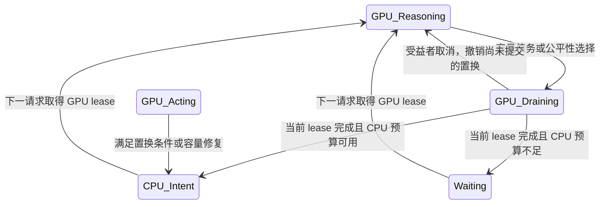

# MORI 分支、容量和 sticky placement 重构 — 2026-10-28

状态：重构已实现，CPU 验证与复审见下文；本文追加设计，不改写历史实验结论。源码基线及原实验 diff
保存在 `artifacts/mori-redesign-20261028/baseline.json`、`before.patch`。

## 问题与边界

旧实现把重叠请求绑定到同一个 context/tier/phase，完成时覆盖 context；ACTIVE
快捷路径可延长待降层推理，逐候选回收重复扫描全集。
证据（重构前）：[agentinfer/scheduling/runtime.py:163-207,394-409,588-591](/data/zx/agent-kvc/.worktrees/mori/agentinfer/scheduling/runtime.py:163)、
[agentinfer/scheduling/mori/strategy.py:106-116,179-222,449-615](/data/zx/agent-kvc/.worktrees/mori/agentinfer/scheduling/mori/strategy.py:106)。

论文 §3.1 的串行前缀增长 Program、§4.3 的 sticky/容量驱动与 lazy demotion 是基线：
<https://arxiv.org/html/2606.00866v1> 。论文未规定任意重叠请求的上下文继承、共享块
计费和迁移确认协议。以下并发分支、稳定性阈值、公平性机制属于工程扩展。

## 实现契约

1. 外部 Program 保留业务身份；内部 lineage 是独立调度/缓存 owner。显式
   `lineage_id` 表示可延续的串行推理链；同 lineage 重叠请求排队。没有 lineage
   时默认串行链继续存在，重叠请求成为临时、不阻塞父级的独立分支，完成后释放
   保护但不强制销毁 native 缓存。不能从请求名称、完成顺序或长度推断主分支。
2. 后续真实 prompt 决定新的工作集；完成只更新自己的分支。用户若需要保留并
   延续重叠分支，应提供稳定 lineage。默认临时分支不能保证未来 cache protection。
3. 每个 lineage 至多一个已授权请求；已排队请求不计入正在执行的 drain 集合。
   降层标记阻止新增授权，已有 Reasoning 完成或取消后才提交 CPU/Waiting。
   新请求不能延长 drain；完成、取消、终止和迟到事件必须按 generation 处理。
4. 事件负责更新和唤醒，统一规划负责 placement。合法驻留在无压力时保持；
   硬容量债务必须修复，等待者置换需要驻留稳定性、相对 idleness 或公平性条件。
   先证明完整计划能使请求进展，再提交 victim；容量受益者不能被后到工作反复挤走。
5. 有效容量从 native 可分配 pool 取得，扣除 null block；单位为实际 block/chunk。
   每个分支完整 context 与 decode headroom 保守计费。共享只在 native 唯一块
   证据有效时抵扣；无证据则不抵扣。逻辑承诺、驻留副本、在途传输分开观察。
6. Reasoning 完成前不能提交降层或兑现 GPU 释放；现有 eager D2H 是备份，
   不代表降层。native 继续负责 refcount、传输 fence、驱逐合法性及分配。
   CPU 意图不是 CPU_READY 保证，缓存覆盖未知/缺失时允许 native 重算。
7. 每轮固定时间和快照，各规划阶段预算计算一次，候选/victim 各排序一次，以单轮完整计划
   选择 victim；请求队列按 owner 索引。复杂度目标为 O(P log P) 加实际块/owner 变更。
   idleness 随时间变化，不能使用永不刷新的排序堆。

## 组件和数据流

`AgentIdentity` -> 分支解析/串行队列 -> `ProgramRegistry` 独立 owner ->
MORI 预算与迁移计划 -> 请求授权 -> native。
native owner/readiness/transfer snapshot -> 物理观测；生命周期/完成 -> 排空与下一轮唤醒。
Progress-TTL 保留原语义，通过策略能力选择 MORI 的分支处理路径。

配置在 `agentinfer/scheduling/mori/config.py` 定义，经
`agentinfer/agentcache/core/controller.py` 校验。维护周期与事件唤醒独立；稳定性和
等待进展参数必须有单位、有限值校验，并在 diagnostics 记录触发原因。

## 取舍

- 不采用全局 max(context)：不能表达分叉的联合工作集。
- 不直接扣 shared_prefix_tokens：命中观测不是全局唯一块容量承诺。
- 不把重叠默认映射为应用 subagent：服务端不知道业务依赖，也不能阻塞父级。
- 不在本次直接切换 native lazy_offload：现有 full 接线要求 eager，先保证状态契约。
- 不把全部状态移到后台线程：先消除重复扫描，保留 native 单写者安全边界。
- 临时分支完成即释放保护是保守默认；持续分支应提供 lineage_id。

## 实现顺序与验收

| 阶段 | 验收证据 |
| --- | --- |
| 身份与生命周期 | 独立/显式 lineage、乱序完成、取消、终止、prompt 缩短测试 |
| 排空与统一规划 | Reasoning 中不降层、新请求不延长 drain、短 gap sticky、等待者进展 |
| 容量与索引 | null block、取整、增长、共享证据、pending 预算、扫描计数 |
| 接线与复审 | 相关 scheduling/agentcache 测试、native patch 检查、pre-commit、独立复审记录 |

GPU/E2E 性能实验继续遵守既有暂停；本次 CPU 验证不能证明吞吐收益。下一轮性能
实验应分别消融事件唤醒、置换条件、共享计费、复制策略，并记录逻辑迁移、真实
D2H/H2D、边际回收、回迁、重算、队列分段和决策 CPU。

## 2026-10-28 实现落点与论文对照

下表路径均相对于本 MORI worktree。重构前的未提交实验改动完整保存在 `before.patch`，
不能把 HEAD 当作本次实验基线。源码索引对应此次实现；验证命令和环境见同目录
`artifacts/mori-redesign-20261028/validation.json`。

| 契约 | 论文/原实现差异 | 当前实现与验收索引 |
| --- | --- | --- |
| 独立调度 owner | 论文串行 Program 没有定义同身份并发；原实现共享 context 与 phase | [agentinfer/scheduling/lineage.py:27-72](/data/zx/agent-kvc/.worktrees/mori/agentinfer/scheduling/lineage.py:27)；[tests/scheduling/test_mori_lineages.py:32-76](/data/zx/agent-kvc/.worktrees/mori/tests/scheduling/test_mori_lineages.py:32) |
| 上下文采用 | 服务端无法知道哪个回答进入后续上下文，不能依靠最后完成或最长请求推断 | [agentinfer/scheduling/runtime.py:170-249,536-576](/data/zx/agent-kvc/.worktrees/mori/agentinfer/scheduling/runtime.py:170)；真实新 prompt 替换旧 estimate |
| 有限执行 lease | 保留论文 Reasoning 完成后才 lazy demotion 的语义；排队者不是正在执行者 | [agentinfer/scheduling/runtime.py:518-576,682-743](/data/zx/agent-kvc/.worktrees/mori/agentinfer/scheduling/runtime.py:518)；[tests/scheduling/test_mori_lineages.py:113-161](/data/zx/agent-kvc/.worktrees/mori/tests/scheduling/test_mori_lineages.py:113) |
| 取消与迟到 terminal | 独立 owner 加请求 receipt，不让旧响应结束新上下文；native 取消意图不等于完成 | [agentinfer/scheduling/runtime.py:578-599](/data/zx/agent-kvc/.worktrees/mori/agentinfer/scheduling/runtime.py:578)；[agentinfer/agentcache/core/scheduler.py:369-424](/data/zx/agent-kvc/.worktrees/mori/agentinfer/agentcache/core/scheduler.py:369)；[tests/agentcache/core/test_mori_vllm_adapter.py:467-495](/data/zx/agent-kvc/.worktrees/mori/tests/agentcache/core/test_mori_vllm_adapter.py:467) |
| sticky 与事件 | 保留容量驱动；新增稳定性、老等待者进展和受益者预留，事件本身不构成迁移理由 | [agentinfer/scheduling/mori/strategy.py:223-385](/data/zx/agent-kvc/.worktrees/mori/agentinfer/scheduling/mori/strategy.py:223)；[tests/scheduling/test_mori_lineages.py:164-192](/data/zx/agent-kvc/.worktrees/mori/tests/scheduling/test_mori_lineages.py:164) |
| Reasoning 时长 | 排除 scheduler/native 等待与 preemption 间隔；无 native 观测时保留兼容计时 | [agentinfer/scheduling/mori/strategy.py:72-94](/data/zx/agent-kvc/.worktrees/mori/agentinfer/scheduling/mori/strategy.py:72)；[tests/scheduling/test_mori_lineages.py:222-238](/data/zx/agent-kvc/.worktrees/mori/tests/scheduling/test_mori_lineages.py:222) |
| 共享容量 | 论文未给并发分叉的联合工作集账本；原逻辑 sum/max 都不能精确表达共享 | [agentinfer/scheduling/mori/capacity.py:30-80](/data/zx/agent-kvc/.worktrees/mori/agentinfer/scheduling/mori/capacity.py:30)；[tests/scheduling/test_mori_capacity.py:23-67,90-112](/data/zx/agent-kvc/.worktrees/mori/tests/scheduling/test_mori_capacity.py:23) |
| 证据失效 | block 复用、prompt 替换、owner release、cache reset 撤销抵扣 | [agentinfer/agentcache/mori/footprints.py:10-54](/data/zx/agent-kvc/.worktrees/mori/agentinfer/agentcache/mori/footprints.py:10)；[tests/scheduling/test_mori_capacity.py:70-87](/data/zx/agent-kvc/.worktrees/mori/tests/scheduling/test_mori_capacity.py:70) |
| 容量上界与增长 | 扣除 null block，准入核对 prompt + max output，增长唤醒按 context + headroom 取整 | [agentinfer/agentcache/core/scheduler.py:141-198](/data/zx/agent-kvc/.worktrees/mori/agentinfer/agentcache/core/scheduler.py:141)；[agentinfer/scheduling/mori/strategy.py:62-70](/data/zx/agent-kvc/.worktrees/mori/agentinfer/scheduling/mori/strategy.py:62)；[tests/scheduling/test_mori_lineages.py:86-110](/data/zx/agent-kvc/.worktrees/mori/tests/scheduling/test_mori_lineages.py:86) |
| 扫描复杂度 | 去掉每个不 fit 候选重新扫描/修复全集的路径 | [agentinfer/scheduling/mori/strategy.py:223-349,655-770](/data/zx/agent-kvc/.worktrees/mori/agentinfer/scheduling/mori/strategy.py:223)；[tests/scheduling/test_mori_capacity.py:115-134](/data/zx/agent-kvc/.worktrees/mori/tests/scheduling/test_mori_capacity.py:115) |

### 迁移保证的精确含义



`GPU_Draining` 期间 GPU 预算仍全额计入；新到的同 lineage 请求只能排队。降层在
当前请求完成或 native 确认取消后提交，不等待串行后续请求。runtime 还独立检查
授权 lease，即使错误的 phase 观测显示 Acting，也拒绝降层。
证据：[agentinfer/scheduling/runtime.py:524-576,699-710](/data/zx/agent-kvc/.worktrees/mori/agentinfer/scheduling/runtime.py:524)。

这是 MORI 的 placement 保证，不承诺 vLLM 不会因自身容量压力 preempt。现有 eager
D2H 可在 Reasoning 中创建备份，但不会因此提交 MORI 降层或提前释放其 GPU 预算。
D2H source/destination pin、H2D fence 和真实驱逐仍由 native 负责。`CPU_Intent`
仅表示保留/优先级意图，不是完整 KV 已 READY；这次没有另造一套主动复制调度器。
证据：[agentinfer/scheduling/mori/strategy.py:681-716](/data/zx/agent-kvc/.worktrees/mori/agentinfer/scheduling/mori/strategy.py:681)、
[agentinfer/agentcache/mori/simple_cpu_policy.py:13-18,46-63](/data/zx/agent-kvc/.worktrees/mori/agentinfer/agentcache/mori/simple_cpu_policy.py:13)、
`agentinfer/agentcache/patches/vllm-0.31-mori-simple-cpu-provider.patch:118-140`。

### 容量账本

设 HBM block 大小为 B，有效预算为 C，当前分支 context 为 T，工程 headroom 为 d=100。
每个分支 GPU promise 为 `max(ceil_B(T), min(ceil_B(T+d), C))`；CPU promise 为
`ceil_chunk(T)`。共享集合 K 仅由当前 prompt 版本且尚未 native remove 的唯一块 ID
构成；共享证据超过可容纳 context 时全部丢弃，不能猜测子集。

```text
used = Σ(claim.tokens - quantum × |claim.blocks|)
       + quantum × |union(claim.blocks)|
reclaim(owner) = claim.tokens - quantum × |仍有其他 owner 的 claim.blocks|
```

例如 A 使用 40 块、B 使用 30 块、共享 20 块，联合 context 是 50 块；移除 A 仅
释放 20 块 context 的逻辑承诺。decode 私有余量另算。移除 Reasoning owner 的
推测 relief 只用于规划，不能直接进入可准入预算。
证据：[agentinfer/scheduling/mori/capacity.py:44-72](/data/zx/agent-kvc/.worktrees/mori/agentinfer/scheduling/mori/capacity.py:44)、
[tests/scheduling/test_mori_capacity.py:23-50,90-112](/data/zx/agent-kvc/.worktrees/mori/tests/scheduling/test_mori_capacity.py:23)。

物理 HBM/CPU resident 与 pending D2H/H2D 单独记录，不能把逻辑承诺相减的结果当成
native allocator 已有的空闲块。缺失当前 prompt 的 footprint 时完整保守收费；
本轮没有为等待队列额外建立全局 hash 预取/预准入目录，因此共享抵扣可能偏少。
只支持单 KV cache group 的 token 等价计费，多个 group 在启动时明确拒绝。
证据：[agentinfer/agentcache/core/scheduler.py:141-158](/data/zx/agent-kvc/.worktrees/mori/agentinfer/agentcache/core/scheduler.py:141)、
[agentinfer/scheduling/mori/strategy.py:450-466,657-679](/data/zx/agent-kvc/.worktrees/mori/agentinfer/scheduling/mori/strategy.py:450)。

### 参数和进展条件

| 参数 | 默认值 | 含义与限制 |
| --- | --- | --- |
| `min_residency_seconds` | 1.0 秒 | 普通置换要求 GPU 驻留稳定；硬容量债务与公平性例外可越过 |
| `idleness_margin` | 0.05 | 普通 Acting 置换的相对 idleness 差；GPU 全 Acting 时允许稳定工具阶段释放 |
| `max_wait_seconds` | 30.0 秒 | 老等待者优先，必要时选择 Reasoning lazy victim；不是请求延迟上界 |
| `window_size` | 5 | 最近 cycle 窗口，包含当前部分 cycle |
| `decode_buffer_tokens` | 100 | 当前固定服务侧值，按实际 block 取整，不是最坏输出的全量预留 |

前三项是未经过 GPU 消融调优的工程默认值，不能归为论文常数。最小驻留时间从
promotion 开始计，不保证每次工具调用都至少等待一秒才回收；相对 idleness 明显
更差或已达到公平性阈值时仍可能发生置换。无等待者且无债务时不会为了 idleness
变化而迁移。证据：[agentinfer/scheduling/mori/config.py:19-42](/data/zx/agent-kvc/.worktrees/mori/agentinfer/scheduling/mori/config.py:19)、
[agentinfer/scheduling/mori/strategy.py:275-326,713-743](/data/zx/agent-kvc/.worktrees/mori/agentinfer/scheduling/mori/strategy.py:275)。

有效容量上界校验是保守的新行为：即使模型可能提前 EOS，只要声明的 prompt +
max output 超过单请求可容纳容量，也会拒绝。多请求未来同时增长仍可能产生容量
债务并触发 native preemption；100-token headroom 不是对所有未来输出的硬担保。
证据：[agentinfer/agentcache/core/scheduler.py:181-198](/data/zx/agent-kvc/.worktrees/mori/agentinfer/agentcache/core/scheduler.py:181)、
[agentinfer/scheduling/mori/strategy.py:720-750,820-840](/data/zx/agent-kvc/.worktrees/mori/agentinfer/scheduling/mori/strategy.py:720)。

### 复杂度、验证和后续性能实验

每个规划阶段建立一次 union ledger，固定次数线性遍历，候选/victim 各排序一次；
单轮至多提交一个新的完整置换计划。总成本为 O(P log P + K)，K 为扫描的有效块
证明数；typed-LRU owner 变更另计。到达仍需构造快照及检查已有 slack，不承诺
每个请求 O(1)，高并发到达批次仍有累计 O(arrivals × P) 成本。
证据：[agentinfer/scheduling/mori/strategy.py:139-210,223-345,668-679](/data/zx/agent-kvc/.worktrees/mori/agentinfer/scheduling/mori/strategy.py:139)、
[agentinfer/scheduling/request_pool.py:50-92](/data/zx/agent-kvc/.worktrees/mori/agentinfer/scheduling/request_pool.py:50)。

可复现 CPU 探针在 `artifacts/mori-redesign-20261028/probe_scaling.py`，样本和计数
在 `scaling.json`。它验证不 fit 等待者增加时 factor 读取的增长，不代表 GPU 吞吐、
TTFT、重算率或任务正确率的改进。相关 CPU 回归、native patch 与静态检查的精确
命令和结果见 `validation.json`。GPU 冷启动 baseline/candidate 对照、SWE-bench
正确率和消融继续明确延期，沿用用户暂停性能实验的约束。

后续应重点量化：保守未知 footprint 造成的过度排队、eager D2H 流量、native
preemption、工具间隙回迁率、各队列分段等待与 planner CPU。临时重叠分支完成即
解除保护，可能降低它作为未来上下文时的命中率；需要跨轮次保留时应使用稳定
`lineage_id`，而不是让服务端猜测被采用的输出。

复审补充：显式 lineage 的 family 终止后也复用内部 ID 槽位，并递增 generation，
避免每次请求结束都积累一个永久 UUID tombstone。临时分支采用相同的 generation
隔离原则；旧响应不能命中新 owner。证据：[agentinfer/scheduling/lineage.py:27-72](/data/zx/agent-kvc/.worktrees/mori/agentinfer/scheduling/lineage.py:27)、
[tests/scheduling/test_mori_lineages.py:239-256](/data/zx/agent-kvc/.worktrees/mori/tests/scheduling/test_mori_lineages.py:239)。
