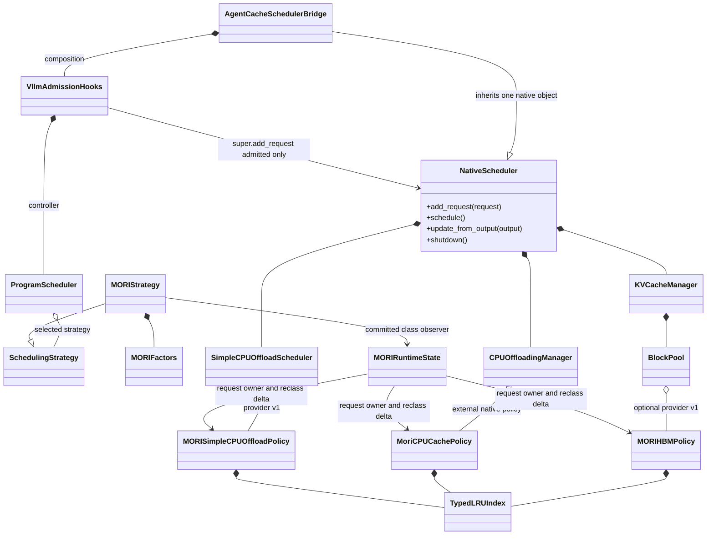
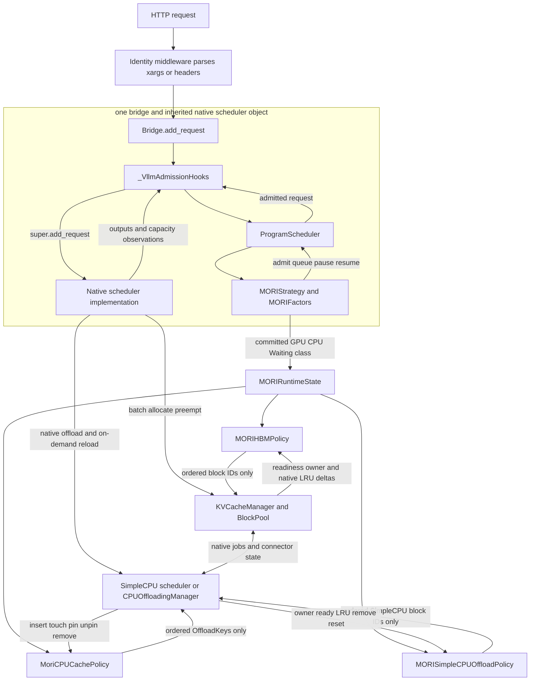
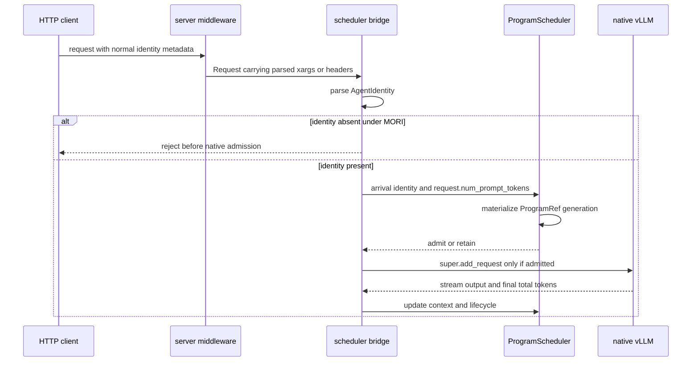
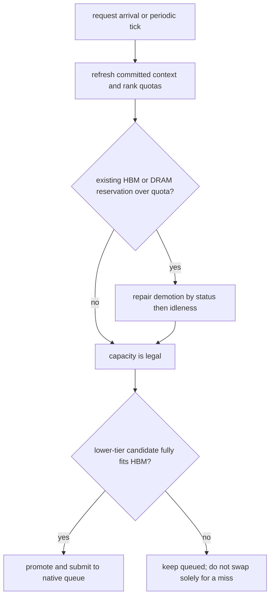
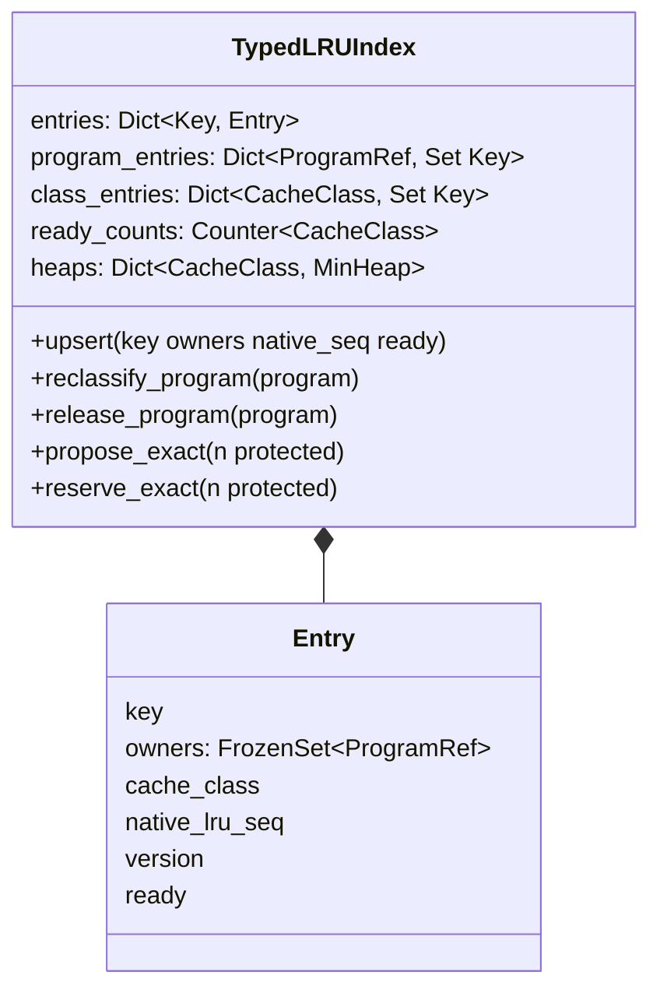

## MORI scheduling and typed KV replacement

## 范围与事实边界

MORI 是 AgentInfer 的 Program-level sticky placement strategy。它依据最近 `k=5` 个已提交
Reasoning/Acting 周期的相对空闲度，在 GPU、CPU、Waiting 三个逻辑 tier 间放置 Program，并让 HBM 与
DRAM 的 replacement policy 使用同一份已提交 cache class。实现不依赖 replay plan、DAG successor、未来返回时间
或客户端预解析的 trace；请求 identity、prompt、stream output、terminal usage、当前容量和 cache 生命周期都由
服务端路径采集。

论文没有开放源码，也没有规定 AgentInfer/vLLM 的具体 hook、输出 reservation estimator 或并发请求语义。本实现把
`k=5`、sticky capacity-triggered placement 和 typed eviction 作为论文算法语义；固定 100-token decode buffer、
generation-safe identity、fail-closed capability negotiation、单 Program 单 in-flight request 以及 native safety ownership
是 AgentInfer 的工程化约束，不应被描述为论文原文机制。

首版范围是单个 embedded backend rank、单 full-attention KV group 和 full-KV CPU offload。推荐数据面是 vLLM
`SimpleCPUOffloadConnector` 的 CPU backend 与 eager 模式；原 `OffloadingConnector + MoriCPUCachePolicy` 保留为
policy-backed 兼容路径。一个 subagent 必须有独立的服务端 Program ID；同一 Program generation 不允许重叠的
inference request。

## 组件静态关系

`AgentCacheAsyncSchedulerBridge`/`AgentCacheSyncSchedulerBridge` 本身就是 native scheduler 的子类。它们不是在
`ProgramScheduler` 前后各放置一个独立 scheduler；bridge 组合一个 `_VllmAdmissionHooks`，hooks 再组合唯一的
`ProgramScheduler`。MORI 是 `ProgramScheduler` 内的一项 strategy，不直接调用 native scheduler。



Progress-TTL 与 MORI 复用相同 bridge、hooks、`ProgramScheduler` 和 transition contract。差异是 MORI 选择
repair-before-resume、强制 server-resolved identity、禁止同 Program overlap，并额外安装 HBM/CPU typed policy。

## 请求控制流与 KVC 数据面



控制面和数据面各自只有一个最终 owner：

- `ProgramScheduler` 拥有 Program generation、请求保留和状态转换；`MORIStrategy` 只计算决策。
- native scheduler 拥有 batching、token step、preemption 和 request queues。
- native `BlockPool` 拥有 HBM queue、hash、refcount、allocation 和最终 block removal。MORI 的 HBM provider
  仅提供完整、有序的 block-ID proposal；native 在任何 mutation 前验证范围、唯一性、free-queue membership、
  null block 和 `ref_cnt == 0`。
- native SimpleCPU scheduler/BlockPool 拥有 CPU block、hash、refcount、transfer completion 和最终释放；
  `MORISimpleCPUOffloadPolicy` 只返回 block-ID proposal。兼容的 OffloadingConnector 路径仍由 CPU manager 拥有
  chunk、protected set、job/fence，并由 `MoriCPUCachePolicy` 实现 replacement order。
- MORI 不发起 proactive prefetch。CPU Program 被 promotion 后，请求进入 native scheduler，由 vLLM 的既有
  on-demand load 路径执行 H2D；D2H 也由 native offload connector 触发。

因此，正式实现不需要 MORI 自己维护 `COPYING_H2D/COPYING_D2H/DEST_READY` 状态机。`pending_tier` 只表示
Reasoning Program 已提交 lazy demotion、需等当前请求完成后 pause 的逻辑目标；它不是传输状态。

## Server-only identity 与观测



HBM patch only reports native `request_id`; `MORIRuntimeState` resolves it to the exact `ProgramRef` already created by
the server. HBM/CPU policies never parse a plan or accept a client-supplied owner map. Missing identity under MORI is an
error rather than unmanaged compatibility traffic sharing the same capacity pool.

## Program factors 与 idleness

`MORIProgramFactors` 保存：

- 稳定 `tier`：`GPU`、`CPU` 或 `WAITING`；
- 最近最多 `k=5` 个 `(reasoning_seconds, acting_seconds)` 已提交周期；
- 当前未闭合的 Reasoning 或 Acting 起点；
- lazy demotion 的 `pending_tier`；
- 诊断用 `last_idleness`。

相对空闲度为：

```text
idleness = acting_seconds / (reasoning_seconds + acting_seconds)
```

窗口优先包含当前 partial cycle，再取最近完整周期补足 `k`。服务端 scheduler queue time 从 request latency 中
扣除后才作为 Reasoning 时间；等待准入不属于 Reasoning/Acting。分母为零时结果为 0。idleness 只决定候选或
victim 的相对顺序，绝不因排名交叉单独触发 tier reshuffle。

## 容量 reservation

首版保留固定 decode buffer：

```text
gpu_target(p) = round_up(context_tokens(p) + 100, hbm_block_size_tokens)
dram_target(p) = round_up(context_tokens(p), dram_chunk_size_tokens)
```

字段 `estimated_context_tokens` 是 core runtime 的历史命名，不等于依赖客户端预测。到达时它来自 native
`request.num_prompt_tokens`，streaming 时由服务端的 output count 单调更新，完成时由 backend 最终
prompt+completion usage 覆盖，并把 source 标记为 `BACKEND_USAGE`。尚未生成的 decode KV 不可能被引擎精确
观测，因此 100-token buffer 是显式、固定的前瞻 reservation。

logical reservation 用于 Program admission 和 repair；`native_used_kv_tokens`、DRAM used、pending H2D/D2H
作为独立诊断事实，不再与同一批 managed Program reservation 相加，避免重复计费。物理分配即便偏离 logical
target，native allocator 和 offload manager 仍负责安全，下一轮 server-observed context/quota 会触发修复。

`full` 模式启动时要求 rank-local HBM quota、DRAM quota、HBM block size 和 DRAM chunk size。DRAM quota 由
offload manager 的 `num_chunks * tokens_per_chunk` 归一化得到，并经 `DpRankInfo` 和 `SchedulingSnapshot`
传播；策略每轮读取 snapshot，不缓存 manager 私有字段。

## Admission、promotion 与 demotion

2026-10-27 服务安全修订：下述首版 sticky 顺序保留用于未超时请求。当前实现对等待超过
`mori.starvation_timeout_seconds`（默认 60 秒）的请求使用跨组 oldest-first 顺序，并在必要时为最早可行请求
回收 GPU reservation；Reasoning 仍只在完成后释放容量。新请求不能从 admission 快径绕过正在等待的请求。
这是防饿死的工程扩展，不归因于论文算法；用法与边界见 [MORI 使用指南](../../../docs/zh/how-to/use-mori.md)。



一个 scheduling cycle 固定先 repair、再 resume。原因是 pending relief 在 pause 真正提交前仍占 GPU reservation，
不能被当作空闲容量给新 promotion。

Promotion 顺序：

1. CPU tier 的 returning Program；
2. Waiting tier 且已经完成过请求的 returning Program；
3. 新 Program，较小的完整 HBM target 优先；
4. 同组按 idleness 从低到高，再以 `ProgramRef` 确定性 tie-break。

候选必须整体 fit 才能 promotion。首版不会因为一个下层候选 no-fit 就驱逐仍合法的 GPU Program；这保持
sticky placement，并避免没有收益阈值和 hysteresis 的 eager swap。

Demotion 仅在 GPU aggregate target 超 quota 时触发：

1. Acting victim 先于 Reasoning victim；
2. 同 status 内 idleness 从高到低；
3. Acting 可立即 pause；Reasoning 只 `MARK_FOR_PAUSE`，完成后才提交 tier change；
4. CPU destination 能完整 reservation 时进入 CPU，否则进入 Waiting。

正常 demotion 不为了腾 DRAM 驱逐一个仍合法的 CPU Program。若 quota 下调或 observer 纠偏已经造成 DRAM
overage，repair 才把最 idle 的 CPU Program 依次改为 Waiting。

## Cache class 与 typed eviction

稳定 tier 映射为：

| MORI tier | Cache class | 语义 |
| --- | --- | --- |
| `WAITING` | `INACTIVE` | 两层都最先回收 |
| `CPU` | `IDLE` | HBM 可回收，DRAM 最保护 |
| `GPU` | `BUSY` | HBM 最保护，冗余 DRAM copy 次优回收 |

HBM eviction order 是 `INACTIVE -> IDLE -> BUSY`；CPU eviction order 是
`INACTIVE -> BUSY -> IDLE`。两层共用算法数据结构但维护独立实例、独立 entry key、独立 native recency 和
独立 safety validator。

shared entry 的 class 取所有 live owners 中最受保护者。只要一个 HBM block 有 BUSY owner，就不能按
IDLE/INACTIVE 提前淘汰；只要一个 CPU chunk 有 IDLE owner，就按 IDLE 保护。

## TypedLRUIndex 数据结构与复杂度



每个 class 一个以 `(native_lru_seq, ticket, version, key)` 排序的 min-heap；`version` 实现 lazy invalidation。
`program_entries` 是 owner 反向索引，使 Program tier change 只访问该 Program 实际拥有的 entries；
`class_entries` 只用于 class-local heap compaction，不在 proposal 时做全局 owner join 或全量排序。

| 操作 | 复杂度 | 说明 |
| --- | --- | --- |
| entry insert/touch/readiness delta | `O(log N)` | push 新版本，旧版本 lazy invalid |
| Program class change | `O(Bp log N)` | `Bp` 是该 Program 拥有的 entries；精确 eager reclass |
| Program release | `O(Bp log N)` | 删除一个 generation owner，并按剩余 owners 重分类 |
| propose `n` victims | `O((n + p + s) log N)` | `p` 是 protected heads，`s` 是有界 stale repairs |
| reserve/commit `n` victims | `O((n + p + s) log N)` | 未提交自动恢复；成功删除不把 victims 无效回压 |
| class-local compaction | amortized `O(Nc)` | heap 达到阈值时仅重建该 class 的 ready entries |

同时声称“精确 class 顺序”“proposal 不扫描”且“任意 Program class change 为 O(1)”是不成立的。本实现选择
eager reverse-index reclassification，明确支付 `O(Bp log N)`，换取 eviction hot path 不再像实验原型一样
遍历全部 CPU keys。2026-10-27 修订后，stale repair 超过上限时重建当前 class 的堆，自愈后继续精确 proposal；
该异常恢复分支额外支付 `O(Nc)`，不再抛出运行期异常。上表 proposal/reservation 复杂度适用于未触发恢复的常规路径。

## HBM native hook

vLLM 0.31 patch 新增 versioned `register_mori_block_selection_provider()`，启动注册时扫描一次 native free queue，
之后只发送 ready、owner、evictability、remove/reset delta。LRU sequence index 只在 provider 注册后分配；MORI
未启用时 native `popleft_n()` 路径保持原样，也不维护 sequence map。

provider 必须返回 exactly `n` 个 block IDs；native 先验证完整 proposal，再从 free queue remove，最后继续
原生 hash eviction、metrics 和 allocation。hook 不 monkey-patch `queue.popleft_n`、`get_new_blocks` 或
`get_computed_blocks`。

owner observation 首次看到一个 request residency 时扫描该 request 的已有 blocks，以覆盖 prefix hit 和恢复场景；
后续 decode 只观察 newly allocated blocks。因而一个 residency 的 bootstrap 是 `O(Bp)`，稳态是 allocation delta，
不是每个 decode step 全量扫描。

## CPU offload typed replacement

推荐的 SimpleCPU 路径通过版本化 `register_mori_offload_tier_provider(1, provider)` 接入该 scheduler 自己的 CPU
BlockPool。D2H destination 分配时记录 request owner，但 entry 在 copy 期间保持 non-evictable；copy 放弃时先清 owner，
commit 后 native `free_blocks()` 再发布 ready 与其真实 LRU sequence。load hit 与 already-cached store 追加共享 owner。
`get_mori_offload_tier_snapshot()` 暴露 total/resident/pending block 数和 scheduler block size，adapter 再统一换算成
token。provider 只支持 `kv_offload_backend=cpu` 与 `lazy_offload=false`，其他模式在注册期 fail closed。

兼容的 policy-backed 路径中，vLLM 0.31 已支持通过 `cache_policy_module_path` 加载外部 `CachePolicy`。

`MoriCPUCachePolicy` 直接实现该协议，
在 `insert/touch/on_request_finished/mark_evictable/mark_non_evictable/remove` 回调中维护 owner、recency 和 ready
delta。`evict(n, protected)` 返回 exactly `n` 个 `(OffloadKey, ChunkStatus)` 或 `None`；返回前再次检查
`ref_cnt == 0` 和 native protected set，失败时不做 partial eviction。

OffloadingConnector 的 CPU manager 继续决定何时 store/load、哪些 keys 被 job/fence 保护、chunk allocation 以及传输完成。这里无需修改
native manager，更不应运行时替换其 `LRUCachePolicy.evict` bound method。
CPU policy 另外维护 pending-owner 反向索引；Program release 以 `O(Bp)` 删除 live 与尚未 insert 的 owner，
避免已终止 generation 在后续 store completion 时被重新挂回 typed index。ownerless cached chunk 仍是可淘汰的
`INACTIVE` entry，不会因为 owner release 变成永久不可回收。

CPU eviction 使用作用域 `reserve_exact()`：先完整选出并校验 victims，校验失败则退出作用域并恢复 live heap
records；校验成功则在作用域内删除 entries，退出时不再把已经提交的 victims 压回 heap。HBM provider 继续调用
非破坏性的 `propose_exact()`，因此 native hook 的 advice/validate/commit 边界不变。

## 构造、配置与能力协商

MORI 沿用现有 `agentinfer.agentcache.core.controller` 构造模块，不新增动态 factory 文件或 import registry：

```json
{
  "agentcache": {
    "strategy": "mori",
    "schedule_interval_seconds": 5.0,
    "mori": {
      "mode": "full",
      "window_size": 5
    }
  }
}
```

`decode_buffer_tokens=100` 是实现固定值，不能从部署配置覆盖。`full` 模式同时检查 HBM hook 和 offload-tier
capability：SimpleCPU 路径检查 snapshot、register/unregister 与 API version；兼容路径检查 CPU policy marker。
任何能力缺失都在启动期 fail closed。`placement_only` 是显式消融，只运行 Program placement，不安装两层 native
policy，也不宣称完成 MORI cache management。

## Cache hit 与调度开销报告

每个已完成请求的 server event 携带 prompt、可复用 prefix、HBM prefix hit 和命中但完成前 `ref_cnt==0` 的
token 数。MORI diagnostics 累积请求数、四类 token counter，并输出 prefix/HBM token hit ratio；这些值来自真实
native lookup 后的服务端观察，不来自 replay plan。`decision_cpu_seconds`、schedule cycles、tier counts、logical
reservation、physical used 和 pending H2D/D2H 同时输出，以便 benchmark 区分“策略效果”和“调度实现开销”。
CPU offload lookup/store/load 的 hit、job 与 transfer 指标继续使用所选 connector 的 vLLM 原生 metrics；结果
收集器应把 MORI diagnostics 和 native offload metrics 放入同一份 cache report，不能用 HBM prefix hit 代替 CPU hit。

## 源码目录

| 路径 | 职责 |
| --- | --- |
| `agentinfer/scheduling/mori/config.py` | `k`、mode 与固定 decode buffer 校验 |
| `agentinfer/scheduling/mori/factors.py` | idleness history、tier 与 lazy target |
| `agentinfer/scheduling/mori/strategy.py` | admission、repair、promotion/demotion、capacity target 与 diagnostics |
| `agentinfer/scheduling/mori/builder.py` | 仿 Progress-TTL 构造 strategy/factors |
| `agentinfer/scheduling/cache_placement.py` | backend-neutral cache class provider/observer 协议 |
| `agentinfer/scheduling/runtime.py` | identity generation、单 Program overlap contract、server token/lifecycle events |
| `agentinfer/scheduling/backend.py` / `snapshot.py` | rank-local DRAM、transfer、block/chunk facts |
| `agentinfer/agentcache/core/controller.py` | 在现有构造模块显式选择 `progress_ttl` 或 `mori` |
| `agentinfer/agentcache/core/scheduler.py` | bridge wiring、request owner binding、server observations 与 shutdown cleanup |
| `agentinfer/agentcache/mori/runtime_state.py` | request ID 到 ProgramRef、class observer 与 index fan-out |
| `agentinfer/agentcache/mori/typed_lru.py` | 两层复用的 incremental typed-LRU |
| `agentinfer/agentcache/mori/hbm_policy.py` | HBM provider v1 |
| `agentinfer/agentcache/mori/simple_cpu_policy.py` | SimpleCPU BlockPool provider v1 |
| `agentinfer/agentcache/mori/vllm_adapter.py` | full-mode capability check 与 DRAM observation |
| `agentinfer/agentcache/mori_cpu_policy.py` | OffloadingConnector 兼容路径的 external CPU `CachePolicy` |
| `agentinfer/agentcache/patches/vllm-0.31-mori-hbm-provider.patch` | 窄 HBM hook；不含 MORI strategy |
| `agentinfer/agentcache/patches/vllm-0.31-mori-simple-cpu-provider.patch` | SimpleCPU 注册、快照和 owner 事件 |
| `tools/benchmark_mori_typed_lru.py` | 从既有 D2H trace 重建 CPU eviction batches 的受控比较器 |

受控开销结果、原始命令和限制见 [MORI typed-LRU performance](mori-performance.md)。
组件时序、数据结构、逐文件代码走读以及与隔离 replay 原型的差异见
[MORI 正式实现完整走读](mori-implementation.zh-CN.md)。

## 安全不变量与验证边界

- tier 变化只有 strategy 在 `ProgramScheduler` transition/event 路径提交；cache policy 不能反向改 Program。
- pending lazy relief 在 pause event 前仍按 GPU reservation 计费。
- shared entry 永远取最受保护 live owner；Program release 使用 generation-safe reverse index 清 owner。
- HBM/CPU proposal 都是原子的 exact-count proposal；native safety check 失败则不 partial evict。
- full mode 不允许 identity-less request、缺 DRAM quota、缺 connector-specific offload hook/policy 或缺 HBM hook。
- shutdown 必须 unregister provider、detach observers 并清 process-local request bindings，支持同进程重启。

当前单元测试覆盖 placement order、capacity debt、lazy demotion、固定 buffer rounding、server output accounting、
overlap rejection、subagent isolation、shared-owner protection、两层 eviction order、heap compaction、SimpleCPU
snapshot/capability failure 和 idempotent cleanup。真实 GPU replay 仍是独立验收阶段；CPU 单元测试和 native patch
smoke 不能替代 D2H/H2D、
cache hit 与端到端时延报告。
